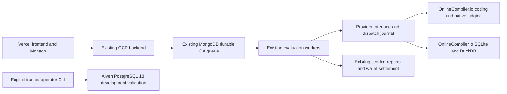
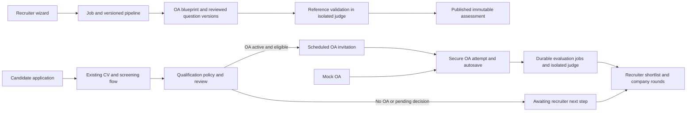
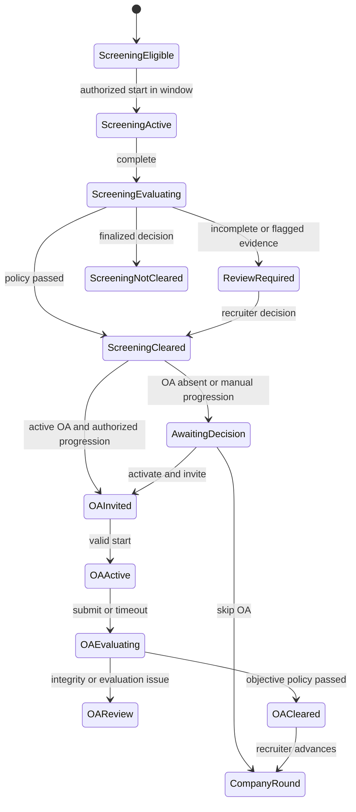

# GenHire OA integration and dynamic hiring pipeline

## Final infrastructure migration — 21 October 2026

**Credential verification update, 22 October:** the owner-filled OnlineCompiler key, Aiven URI and PEM CA passed live checks from the development machine using both saved profiles. Python, native hidden judging, SQLite and DuckDB passed; Aiven returned PostgreSQL 18.6 over verified TLS 1.3, and a trusted two-dataset reference check passed with rollback. The policy ID and acceptance record remain pending; no deployed environment was tested or changed. See [current verification and GCP steps](../AIVEN_GCP_AND_CREDENTIAL_CHECK.md). Statements below about initially blank Aiven credentials record the earlier migration checkpoint.

**Current architecture: OnlineCompiler.io for coding and generic SQL; Aiven PostgreSQL 18 for trusted reference development only.** Follow [OA_FINAL_SETUP.md](../OA_FINAL_SETUP.md) for the exact fields to fill, commands, acceptance review and deployment checklist. Previous implementation notes below this migration section are historical; their retired provider instructions do not govern current execution.

### Architecture and dependency graph



The existing application database, frontend routes, authentication, screening/AI services, invitation progression, answer autosave/timers, reports, credit prices and wallet ledger remain in place. Candidate source is sent by the backend; execution secrets never enter Monaco or frontend build settings. MCQs are scored in the backend and consume no compiler runs. There is no hosted challenge/iframe migration.

The prior clients were OneCompiler and, earlier, Sphere Engine plus a custom GCP PostgreSQL/MySQL judge. Their active clients, discovery tools, parsers, obsolete tests and unused SQL judge infrastructure sources are removed. General GCP backend/storage/authentication configuration is retained. Historical documentation, legacy content engine identifiers, immutable question versions, provider IDs and stored results remain readable. No deployed resource, application database or stored result was deleted.

### Implementation map

| Area | Current files and behavior |
|---|---|
| Provider boundary | `services/oa_execution_provider.py` selects the approved provider and defines code/SQL execution/evaluation operations. |
| REST transport and intent | `services/onlinecompiler_execution_provider.py`: strict official HTTPS destination, raw `Authorization` REST header, no redirect, bounded output/time, native test normalization, atomic reservation and journal. |
| Generic SQL | `services/sql_result_codec.py`: one read query, fresh engine process per dataset, schema plus only that dataset's seed, actual column metadata and framed JSON results. |
| Trusted PostgreSQL | `services/aiven_question_validator.py` and `scripts/admin/validate_postgres_question.py`: explicit trusted-reference gate, CA and hostname verification, PostgreSQL 18 check, isolated transaction schemas, rollback. No candidate route imports this module. |
| Acceptance and queue | `managed_assessment_validator.py`, `assessment_executor_preflight.py`, `assessment_execution_service.py`: current profile acceptance, existing worker fencing, bounded queue, retry/reconciliation. |
| Authoring and UX | Existing authoring/runtime/practice/public-run services, question contracts, generation prompts, role templates, recruiter settings/editor and mock selector updated for actual runtimes and SQLite/DuckDB. PostgreSQL is labeled authoring-only. |
| Operations | `scripts/check_environment.py`, `scripts/prepare_oa_environment.py`, four backend env profiles, `scripts/admin/discover_oa_provider.py`, deployment/owner/evaluation guides and migration tests. |

Paths in this table are relative to `python-backend` except the root scripts and frontend components. The runtime catalog is pinned to `python-3.14`, `g++-15`, `gcc-15`, `openjdk-25`, `nodejs-24`, `sqlite-3`, `duckdb-1.5`. JavaScript and the historical Node alias share the Node runtime. Historical runtime pins fail closed and need explicit revision and live revalidation.

### Coding and SQL evaluation contracts

Run Code uses `/api/run-code-sync/`; standard stdin/stdout final grading uses native `/api/run-tests/`, weighted tests and exact/trim checking. Each test is a billable run, regardless of request batching. Hidden native results provide only verdicts: missing hidden resource metrics are intentional and are never fabricated. The backend applies the existing case weights and immutable question marks; it does not trust an arbitrary provider score to change business rules. Function questions retain GenHire's typed JSON return comparison through the synchronous transport because native string comparison does not implement the existing typed contract.

The provider supports bounded batches (default four); the existing durable application queue still dispatches one immutable case per task for independent recovery and scoring. Multi-case native judging is implemented and tested, but queue task aggregation is deferred. Public Run Code accepts custom stdin and returns safe diagnostics; hidden fixtures are never included in its payload. Candidate compile/runtime/time/memory/output failures produce the appropriate case verdict. Provider authentication, quota, infrastructure and ambiguous dispatch failures block/retry/reconcile without assigning a fabricated candidate zero.

Each generic SQL dataset runs in its own fresh provider sandbox. The codec supports SELECT, JOIN, grouping/HAVING, subqueries, CTEs, window functions and aggregation within the selected dialect. It rejects multiple statements, client commands and obvious mutation/file commands. This query filter is an additional contract guard, **not an isolation boundary**. Fresh engine execution plus reviewed provider network/filesystem/resource isolation is required before release.

Actual result columns, NULL versus the string `NULL`, Unicode, primitive numbers, duplicate rows, ordered/unordered rows and numeric tolerance are checked by backend typed comparison. Empty results still require actual column metadata; incomplete/truncated framing cannot pass. Ambiguous/nested result types must be cast to supported primitives. The implementation materializes the candidate query into a temporary result table; verify ordering-sensitive questions on the chosen engine during live reference acceptance. Expected hidden answers are never injected into candidate SQL. Native string/rows checking is not used where it would lose typed SQL semantics.

SQLite/DuckDB are not PostgreSQL/MySQL replacements for dialect-specific syntax. PostgreSQL 18 references can be validated only by an explicitly trusted operator on the dedicated Aiven development service. Aiven requires a real CA file and `verify-full` TLS, restricts statement/lock time and result rows, creates separate dataset schemas and always rolls back. Trusted schema/seed code has database privileges; never pass candidate code or unreviewed generated SQL to this CLI. It returns validation evidence without authorizing candidate publication. PostgreSQL and legacy MySQL candidate starts, public runs and publication remain blocked even if another capability is stubbed or an env toggle is changed.

### Configuration

All four backend profiles now contain the final settings. Local/production private files remain gitignored; new credentials are blank for manual entry. Unrelated assignments were preserved. The frontend has no new private settings. Example rollout gates remain false; existing private gate values were preserved and do not establish acceptance.

| New/retained field | Default or requirement |
|---|---|
| `OA_EXECUTION_PROVIDER`, `OA_GENERIC_SQL_PROVIDER` | `onlinecompiler` |
| `ONLINECOMPILER_API_BASE_URL` | `https://api.onlinecompiler.io` |
| `ONLINECOMPILER_API_KEY` | Owner supplies backend-only REST key |
| `ONLINECOMPILER_TEST_BATCH_SIZE` | 4; confirm account batch cap before increasing |
| `ONLINECOMPILER_RUNS_PER_MINUTE` | 30 conservative Free admission budget |
| `ONLINECOMPILER_MONTHLY_PLAN_USD` | 0 reporting value; update after an approved purchase |
| `OA_MAX_CONCURRENT_EXECUTIONS` | 2 distributed slots, matching the tested Free account |
| `OA_EXECUTION_TIMEOUT_MS` | 30000 transport deadline |
| `OA_MAX_PRACTICE_RUNS_PER_QUESTION` | 10 public runs |
| `OA_ENABLE_SQLITE`, `OA_ENABLE_DUCKDB` | true |
| `AIVEN_POSTGRES_URL`, `AIVEN_POSTGRES_SSL_ROOT_CERT` | Owner's dedicated PostgreSQL 18 URI and accessible CA file |
| `AIVEN_POSTGRES_SSL_REQUIRED`, `AIVEN_POSTGRES_PURPOSE` | true; `question_validation` |
| `OA_POSTGRES_QUESTION_AUTHORING_ENABLED` | true |
| `OA_POSTGRES_CANDIDATE_EXECUTION_ENABLED` | false; candidate code never goes to Aiven |
| `GENHIRE_EXECUTOR_ISOLATION_POLICY_ID` | Existing required policy identifier matching a completed review |

#### Retired environment settings

The cleanup tool removes and audit rejects these retired names; mentions here are a retirement inventory, not active configuration:

```text
ONECOMPILER_API_URL ONECOMPILER_API_BASE_URL ONECOMPILER_API_KEY
ONECOMPILER_AUTH_TOKEN ONECOMPILER_API_SECRET
OA_SQL_PROVIDER OA_JUDGE_PROVIDER
SPHERE_PROBLEMS_ENDPOINT SPHERE_COMPILERS_ENDPOINT
SPHERE_PROBLEMS_TOKEN SPHERE_COMPILERS_TOKEN
SPHERE_PROBLEMS_API_URL SPHERE_COMPILERS_API_URL
SPHERE_PROBLEMS_API_TOKEN SPHERE_COMPILERS_API_TOKEN
SPHERE_RUNTIME_PROFILES_JSON SPHERE_MASTER_JUDGE_ID SPHERE_TESTCASE_JUDGE_ID
GENHIRE_SPHERE_MONTHLY_SUBMISSION_LIMIT GENHIRE_OA_EXECUTION_CONCURRENCY
OA_SQL_POSTGRES_JOB OA_SQL_MYSQL_JOB OA_SQL_POSTGRES_REGION OA_SQL_MYSQL_REGION
GENHIRE_SQL_PROJECT GENHIRE_SQL_REGION GENHIRE_SQL_ARTIFACT_BUCKET
GENHIRE_SQL_POSTGRESQL_JOB GENHIRE_SQL_MYSQL_JOB
GENHIRE_SQL_TASK_TIMEOUT_SECONDS GENHIRE_SQL_MAX_CONCURRENT_EXECUTIONS
GENHIRE_SQL_MONTHLY_EXECUTION_LIMIT GENHIRE_SQL_MONTHLY_BUDGET_USD
```

`OA_EXECUTION_PROVIDER` was changed from the old provider to `onlinecompiler`; the SQL selector is now `OA_GENERIC_SQL_PROVIDER`. The old execution concurrency name is replaced by `OA_MAX_CONCURRENT_EXECUTIONS`. Shared Google/GCS, MongoDB, auth, payment, AI and email settings were retained.

### Real API checks and remaining acceptance

Using the previously authorized OnlineCompiler.io key ephemerally, live checks returned successful execution for Python, JavaScript, Java, C++ and C. A three-case native judging request with weights 1/2/3 produced accepted/wrong-answer/accepted, two passed cases and the expected 66.67% weighted score. The hidden response contained only verdict/visibility. SQLite and DuckDB each successfully reused a schema name in independent requests with different seeds; typed NULL and string values were preserved. Usage increased from 1 to 13: exactly **12 executed runs** (five language runs, three judged tests, four SQL requests). No key was written into an artifact or printed in a result. The private temporary smoke artifact is not production acceptance evidence.

Additional live checks verified hidden C++ compilation failure, Python runtime failure and timeout verdicts, plus joins, CTEs, GROUP BY/HAVING, window ranking and empty-result column metadata on both SQL engines. The first richer DuckDB check exposed numeric aggregates encoded as JSON strings; the decoder now uses actual engine column types to convert numeric values without converting text. All seven additional checks passed after that fix. Including the initial failed verification attempt and rerun, the account now reports 26/10,000 monthly runs consumed, 9,974 remaining. This is an account snapshot, not a per-OA cost guarantee.

Aiven live connectivity is **not verified**: the new URI and CA are blank. The driver installed successfully; synthetic tests cover trust, TLS options, server version and rollback. Provider smoke results are not a network/filesystem isolation audit. Full operator security review and profile-bound live acceptance remain required, followed by the real staging cohort, native proctoring/device, payment and failure-recovery checks. Deployment environment inspection was unavailable because GCP/Vercel CLIs and an authenticated browser connection were absent. No deployed env settings were changed.

### Automated regression verification

The complete backend suite passed on a disposable local MongoDB replica set: **477 tests ran, 474 passed and three opt-in checks skipped**. After the final retired-task guard, the provider suite passed 19 tests and the evaluation suite passed 22 tests. Coverage includes native hidden-verdict collection through the durable dispatcher, real Mongo concurrency/idempotency, SQL typed results and retirement of old queued work. The environment unit suite passed 20 tests; schema audit passed with zero errors/notices across local/production and examples. Full local/production configuration audits correctly report the blank API key/policy fields, plus pending Aiven setup notices; schema parity alone is not readiness. Frontend `npm run check:oa` passed smoke tests, lint, web build and kiosk build; `npm test` passed 44 tests. Builds emit existing large-bundle and outdated Browserslist advisories. No separate TypeScript project check is configured. The PostgreSQL driver installed successfully. These checks exercise synthetic transports/local application integration; the live checks above are the distinct provider evidence.

### Costs and separate usage ledgers

The provider currently advertises Free 10,000 runs/month; Starter $10/150,000; Pro $49/1,000,000; Business $199/4,000,000 (coming soon); Enterprise custom. Recheck [official pricing and limits](https://onlinecompiler.io/) before purchase. Aiven's selected Free development service should add $0 if it qualifies; no paid database was provisioned. Existing backend, storage, AI, payment, proctoring and bandwidth costs are additional.

For one OA with three coding questions, two SQL questions and twenty MCQs:

`final_runs = sum(coding hidden-test counts) + sum(SQL dataset counts)`

For example, three default 16-case coding questions (two samples and fourteen graded hidden tests each) plus two six-dataset SQL questions cost **54 final runs**. Twenty MCQs cost zero compiler runs. Ten public runs on each of five executable questions adds up to 50 runs, making **104 runs**. Authoring validation multiplies coding tests by enabled reference languages and adds SQL datasets; it is separate from candidate execution. Infrastructure retries and acceptance checks also consume allowance.

| Plan | 54-run allowance cost | 104-run allowance cost | Maximum 54-run OAs before other use |
|---|---:|---:|---:|
| Free | ₹0 within allowance | ₹0 within allowance | 185/month |
| Starter | ₹0.324 | ₹0.624 | 2,777/month |
| Pro | ₹0.23814 | ₹0.45864 | 18,518/month |

INR values use an **illustrative ₹90/USD**, not a live exchange quote, and assume the whole plan allowance is used; they exclude tax/payment fees and all other services. Actual allocated compiler expense is `monthly subscription INR / completed OAs that month`. For example, a $10 subscription spread over 300 OAs at that illustrative rate is ₹3/OA, even if the unused allowance calculation is ₹0.324. On Free, quota exhaustion stops work; it is not a promise of unlimited free OAs or paid overage handling.

The new `oa_provider_requests` journal records request count, estimated/known actual runs, public/hidden usage, purpose, language, recruitment/practice pool, attempt/owner and unknown outcomes. The existing GenHire wallet/credit ledger remains separate and prices unchanged. `/api/usage/` snapshots are allowlisted and can be recorded with the admin discovery command; the existing admin evaluation operations response includes `provider_usage`, per-attempt runs and estimated allowance cost when a real allowance snapshot exists. Missing snapshots and ambiguous outcomes remain unknown, not zero or fabricated balance.

### Scaling roadmap and operational limits

Monthly allowance and simultaneous execution are separate constraints. The tested Free account allows two simultaneous runs, eight pending tests/request and 30 runs/minute. The application defaults to two distributed active requests and a conservative 30-run/minute reservation; a multi-test request can itself use multiple provider runners. A global bounded Mongo queue, durable task state, idempotency, lease fencing and backpressure already exist. Queue admission is not a throughput guarantee.

Assuming one OA per active user daily for 30 days, excluding validation/retries:

| DAU | Final-only 54 runs/OA | With 104 runs/OA | Planning action |
|---:|---:|---:|---|
| 10 | 16,200/month | 31,200/month | Free is for initial testing; even this daily volume exceeds it. Check actual demand before Starter. |
| 50 | 81,000 | 156,000 | Starter may cover final-only usage; practice can exceed it. Verify rate/concurrency independently. |
| 100 | 162,000 | 312,000 | Evaluate Pro, worker recovery and peak-window load tests. |
| 2,000 | 3,240,000 | 6,240,000 | Negotiate available capacity/Enterprise; coming-soon Business is not a provisionable plan assumption. |

At 30 runs/minute, 54 final runs alone require at least 1.8 minutes of aggregate dispatch budget, before compile latency or contention. Before a large exam, load-test queue wait and provider saturation, allocate fair organization quotas, review output/storage growth and alert on monthly allowance/429s/unknown dispatches. Organization fairness and a measured 2,000-user peak are future milestones, not delivered guarantees. PostgreSQL candidate isolation remains a separate future design requiring approval; do not build another GCP judge or run it on the shared Aiven service.

### Cutover, rollback and next milestone

Set manual credentials, install backend requirements, run the environment audit, complete trusted Aiven validation, and obtain live coding/generic-SQL acceptance. Explicitly revise and validate old pinned question versions. Reconcile/drain retired queued or ambiguous tasks before candidate cutover. Old provider tasks are blocked for review rather than replayed; their records and IDs remain. Unknown new POSTs retain their journal/slot and never retry automatically. Known pre-dispatch rate/capacity rejections can requeue safely; quota/auth failures require operator action.

For rollback, pause new candidate starts, retain immutable submissions/results/credit records and all journals, then review the previous release and its original credentials/acceptance before separately approving a deployment. Never interpret old IDs on the new provider, translate candidate dialects automatically, or replay unknown paid execution. There is no automatic fallback to retired providers. No deploy, purchase, cloud deletion, commit or push was performed. After verified cutover, revoke retired provider credentials; audit unused GCP judge resources separately before any approved retirement.

This milestone is ready for development configuration and staging acceptance, **not production deployment**. Next milestones require owner approval: actual Aiven connection, full isolation acceptance, staging cohort/device/failure rehearsal, measured peak capacity and eventual release. Stop after the migration milestone.

### Historical workflow implementation record


Planning and decision-finalization date: 2026-10-19 (Asia/Kolkata). Owner choices recorded: Q11 B, Q16 C, Q21 A+B, all other questions A.

## 1. Scope and execution contract

Evolve the working AI screening product into configurable recruitment with optional online assessments (OA), role templates, manual/AI/hybrid questions, company-managed rounds, and candidate mock OAs. Keep job descriptions and assessment content separate. Preserve existing screening, applications, invites, payments, and reports.

**Current progress: Steps 0, 1 and 2 Completed; Step 3 implementation delivered, live acceptance pending; Steps 4–5 locally verified; Steps 6–10 implementation delivered with local verification recorded in sections 20–24. Step 10 formal release acceptance remains pending.** Formal Steps 3, 6 and 7 retain their real-execution/security/device/storage/production-load acceptance gates; Step 8 live mail and Step 9 real AI/content/provider/device/load acceptance remain pending. The owner explicitly authorized Step 10. Sections 17–24 record changes, verification and remaining live gates. Workflow, generation, execution, scheduling, evaluation, integrity, media, company hiring, mock OA launch and hiring email delivery default off. No production migration, live OA activation, commit or deployment was performed.

Per-job thresholds, recruitment per-candidate OA price and measured production capacity remain configuration/rollout prerequisites, not unanswered selections among Q1–30. Provider, runtime, region and pilot budget choices were subsequently resolved in section 17; older sections retain their historical checkpoints. Live credentials, SQL provisioning and execution/isolation acceptance still gate dependent publication/paid execution/rollout. Do not invent approvals or expose an incomplete OA while resolving them.

Evidence vocabulary throughout: **Existing** = observed in source; **Missing** = no implementation found in the inspected models/routes/services/UI and targeted searches; **Proposed** = architectural recommendation; **Pending** = requires an owner decision or environment validation. Source presence is not proof of production operation.

## 2. Audit scope and current architecture

Inspected relevant tracked file inventory, package manifests, backend composition/auth/models/controllers/routes/services, interview lifecycle and scoring helpers, wallet implementation, worker orchestration, frontend routes/status utilities/job creation/editing/application/practice views, Electron security settings, tests, deployment configuration, and architecture documentation. No AGENTS.md was found in the workspace inventory or checked ancestor locations. Initial Git working tree was clean.

The attachment supplied for this task was read. Only variable names were extracted from the active backend `.env`; secret values were not printed or copied. Live infrastructure, database records/indexes, cloud configuration, external-provider availability, and production concurrency were not tested. Not every source file was read line by line. Installed dependencies/generated assets are outside the audit scope.

| Area | Existing evidence and implications |
|---|---|
| Frontend | `react-frontend/package.json`: React 19, Vite 5, React Router 7, Axios, Socket.IO, CSS modules, Chart.js, Lucide. `src/app/routes.jsx` lazy routes, `providers.jsx` OAuth/candidate context/error boundary; shared API/session/UI utilities. Preserve conventions; no state-library rewrite needed. |
| API | `python-backend/core/factory.py`, `app.py`: Flask application factory and blueprints, controllers/repositories/services, JWT auth, Flask-SocketIO threaded mode, CORS, request IDs, optional Sentry/Talisman. |
| Database | `config/database.py`, `config/indexes.py`: PyMongo/MongoDB, startup indexes, unique canonical job/student application identity. `models/job.py` and `models/application.py` are dataclasses; controllers also write raw documents. A model-only change will miss runtime fields such as `minimum_cv_score`. |
| Live interview | `interview/core/session_manager.py`, `interview/runtime.py`, `routes/interview_routes.py`: process-local engine with persisted interview documents, start leases, answer/end/report/media endpoints. `services/interview_completion_service.py` handles background completion. |
| Workers | `jobs/runner.py`: daemon worker lifecycle for CV scoring, invite cleanup, refunds, integrity. `services/background_processor.py` already has durable Mongo CV tasks, atomic claims, renewable leases, bounded workers, retry times. Reuse this reliability pattern, not the outdated assumption that all work is only an in-memory queue. |
| Scaling | `gunicorn.conf.py`: one gthread worker, 32 threads, explicitly because interview/Socket.IO state is local. `core/extensions.py` uses threading. Merely adding API replicas does not make screening horizontally safe. |
| Auth | `middleware/auth_middleware.py`: HS256 JWT, database user lookup, active/expired invite checks, recruiter/candidate/admin/permission decorators. `application_controller.py` and `job_controller.py` scope recruiter actions by job `created_by`; candidate by `student_id`. |
| Company boundary | Jobs have company display information, but current reviewed access is recruiter-owner based. `RecruiterTeam.jsx` wraps `TeamPage.jsx`, which displays GenHire developers; this is not organization membership management. No reusable company-membership authorization model was found in reviewed user/recruiter paths. |
| Storage | `services/gcs_service.py`, factory: GCS mandatory for uploads/artifacts. `identity_card_service.py` stores ID cards in GridFS; face capture routes also use GridFS. Do not assume every artifact uses one storage backend. |
| AI | `services/llm_fallback_service.py`, `interview/llm/*`: configurable provider order, quota/cooldown/fallback, usage tracking. Source default chain is DeepSeek, Google, Groq, with optional OpenAI; older architecture prose lists a different default. Use source/configuration as authority. |
| Credits/payments | `payment_module/config/settings.py`, `services/wallet_service.py`, transaction/wallet models, Razorpay services/controllers: audience wallets, recharge packs, audit ledger, env prices and idempotency keys. See billing risks below. |
| Email/invites | `services/email_service.py`, `email_providers/*`, `invite_service.py`, `controllers/invite_controller.py`: provider abstraction (ZeptoMail/Mailgun/noop), send audit, bulk parsing, job-scoped invite accounts, invite batches, token expiry and cleanup. Provider configuration selects one provider; do not assume automatic delivery failover. |
| Secure app | `secure-browser-kiosk/main.js`, `runtime-security.js`, `preload.js`: Electron 40 app, custom `secure-interview` protocol, packaged React kiosk UI, kiosk mode, navigation restrictions, popup denial; `nodeIntegration: false`, `contextIsolation: true`, `sandbox: true`. Extend existing app rather than invent a second secure client. |
| Tests/operations | Backend `tests/test_*.py` unittest suite, frontend Node utility tests and portal/interview smoke scripts, Electron tests. Docker Python 3.11/Gunicorn targets Cloud Run; Vercel configs exist. Only a keep-warm workflow was found under `.github/workflows`; this is not build/test CI. Actual deployed settings are unverified. |

### Existing end-to-end flow

1. Verified recruiter creates a manual job or calls `POST /api/jobs/generate-ai` through `routes/job_routes.py` and `JobController.generate_jd_with_ai`. A generated draft is reviewed before job creation. JD files are parsed/stored using existing services.
2. `JobCreationModal.jsx` currently suggests a **30-day** deadline; backend stores a deadline and `minimum_cv_score` (default 50). Job states are draft/active/paused/closed.
3. Candidate submits CV/application. `ApplicationController.apply_for_job` rejects inactive jobs and elapsed valid deadlines, snapshots CV/JD, creates hidden processing work, and protects duplicate application identity. Invalid legacy deadline parsing currently falls back to status gating.
4. `background_processor.py` scores CVs and usually chooses shortlisted/rejected; recruiter interview invites can preserve pre-shortlisting. Processing state and hiring status are already distinct concepts.
5. `POST /api/interviews/start` requires candidate ownership, eligible shortlist status, completed application/CV, ID prerequisites, and no terminal attempt lock. Mongo creation lease prevents duplicate paid starts. Invite access expiry is separate from interview availability; no dedicated three-day stage window was found in the inspected start path.
6. Recruiter wallet is debited for real screening. The existing interview runs with AI questions, speech, identity checks, optional camera/voice/object/gaze/dual-camera/AI-detection settings, persisted answers and reports.
7. Completion stores evaluation/proctoring results and sets application `interviewed`. Deferred evaluation refresh can update the interview/application score later. Stale-attempt finalization/refunds provide additional completion paths.
8. Recruiter manually changes status, including screening cleared/rejected. Socket.IO publishes updates; emails notify relevant decisions. Screening-cleared candidates can already be exported via `GET /api/jobs/<id>/screening-cleared/export` (CSV/XLSX), backed by `services/screening_export_service.py`.
9. Candidate practice currently creates AI mock interviews through `practice_controller.py`/`practice_routes.py` and `Practice.jsx`; it is not an OA engine.

### Current status and score semantics

`models/application.py`, `ApplicationController.update_application_status`, and `src/shared/utils/applicationStatus.js` use: `pending`, `reviewed`, `shortlisted`, `interviewed`, `screening_cleared`, `rejected`. Legacy `selected` normalizes to `screening_cleared`; `scripts/migrations/migrate_screening_cleared.py` exists. `rejected` means both failed CV shortlisting and post-screening rejection; UI guesses using interview fields. `shortlisted` currently means eligible for screening, not final company-round shortlisting.

Job documents maintain status counters (`pending`, `interviewed`, `screening_cleared`, `rejected`) separately. Changes are spread across status updates, CV processing, completion, stale finalization, admin paths, repositories, exports, and UI. Some counters are separate writes from application changes, so transitions need a central consistent write path.

`services/interview_flow_service.py:evaluation_percentage` combines normalized answer/language scores at 70%/30% where present, otherwise uses final score. This existing interview formula must not be confused with the new proposed screening/proctoring eligibility formula. `services/proctoring_service.py` calculates up to 100 minus weighted recorded infractions/interruptions; missing/disabled coverage can yield no score. Missing evidence must remain unknown, not zero, pass, or proof of misconduct. No job-specific post-screening qualification engine combining both scores was found.

### Verified gaps and risks

- **Missing:** OA blueprints, immutable OA versions, candidate OA attempts/autosaves/submissions, MCQ authoring/scoring, SQL result judge, programming judge/editor, and a reusable OA practice engine in inspected code. Existing `question_bank/` contains interview material and role JD text, not validated OA problems with hidden tests/reference solutions.
- **Missing:** job-specific stage instances/outcomes/history, general transition policies, explicit stage schedules, durable assessment notification outbox, and company-membership permissions in reviewed paths.
- **Existing risk:** wallet debit does a read for idempotency, updates wallet balance, then inserts a separate ledger document. Concurrent identical keys can debit twice before a duplicate insert is caught; a crash between writes can leave an unlogged debit. Atomic balance gating alone is insufficient for exactly-once business effects. Fix before new paid OA actions.
- **Existing risk:** `services/credit_service.py` contains separate activity-derived credit estimates/defaults; actual billing is in payment wallet paths. UI/cost reports must converge on authoritative transactions and pricing, without charging twice.
- **Existing mismatch:** `ApplicationView.jsx` synthesizes timeline events from a flat status and includes scheduled-interview time heuristics. It cannot represent screening-cleared/awaiting OA activation reliably.
- **Existing mismatch:** job creation/edit forms contain fixed 30/50-credit copy and 10-credit AI drafting copy; these become inaccurate when env prices change.
- **Pending:** deployment topology/replica count, Mongo transaction capability, email delivery webhooks, Redis availability (an env key is not proof of a configured queue), candidate concurrency, security patch posture, and operating budget.

## 3. Finalized target architecture and journeys

Keep React + Flask + MongoDB. Add clear backend modules for workflow, assessment authoring/generation, attempt lifecycle, judge adapters, deterministic scoring, scheduling/notifications, and pricing. Keep interview conversation state separate from OA durable state. No broad framework replacement or full enterprise ATS is proposed.



Practice reuses the runtime/judge but has separate ownership, billing, retention, reports, and question pools; it never advances an application or exposes live recruitment questions.

### State model: separate stage, outcome, invitation, and application

The separation of concepts below is approved. Field/collection/route names are target contracts for implementation, not claims that these exist in the current codebase; refine exact serialization in the relevant step without changing approved behavior.

| Entity | Proposed responsibility |
|---|---|
| Application | Stable job/candidate identity, `workflow_version_id`, `current_stage_id`, lifecycle (`active`, `withdrawn`, `rejected`, `hired`, `closed`) and optimistic revision. Hired is a recruiter-recorded company outcome only. |
| Workflow version | Ordered stage IDs/types/configuration, activation, visibility, threshold policy version, schedules. Initial scope: application review, screening, optional OA, company-managed stages. |
| Candidate stage | State (`not_ready`, `eligible`, `invited`, `in_progress`, `submitted`, `evaluating`, `completed`, `expired`, `cancelled`, `skipped`), outcome (`pending`, `cleared`, `not_cleared`, `review_required`), reason, score references and policy snapshot. |
| Invitation | Pending/scheduled/sent/failed/revoked; open/close dates; distinct from qualification. Email delivery failure does not erase eligibility. |
| Stage event | Append-only actor, tenant/owner, stage, from/to state, reason, policy/version, request/idempotency key, timestamp. Restrict mutation permissions. |
| Attempt | Setup/in-progress/submitted/evaluating/evaluated/expired/cancelled, attempt number, immutable questions/scoring, deadlines, answer revisions, integrity evidence, evaluation status. |

Candidate labels are server-derived projections: “Screening in progress”, “Screening completed — evaluation pending”, “Screening cleared — awaiting recruiter decision”, “OA eligible — invitation pending”, “OA opens on …”, “OA in progress”, “OA submitted — evaluation pending”, “OA cleared — awaiting company next round”. Expiration, technical failure, integrity review, and rejection must remain distinct. Internal notes/threshold details are not exposed by default.



Eligibility runs server-side only on finalized/usable result versions. Replayed completion events must not invite twice. Deferred score refresh, stale completion, reviewer overrides, and threshold changes must all enter the same transition service with expected revision and immutable decision evidence. Qualification uses separate recruiter-set interview/proctoring minimums; low/questionable or required-but-missing integrity evidence enters review. Eligible candidates await recruiter approval by default; automatic invitation is an explicit per-job opt-in. Threshold changes are prospective unless the recruiter previews and requests recalculation for uninvited candidates; active/downstream stages cannot be silently revoked. Recruiter bulk changes return per-candidate outcomes; no all-or-nothing UI fiction.

## 4. Proposed data model and migration

Target collections: `hiring_workflow_versions`, `application_stages`, `stage_events`, `assessment_blueprints`, `assessment_versions`, `question_versions`, `assessment_attempts`, `assessment_answers`, `assessment_submissions`, `assessment_evaluation_jobs`, `notification_outbox`, `billing_operations`. Q19 A selects recruiter-owner scope for V1 and an ownership abstraction for later organization membership; company-wide banks/memberships are deferred. Never use a free-text company name as an authorization boundary.

Use stable IDs, schema versions, ownership references, creation/update metadata, soft archive of referenced records, and explicit public/private serializers. Unique keys: application/workflow/stage; attempt number; one active attempt per stage; attempt/question answer revision; evaluation submission/version; transition idempotency; notification event/channel/recipient; billing business operation. Index owner/job/stage/outcome, attempt deadline, work status/next retry/lease expiry, and event history. Keep high-volume answers/events outside large job documents.

Migration sequence: additive schema and flags → dry-run audit/counts/legacy ambiguity report → repeatable checkpointed backfill → consistency checks → compatible dual read/projection → opt-in rollout. Existing jobs retain screening-only behavior and existing deadlines. Existing invitations and active interviews must not be invalidated. Map `selected` to screening cleared; preserve original status, report IDs, and provenance. Do not infer that ambiguous `rejected` records failed screening without evidence. Do not invent historical timestamps/events; tag imported snapshots as migration records.

Legacy `status` becomes a compatibility projection during migration, with one canonical workflow writer; block old direct mutations for migrated jobs or adapt them through the transition service. Backfill counters from canonical stage aggregates and provide reconciliation. Rollback disables new entry points, preserves all records/attempts, and uses compatible readers; never downgrade by deleting new evidence. Migration scripts require production dry-run/backup/recovery review before execution.

## 5. OA authoring, models, and generation

Blueprint: role/template version, skills and AI instructions, manual/AI/hybrid source, sections, question types/counts, difficulties, allowed languages/dialect, scoring policy, duration/timer/navigation policy, proctoring policy, qualification policy, publication validation and price quote. JD text remains in job data; blueprint references it by snapshot/version.

Every question version: type, title/statement, difficulty/topics, maximum marks, instructions, source/owner, quality state and provenance. Coding adds input/output formats, constraints, examples/explanations, starter code, allowed languages, limits, public samples, private tests and reference solutions. Q21 A+B requires both stdin/stdout and LeetCode-style function-signature tasks in V1. MCQ adds stable option IDs, single/multiple-correct key and explanation; V1 uses no negative marks and exact-match multiple-correct scoring. SQL adds dialect, schema/seed fixtures, public examples, private datasets, reference queries/results, ordering and numeric-comparison rules. Descriptive/case-study rubric fields remain an extension point; those question types and paid descriptive grading are deferred under Q13 A.

Function tasks store a versioned typed signature (parameter names/types and return type), public call examples, structured private test arguments/expected results, and starter methods per allowed language. Server-owned, versioned harnesses convert structured test data and serialize results consistently for Python, JavaScript, Java and C++. Initial supported types cover scalars, strings and arrays/nested arrays with explicit size limits; unsupported custom types must fail validation, not fall back to fake grading. Store problem contracts and harness/runtime versions in the publication snapshot. Validate reference solutions through the same harness as candidate solutions, including empty/null/type/overflow and output-comparison cases where applicable. Do not let recruiter-supplied harness text run with trusted service privileges.

Q16 C requires PostgreSQL and MySQL support from V1, selectable per assessment. Each SQL question version pins its engine/version and matching fixtures/reference queries; question-bank selection must match the assessment's declared engine. V1 does not require mixed-engine assessments. Each run uses an isolated disposable fixture in its declared engine, with dialect-aware limits and result comparison. Never silently translate SQL or share fixtures across candidates. Publication requires validation in the declared engine; PG and MySQL need separate integration/security coverage and an execution adapter that actually supports both.

Never send private answers, reference solutions, hidden datasets, or rubrics to candidate APIs, generated bundles, downloadable artifacts, logs or error traces. Judge messages pass opaque IDs, use restricted service credentials, and bound output.

Generation: request with idempotency key and bounded quote → durable job → existing provider fallback/telemetry → strict schema validation → deterministic quality checks → isolated reference execution → question review → immutable publication. Execute reference solutions against all tests; independently verify sample output, edge cases, runtime and limits; reject inconsistent/ambiguous questions. MCQ keys require human review in addition to structural checks. SQL validation compares results, not query strings. Generated JSON alone never passes publication.

Selective regeneration creates new versions with visible cost and generation limits; it does not mutate invited candidates' assessments. Track provenance/content fingerprints/exposure and prevent live recruitment pools from entering mock OA. Role templates are editable recommendations, not promises of unimplemented question types.

Approved initial template categories: SDE; frontend/backend/full-stack; data analyst; data science/ML; DevOps/SRE; product; QA/automation; business analyst; custom. SDE starting preset: one easy, one medium, one hard coding problem with 20/30/50 marks, plus configurable MCQs; duration/section weight remains recruiter-configurable. Non-coding templates work without a coding section; product/business profiles initially use relevant MCQs, not unimplemented descriptive tasks. Counts/difficulty/marks/time remain editable. Launch languages: Python, JavaScript, Java and C++, with pinned versions verified against the selected judge.

## 6. Code execution and evaluation options

| Option | Benefits | Tradeoffs / readiness |
|---|---|---|
| Managed isolated judge behind an adapter | Selected MVP approach under Q30 A; less sandbox operations burden | Vendor, per-run fees, data location/privacy, quotas and runtime capabilities still require verification. A programming provider must not be assumed to support both SQL engines. |
| Separate self-hosted Judge0 deployment | API boundary, control over capacity/runtime settings | Requires patched isolation, separate hosts/credentials/network, monitoring, capacity planning and ongoing operations. Installing Docker alone is not the security design. |
| Custom sandbox worker fleet | Most control and future specialization | Largest engineering/security/operations burden; defer unless constraints require it. |

Judge0 documents a sandboxed execution API and cloud/self-hosted options ([official project](https://github.com/judge0/judge0), [product](https://judge0.com/)); this establishes an option, not a security certification or a purchased provider recommendation. Pin/verify versions, isolation, terms, quotas and costs during implementation. SQL may require a separate isolated database executor even with a programming judge.

Candidates' code and AI reference solutions never execute in Flask, Electron main process, production MongoDB, or unrestricted host subprocesses. Require isolated ephemeral runtimes, no service secrets/production credentials, denied network egress, bounded CPU/wall time/memory/processes/output/filesystem, nonprivileged execution, cleanup and submission rate/concurrency limits. SQL uses disposable fixtures/read-only roles plus time/row/resource limits; parser filtering alone is not isolation.

Run public samples/custom input separately from final private grading. Cache safe identical evaluations by immutable submission/runtime/test version; cap repeated Run requests. Asynchronous evaluation jobs use renewable claims, bounded retries/backoff, poison-job handling, authenticated callbacks/reconciliation and stale-result fencing. Persist real results and honest pending/unavailable errors. Objective MCQ/coding/SQL scores are authoritative; AI feedback is explanatory and cannot silently replace them. Q20 A selects weighted hidden-test partial credit for coding, no negative MCQ marks, exact-match multiple-correct MCQs, equal default MCQ marks, and editable normalized section weights. A section score is earned marks divided by possible marks; overall score is its weighted normalized aggregate. Unanswered finalized questions earn zero; infrastructure-ungraded questions keep the result pending/unavailable and do not fabricate a zero/final qualification. Section weights must sum to 100; test weights are nonnegative with positive total, and duplicate replay cannot award marks twice. SQL also uses explicitly weighted validated datasets; score by returned results and declared ordering/comparison rules.

Publication validation needs the judge **before** question publication in Step 3. Step 6 completes production runtime/evaluation scaling; essential sandbox/billing/access safety is not postponed to a later heading.

## 7. Scheduling, invitations, and failure policies

Approved defaults (Q7–12): applications close seven days after publication; screening has a shared three-day window after applications close and must finish by its close; OA opens at 09:00 in the job timezone on the next calendar day after screening closes, and accepts starts for 24 hours. Recruiters can edit dates, opt into rolling applications/screening, or activate OA manually. OA invitation approval remains manual by default; an eligible candidate without approval is not automatically invited. Store UTC instants plus recruiter-selected IANA timezone for display/calendar calculations; resolve calendar dates in that timezone, not by blindly adding 24 hours. Schedule edits validate chronological consistency and affected invitations.

**Q11 B overrides the original must-finish OA recommendation.** Rename the OA window endpoint conceptually to `start_closes_at`; it closes entry, not existing attempts. A server-confirmed start must satisfy `opens_at <= started_at < start_closes_at`. An accepted attempt gets `expires_at = started_at + total_duration + approved_extra_time`, even if that is after the shared start window. Never apply `min(..., start_closes_at)` to OA. Browser launch/preflight alone is not a start: activation atomically verifies readiness/eligibility, reserves credits and persists the official start/deadline. Resume is not a new start and remains allowed until that attempt's deadline.

Example: OA opens 21 October at 09:00 and closes entry 22 October at 09:00 (job timezone). A candidate starting 22 October at 08:55 on a 90-minute OA receives until 10:25, including any approved extra time. New starts at 09:00 are refused, but that attempt continues. All times here are illustrative, not configured production dates. Fixed section timers obey the accepted attempt's total duration and cannot be reset by reconnecting or switching questions.

Closing the shared start window expires unused invitations only. Continue autosave, proctoring, account access, submission, grading and reservation reconciliation for active attempts through their own deadlines. Cohort completion/final reports wait until accepted attempts are terminal (or explicitly unavailable/review-required); next company steps need not be falsely marked complete at start-window close. Screening retains its separate finish-by-close rule. Shared overall OA timing/revisit is default; recruiters may choose fixed section timers with no return after a section closes, and section allocations must sum to the total duration.

Use an external scheduler/durable worker to claim opening/closing/reminder/auto-submit work. Every start/save/submit checks server deadlines even if a scheduling worker is delayed. Autosave uses revisions and acknowledgment timestamps; a stale browser cannot overwrite a newer answer. Offline drafts may recover after reconnect but cannot override a server-finalized submission. Timers continue through disconnection unless an audited extension is granted.

Late screening evaluation or manual clearance after OA entry closes enters review/awaiting reschedule; never silently reject or issue an unusable invitation. Early screening clearance waits for the configured OA opening; rolling screening with a shared OA uses the same cutoff and late-result review policy. Manual OA activation validates future usable dates; it does not invite candidates into an already closed window. Deadline extensions are versioned/audited; notify affected users once. Job closure/pause stops new starts while already started OAs retain their deadlines unless explicitly cancelled with a reason, notification and billing disposition. Reopening creates an audited schedule/version change, not a reset of submitted attempts. Candidate withdrawal is a lifecycle event, not record deletion; it ends further participation, cancels active work with retained answers/evidence and does not create an automatic technical-failure refund. Approved accommodations can extend a candidate's entry/duration window without changing the cohort. No-show/expired is distinct from failed. Q23 A permits one recruitment attempt with documented technical-failure retakes using a fresh validated question version; mocks are separately paid new attempts. Recruitment outcomes are released by the recruiter; practice receives educational reporting.

Invite-only account access currently expires independently and can be cleaned up. Extend/coordinate its scope and lifetime for downstream stages without creating a new burner identity per OA or deleting reports; preserve one application/candidate linkage and prevent cross-job access.

Outbox jobs cover screening/OA invitations, openings, reminders, submission acknowledgments and finalized decisions. Store recipient snapshot, template/version, deduplication key, send attempt/status and provider reference; retries must not duplicate transitions/charges. Provider acceptance is distinct from delivered/bounced. Bulk company emails need recipient preview, authorization, deduplication, rate limits and delivery reporting; no messages are sent in this planning step.

## 8. Billing and configurable prices

Existing configuration defaults from `payment_module/config/settings.py`: signup 100; candidate screening practice 30 / proctored 50; AI JD generation 10; recruiter real screening 30 / proctored 50; invite 1 per recipient. These are code defaults, not a claim about active production prices. `interview_credit_service.py` provides abandoned/setup failure refunds. Preserve and test these behaviors.

Approved env-driven catalog structure (illustrative names, not added to `.env`; numbers are editable initial defaults):

| Key | Initial credits | Defined charge unit / remaining gate |
|---|---:|---|
| `GENHIRE_OA_JOB_SETUP_CREDITS` | 30 | Once per job's first successful OA activation, including initial configured content; not again for ordinary edits, retries or reactivation |
| `GENHIRE_MOCK_OA_CREDITS` | 30 | One practice attempt including base generation and objective grading |
| `GENHIRE_OA_ATTEMPT_CREDITS` | Not yet priced | Recruiter-funded candidate attempt; require explicit env price before paid enablement; candidate pays nothing for recruitment OA |
| `GENHIRE_DUAL_PROCTORING_CREDITS` | 10 | Enabled feature per attempt |
| `GENHIRE_AI_DESCRIPTIVE_GRADING_CREDITS` | 10 | Deferred with descriptive types; no V1 charge or purchase toggle |
| `GENHIRE_ADVANCED_OA_ANALYTICS_CREDITS` | 10 | Optional enriched report operation per assessment version; base scores, section reports and funnel remain included |
| `GENHIRE_EXTRA_VARIANTS_CREDITS` | 10 | Additional validated generation batch, capped |
| `GENHIRE_PLAGIARISM_CHECK_CREDITS` | 10 | Optional completed similarity-report operation per submitted attempt; only when implemented |

No charge for ordinary manual form fields, basic accessibility, autosave, required security, hidden tests, or core objective results. Extras are opt-in and unavailable features cannot be sold. Avoid double-counting legacy proctored bundles and new per-feature extras; preserve legacy price plans for old attempts and quote new plans explicitly. Current prices load at server startup; document restart semantics and validate nonnegative bounded integer values centrally.

The server creates a versioned price quote with line items, feature flags, payer, currency/credit units, expiry and limits; browser displays that quote everywhere. Snapshot it on billing operations and attempts so env changes cannot reprice ongoing work. Show costs before generation/publication/start and paid regeneration. Bound questions, tokens, variants, code runs, retries and retained media to control real cost.

Before OA charging, make wallet + ledger + operation identity atomic using a Mongo transaction on a verified supported topology, or an explicitly designed single-document reservation/recovery protocol. MongoDB supports multi-document transactions on supported deployments ([official documentation](https://www.mongodb.com/docs/manual/core/transactions/)); actual deployment capability remains unverified. Use a unique business-operation key, not a newly generated request UUID on every retry. Add crash/concurrent duplicate/refund tests and reconciliation. Never hold database transactions during LLM/judge/email calls.

Q27/28 A approve setup plus per-attempt recruitment billing and 30-credit base mock billing. Setup reserves once and captures on successful OA activation/publication; failed initial generation/setup releases/refunds the associated setup operation. An unactivated draft does not trigger a setup charge. Explicitly quoted paid regenerations are separate operations, with request-key replay and failed-operation refund; normal edits do not silently count as regeneration. Recruitment attempt funds reserve atomically at accepted start and capture after a usable submitted/auto-submitted attempt, including deliberate blank submissions/no further answers after a successful start; disconnection alone does not create a free retake. Platform setup failure releases funds; transient evaluation failure stays pending for retry, and permanently unusable platform evaluation receives an idempotent refund. Approved platform-failure retakes have a recorded charge/refund link so the candidate is not double billed for the failed attempt. Unstarted invites have no attempt charge. Mock generation reserves its quoted 30-credit base and captures once a validated playable OA is ready, including base objective grading/basic feedback; retrying generation/start never repeats that purchase. New mock generations/attempts are new purchases, and extras require explicit quote selection. All failure compensation must be durable and reconcilable, never dependent on a browser staying open.

## 9. Security, proctoring, privacy, and visibility

Reuse proctoring configurations and reports, face/consent preflight where required, kiosk runtime/navigation restrictions, mobile companion and Socket.IO ownership checks. OA editor clipboard/keyboard rules must respect coding and accessibility needs; do not blindly inherit all interview restrictions. Replace long-lived launch credentials with scoped short-lived assessment launch tokens where practical; verify scope server-side and avoid leaking tokens in logs/URLs. Existing desktop protocol is not sufficient proof of a trusted device.

Browser fullscreen/tab events are detectable signals, not OS lockdown. Electron can impose stronger app restrictions but cannot guarantee prevention of external devices, screen capture, collusion or all OS escape paths. Never advertise cheat-proof behavior. Preserve sandbox/context isolation; render question text safely, and do not load untrusted executable question HTML.

Approved integrity levels: basic browser events; optional camera/object/voice; optional dual-device; optional similarity analysis. Required features, consent, alternatives/accommodations, evidence access and retention must be disclosed before entry. Treat low/unknown proctoring and similarity as review evidence (Q4/26), not proof. Similarity cannot silently change objective scores or automatically reject a candidate; recruiter resolves the review evidence. Existing monitoring policy has nontermination reporting paths; review actual active behavior before changing policies. Extend Electron for recruitment and default mock OA with an approved browser accommodation mode; provide Monaco, run/custom input/diagnostics/autosave and both coding contract styles, without an in-assessment AI coding assistant.

Keep recruitment question solutions private; candidate sees submission acknowledgment and the recruiter-approved result summary. Practice gets objective results and educational explanations, with AI suggestions labeled. Detailed hidden-test disclosure is forbidden even in failed runs. Reviewer-only evidence requires scoped authorization and access audit. Q25 A approves configurable starting retention of 30 days for raw media and 180 days for integrity summaries, measured from attempt completion/cancellation; this is not a legal compliance claim. Application scores/history have a separate disclosed retention policy and must not be accidentally removed by raw-media cleanup. Implement retention jobs, access audit and deletion/export controls before media capture rollout; any audited preservation hold must have a reason, owner and expiry. Define incident response processes before rollout.

## 10. Page-by-page changes and reuse map

Paths below are existing relative to `react-frontend/src/` unless explicitly marked proposed.

| Surface | Required change |
|---|---|
| `features/recruiter/components/JobCreationModal.jsx`, `JobEditModal.jsx`, `JobForm.module.css` | Coherent wizard/basic fields/pipeline/OA template and sections/authoring/schedule/qualification/cost review; seven-day default replaces 30-day default only for new jobs. Separate OA entry cutoff from full attempt duration; SQL engine and coding-contract choices; reasoned prospective edits and impact preview. Editing published content makes versions, never live mutation. |
| `features/recruiter/components/JobDetailsModal.jsx`, `JDDetailsModal.jsx`, `JobsGrid.jsx` | Separate JD from OA preview, show activation/publication/version/schedule and stage counts. |
| `features/recruiter/pages/RecruiterDashboard.jsx`, components `OverviewMetrics.jsx`, `RecentActivity.jsx` | Stage-specific funnel, eligible versus invited, review queue, counts by finalized stage outcome. Replace screening-only terminal assumptions. |
| Recruiter `CandidatesList.jsx`, `CandidatesFilters.jsx`, `CandidateCard.jsx`, `StatusBadge.jsx`, `InviteCandidatesModal.jsx` | Filters, combined results/history, safe bulk advancement/OA invitations/overrides/company rounds; stop overloading shortlisted. |
| `shared/utils/applicationStatus.js`, `shared/components/lists/ApplicationHistoryList.jsx` | Compatibility labels plus canonical server stage labels; no growing chain of inferred status conditions. |
| Candidate `pages/Dashboard.jsx`, `Applications.jsx`, `ApplicationView.jsx`, `JobDetails.jsx`, `Profile.jsx`; `components/ApplicationsList.jsx`; application/realtime hooks/context | Actual event timeline, stage-specific actions, clear eligibility/waiting/schedules, no fabricated timeline from flat state; preserve CV/saved jobs/profile. |
| Candidate `pages/Practice.jsx`, `features/interview/components/PracticeDetailsModal.jsx`, `shared/components/lists/PracticeHistoryList.jsx` | Mock interview versus mock OA choice, role/templates/customization/quote, attempt history and educational report. |
| `features/interview/pages/Interview.jsx`, `features/interview/components/PreInterviewChecklist.jsx`, `features/interview/components/KioskLaunchGuide.jsx`, `kiosk.jsx`; Electron `main.js`, `preload.js`, `runtime-security.js` | Preserve screening experience; shared preflight/launch as appropriate, add scoped OA route/mode. Build new OA editor/MCQ/SQL/report components under target `features/assessment/`; show typed function signatures/examples and stdin/stdout modes, SQL dialect/schema, entry cutoff and accepted attempt's own deadline. |
| `features/payment/pages/SubscriptionPlans.jsx`, `CandidateSubscriptionPlans.jsx`, payment hooks/cards; recruiter/candidate cost pages | Server quotes/ledger and dynamic OA feature prices; distinguish recharge packs, current usage, estimated infrastructure costs. |
| Admin `ApplicationDetailModal.jsx`, `JobDetailModal.jsx`, `AdminOverview.jsx`, `CreditStatistics.jsx`, cost pages | Inspect workflow/version/attempt/history, auditable support corrections, billing operations/reconciliation; no unchecked cross-tenant question download. |
| `features/landing/pages/LandingPage.jsx`, navigation and docs | Update screening-only copy when feature flags permit actual OA availability; explain company-managed rounds accurately. Do not promise unavailable role types or security guarantees. |
| `src/app/routes.jsx`, shared API endpoints/client/socket, `ProtectedRoute.jsx` | Add assessment routes/contracts, role checks, resync after missed live events. REST/database is authoritative; events are refresh hints. |

Preserve shared UI components, styling tokens, taxonomy in `shared/constants/jobTaxonomy.js`, CV/JD parsing, provider fallback/usage telemetry, existing invitations/exports and interview reports. Expand `screening_export_service.py` for stage-qualified exports rather than rebuilding spreadsheet machinery. Team pages remain developer profiles unless company membership is explicitly introduced.

## 11. Planned API/service boundaries and jobs

All routes below are planned implementation contracts, not existing endpoints. Exact naming/serialization may follow repository route conventions while preserving the selected behaviors in section 13.

| Proposed route family | Responsibility and existing integration |
|---|---|
| `/api/jobs/:id/workflow`, `/workflow/versions` | Draft, validate, publish and preview impact; integrate job routes/controller, workflow authorization and versioning. |
| `/api/jobs/:id/assessments`, `/api/assessments/:id/versions` | Blueprint, sections, questions, publication, candidate-safe preview. |
| `/api/questions`, `/api/questions/:id/versions` | Owner/company-scoped authoring, tags, duplicate/archive; private serializers. |
| `/api/assessment-generation-jobs`, `/:id` | Idempotent bounded async generation/regeneration with quote and validation status. |
| `/api/applications/:id/stages`, `/stage-actions`, `/api/jobs/:id/bulk-stage-actions` | Canonical history, eligibility, invite, override, withdraw/reject and company decisions. Adapt old status endpoint for migrated jobs. |
| `/api/assessment-invitations/:id`, `/start` | Candidate instructions/schedule/preflight eligibility and unique durable attempt. |
| `/api/assessment-attempts/:id`, `/answers/:questionId`, `/runs`, `/submit`, `/report` | Resume, revisioned autosave, public runs, final snapshot, safe result visibility. |
| `/api/practice/assessments` | Candidate-funded generation and mock-specific reporting through shared engine. |
| `/api/pricing/quote`, `/api/billing-operations/:id` | Authoritative feature prices, business-operation state and failure/refund visibility. |
| `/api/jobs/:id/communications`, `/exports` | Recipient preview/send jobs/delivery and authorized stage-filtered CSV/XLSX. |

Planned services: workflow/qualification policy, assessment authoring/generation/validation, attempt lifecycle, judge adapter, deterministic scoring, price quote/billing operation, durable outbox/scheduler. Existing factory/runner/rate limiter must explicitly register/configure them. Separate deployment workers for generation/validation/evaluation/outbox; use Mongo leased jobs initially given the existing CV implementation, bounded admission/retries and a queue adapter boundary if measured pilot needs justify another broker. Redis env currently relates to request protection; do not assume it is an assessment queue or shared interview session backend.

## 12. Finalized ten-step roadmap and acceptance gates

Steps 1 and 2 are **Completed** (sections 15–16). Step 3 implementation is delivered with live acceptance pending (section 17); Steps 4–5 local acceptance is recorded in sections 18–19. Steps 6–9 implementation/local verification is recorded in sections 20–23, with live acceptance still pending. Step 10 remains **Not Started**. Scope and gates below incorporate the owner's answers. Exact implementation names may follow repository conventions; product choices cannot silently change. Every step updates this document, runs relevant checks, reports remaining limitations and ends with an explicit pause. A local verification pass never substitutes for a required live-provider gate.

| Step | Coherent milestone and affected areas | Required acceptance before completion |
|---|---|---|
| 1 — Completed | Workflow foundation: additive models/indexes, server stage transitions/history/authorization, compatibility projection and UI labels, dry-run migration tooling, feature flags; fix wallet operation atomicity before any new paid action. Existing application/job models/controllers/repositories/admin/completion paths. | Verified: legacy screening regressions, repeatable read-only migration, illegal/cross-owner/stale/duplicate transition checks, real concurrent debit/refund/crash tests and default-off rollout. See section 15 for exact commands and limitations. |
| 2 — Completed | JD + pipeline/OA wizard: all approved role templates, editable sections/marks/timing, both coding contract modes, PostgreSQL/MySQL choice, activation/qualification/schedule controls, draft persistence and dynamic quote preview in creation/edit/details pages. | Verified: legacy editing/deadline preservation, schedule defaults and full-duration wording, strict validation, optional OA, private draft blueprints, server-priced previews, transactional versions and replay. See section 16. |
| 3 | Question bank and AI/manual/hybrid authoring: immutable question/assessment versions, MCQ/coding/SQL editors, typed function contracts/harness versions and stdin/stdout, both SQL dialect fixture formats, generation jobs, selected regeneration, review/publication gates. Establish isolated validation judge/SQL adapters here. | Manual/AI/hybrid share one schema; reference/sample/hidden tests validated through real isolated execution; each advertised language/contract/dialect validated; explicit recruiter approval; cross-owner access denied; candidate serializers contain no secrets; invalid questions cannot publish; no paid generation without approved quote/atomic operation. |
| 4 — Implemented and locally verified | Screening qualification and scheduling: separate score thresholds, review holds, finalized score events from all completion paths, manual-default/opt-in automatic progression, OA activation, entry-window/attempt-deadline separation, outbox reminders, expired/late cases and candidate status updates. | Verified through local real-Mongo and offline UI checks in section 18. Live coding/SQL validation remains Step 3-gated; the accepted-start foundation is tested independently while the real candidate workspace remains Step 5-gated. |
| 5 — Implemented; launch gated | Candidate OA runtime: invitation, consent/preflight, Monaco with stdin/stdout and typed function tasks, MCQ and PostgreSQL/MySQL interfaces, server total/section timers, autosave/reconnect, submit and attempt locking; shared runtime foundation for later practice. | Local Mongo and rendered UI verification in section 19. Public Run uses sample/custom input through Step 3 adapters. Actual browser/provider acceptance remains outstanding; live OA starts stay blocked pending evaluation and security acceptance. |
| 6 — Implementation delivered; live acceptance pending | Production evaluation infrastructure: immutable-submission jobs, Python/JavaScript/Java/C++ contract adapters, isolated PostgreSQL/MySQL datasets, deterministic marks, shared asynchronous case queue, leases/retries/fencing/backpressure, atomic billing, private reports and operator reconciliation/observability. | Local real-Mongo and fake-transport checks in section 20. Actual account compilation/execution, timeout/OOM/egress/SQL isolation, cloud restart/load/cost and rollout acceptance remain required; no live-provider pass is claimed. |
| 7 | **Implemented; local checks passed, live acceptance pending (section 21).** OA secure-browser mode, consent/accommodations/retention, approved randomization/variants, review flags and optional similarity. | Existing screening regression suite preserved; scoped access, truthful coverage, accommodations, retention/access controls and optional billing locally verified. Actual native/device, GCS/detector and production acceptance remain open. |
| 8 | **Implemented; local verification recorded in section 22, live acceptance pending.** Recruiter results, review/overrides, canonical stage funnel/comparisons/filters, bulk shortlist, custom company stages, exports, previewed email batches and admin inspection. | Scoped reasoned decisions, withheld/released summaries, per-item conflicts, replay-safe billing-free decisions, bounded exports and explicit mail approval locally verified. Real provider dispatch/device/load acceptance remains open. |
| 9 | **Implemented; local verification recorded in section 23, live acceptance pending.** Role-based mock OA, shared secure runtime/judge, environment-priced base/extras, teaching reports/advice, support disposition and server-driven pricing/history. | Replay-safe purchase/start, generation compensation, explicit pool isolation, unchanged objective marks, private ledger history and deferred-feature rejection verified locally. Real AI quality, judge/device/storage and production acceptance remain open. |
| 10 | **Implementation delivered; local verification in section 24, formal release acceptance pending.** CI, measured local 100-client load, export/retry/observability hardening, structural accessibility, disposable migration/restore and admission-drain rehearsals, journey matrix and controlled-release runbook. | Local invariants passed; start p95 18.5 seconds remains a tuning concern. Real seven-journey staging/device/provider, deployed HTTP/load/cost, hosted CI and production backup/restore evidence remain open. Flags stay off pending evidence and explicit rollout authorization. |

Dependencies: Step 1 before schema consumers; Step 2 before authoring publication; Step 3 isolated validation before publication; Steps 4–6 before real OA; baseline security/billing throughout; Step 7 safeguards before any wider proctored rollout; Step 9 shares Steps 3/5/6 rather than a second judge. Plan a persistence/session-routing approach for existing screening before scaling that service beyond its supported topology; OA workers can scale separately first.

### Implementation handoff by step

1. **Workflow and billing foundation.** Add versioned stage/attempt-policy schemas and workflow service/repository boundaries; inspect every status writer in application/job/admin/repository/CV processor/interview completion/deferred refresh/stale-finalization paths before adapting it. Establish permission checks and expected-revision/idempotency rules, dry-run migration with ambiguous-legacy report, compatible status projection and one source for funnel counts. Establish atomic wallet/ledger operations plus reservation/capture/release/refund states and unique operation identity; verify Mongo topology or implement and test a documented safe alternative. Do not execute a production backfill as part of routine tests. Deliver disabled-by-default integration and regression evidence, not candidate OA entry points.
2. **Job configuration.** Extend current modal/components through coherent wizard sections rather than replacing surrounding recruiter pages. Save server-validated drafts for all templates, manual/AI/hybrid mode, editable question counts/difficulty/marks, both contract styles, dialects, role instructions, date/timing and separate thresholds. Require finite 0–100 thresholds before enabling automatic qualification; recruiter explicitly sets values, with no invented global pass mark. Present candidate journey and quote. Separate weighted totals from question marks and deny mismatched section durations/unsupported combinations. Authoring/execution links remain feature-gated until available.
3. **Validated content.** Add owner-scoped immutable question bank and assessment publication, manual editors, strict AI output schemas, bounded generation/regeneration jobs and provenance. Add server-owned signature wrappers for all four languages and structured hidden tests; dialect-specific fixture/reference execution for PostgreSQL/MySQL. Provision no paid service without authorization; choose/configure the approved managed execution adapter and isolated SQL route before claiming real validation works. Contract-unit mocks may test failures but cannot stand in for the publication gate. Never mark this step complete with an unavailable real validator.
4. **Progression and dates.** Connect all finalized screening-result paths to separate score policies, evidence review and manual-default invitations. Implement 7-day/3-day/next-calendar-day-09:00/24-hour-entry defaults, rolling/manual overrides, outbox deduplication/reminders and rescheduling. Distinguish entry cutoff from accepted attempt expiration everywhere, including unused invites, billing, account cleanup and candidate actions. Job changes produce audited version/impact records; no retroactive invalidation of active/downstream work. Deliver cohort tests including delayed evaluation and exact start boundary.
5. **Durable attempt UX.** Build candidate assessment routes/components under the assessment feature, with Monaco, signature/statement/sample/constraints display, stdin/stdout and structured function custom inputs, schema/dialect panels, MCQs and total/section timers. Server-confirmed activation, revisioned answer acknowledgments, scoped launch/resume, offline recovery and durable deadline auto-submit protect work. Integrate real public Run paths through the Step 3 adapters; complete throughput/scoring infrastructure in Step 6. User devices cannot select deadlines or extend through reconnects.
6. **Judge and scores.** Complete asynchronous isolated final grading and versioned submission snapshots; distinguish compile/runtime/wrong-answer/time/memory/provider errors. Use per-case/dataset weights and exact MCQ keys; validate normalization and ungraded-state handling. Exercise both coding styles across all four languages and both SQL engines, including type conversions, numeric bounds, ordering/nulls and malicious/time-limited workloads. Add capped run frequency, queued-work admission, authenticated callbacks, lease fencing, recovery and cost metrics. Private results never appear in candidate Run output.
7. **Integrity and retention.** Extend the existing Electron mode with OA-specific consent, keyboard/clipboard rules, camera tiers and accommodation route. Complete opt-in validated variants/pools and exposure tracking, optional similarity reports with human interpretation, raw-media/summary retention jobs and reviewer access audit. Similarity provider/algorithm remains to be technically selected and verified; an unavailable optional integration is hidden and nonbillable, never represented as working. Base isolation, data secrecy and consent precede this step already. Verify existing screening/kiosk tests before release.
8. **Recruiter/company completion.** Update dashboard, cards, filters, detailed reports, admin inspection and real event timelines using canonical workflow data. Include score components, integrity holds, compare/review, reasoned overrides, bulk per-item advancement, custom company technical/HR rounds, hired/rejected outcomes, CSV/XLSX and recipient-previewed bulk email. Delivery and retries must not duplicate decisions or charges. Keep internal notes and private question/rubric material out of candidate/export payloads unless explicitly authorized for the correct audience.
9. **Practice and pricing completion.** Extend Practice to choose mock interview versus role-based OA using the shared engine and distinct pools. Include objective scores, explanations and clearly identified AI educational advice, all approved coding/SQL modes, 30-credit base and opt-in implemented extras. Complete server-catalog-driven price displays, quote history/ledger, env examples and refund/reconciliation UI across both audiences. Pricing must already protect earlier generation/start paths; this step cannot be used to defer billing safety.
10. **Release readiness.** Run the seven representative journeys plus explicit late-start/full-duration, dual-dialect and signature-wrapper journeys; verify legacy data/migration/rollback in a nonproduction rehearsal. Add CI for the established checks, cross-tenant/secret-leak/security cases and private-pilot load tests. Target 100 concurrent OA attempts with bounded run queues; record measured latency/failure/queue/cost and provider quotas. Retain current hosting for API, scale durable OA workers separately and document screening's session-routing constraint. No public enabling, production migration, purchase or deployment occurs solely because code passes tests.

## 13. Clarification archive and approved decisions

The questions/options below preserve the original planning discussion for traceability; the decision register after them is authoritative. Owner response: **“11 b 16 c 21 a + b and for rest a”**. Thus Q11=B, Q16=C, Q21=A+B, and the other 27 selections=A. Original recommendations in the archive are not substituted for these answers.

### A. Hiring workflow and screening

1. **Default OA selection?** A (Recommended): optional, off initially, with role-based suggestions. B: preselect for technical roles with explicit opt-out. C: require an explicit yes/no choice for every new job. D: Custom / Other. A preserves screening-only jobs and avoids surprise costs.
2. **Change OA after publication?** A (Recommended): versioned additions/removals for uninvited candidates; protect invited/active attempts and preview impact. B: freeze pipeline once any application exists; clone job for changes. C: allow changes only before any screening begins. D: Custom / Other. A supports later recruiter decisions without silently changing an accepted assessment.
3. **Screening qualification formula?** A (Recommended): separate recruiter-set interview minimum and proctoring minimum when required; missing evidence goes to review. B: configurable weighted combined score plus minimum interview floor. C: interview minimum only, with integrity review separately. D: Custom / Other. A is explainable and prevents high interview scores masking low integrity coverage; provide desired defaults if selecting A/B.
4. **Questionable/low proctoring result?** A (Recommended): hold advancement for recruiter review. B: configurable warning only. C: block automatically but allow a documented appeal/override. D: Custom / Other. A accounts for imperfect signals while preventing unattended advancement.
5. **Default advancement?** A (Recommended): auto-identify eligibility, recruiter approves next-round invitations; allow per-job automatic invitation after opt-in. B: automatically invite all cleared candidates when OA active. C: fully manual qualification and invitation. D: Custom / Other. A separates screening clearance from the next-stage decision.
6. **Threshold changes and overrides?** A (Recommended): reasoned authorized overrides; new policy applies prospectively, optional previewed recalculation for uninvited candidates, no silent revocation of active/downstream stages. B: freeze thresholds once first result exists. C: explicitly rerun for all completed but not active/downstream candidates. D: Custom / Other. A keeps an auditable history and avoids retroactively breaking invitations.

### B. Applications, deadlines and scheduling

7. **Application window?** A (Recommended): editable seven-day default with optional rolling mode. B: seven-day default, fixed cohort mode only. C: explicit dates required with no default. D: Custom / Other. A replaces the existing 30-day UI suggestion while keeping flexible hiring.
8. **When may screening start?** A (Recommended): default after applications close, recruiter may opt into rolling screening. B: always rolling when CV-qualified. C: cohort-only after close. D: Custom / Other. A matches your proposed timeline without excluding ongoing hiring.
9. **Screening deadline and finish rule?** A (Recommended): shared three-day cohort window; finish by close, with audited accommodations. B: three days per invitation; finish by individual close. C: shared start deadline; allow full interview duration after a timely start. D: Custom / Other. A keeps cohort timing predictable; C is more forgiving but pushes OA scheduling later.
10. **OA activation/opening?** A (Recommended): recruiter opts into scheduling; default opens at 09:00 job timezone on the next calendar day after screening closes, with manual activation available. B: exactly 24 hours after screening closes. C: immediate invitation/opening after individual clearance. D: Custom / Other. A makes “next day” precise; late results go to review/rescheduling rather than unusable invites.
11. **OA availability/late starts?** A (Recommended): shared 24-hour window, must finish by close; warn before a shortened late attempt. B: shared 24-hour start window, full duration allowed after start. C: individualized 24-hour windows with accommodations. D: Custom / Other. A limits exposure and keeps a predictable close; it cannot eliminate question sharing.
12. **Timer and navigation modes?** A (Recommended): recruiter chooses shared overall timer (default, revisit allowed) or fixed section timers (no return after section closes). B: shared timer only for V1. C: section timers only. D: Custom / Other. A supports both use cases with consistent server validation and no nested per-question clocks at launch.

### C. OA content and authoring

13. **V1 assessment types?** A (Recommended): coding, single/multiple-correct MCQ, SQL; nontechnical roles use role-specific MCQs, with descriptive/case studies staged later. B: add descriptive/case studies with human review immediately. C: add descriptive/case studies with AI-assisted rubric grading and human override immediately. D: Custom / Other. A keeps objective grading manageable; choose B/C if richer product/nontechnical OAs are essential at launch.
14. **Initial templates/defaults?** A (Recommended): all nine categories listed in section 5, with specialization presets and editable counts/difficulty/time; SDE sample 1 easy/1 medium/1 hard plus MCQs. B: launch SDE, data analyst, DevOps, product and custom first. C: custom builder plus SDE/data analyst only initially. D: Custom / Other. A covers requested roles; templates must only expose question types selected in Q13.
15. **Launch programming languages?** A (Recommended): Python, JavaScript, Java and C++, pinned runtime versions. B: Python and JavaScript first. C: add TypeScript, C, C# and Go immediately too. D: Custom / Other. A covers common candidates while keeping reference validation/runtime maintenance bounded.
16. **SQL dialect?** A (Recommended): PostgreSQL only initially, isolated per run/dataset. B: MySQL only. C: both selectable per assessment. D: Custom / Other. A provides one consistent result/fixture contract; C doubles compatibility testing and infrastructure work.
17. **AI publication review?** A (Recommended): automated validation plus explicit recruiter review/approval before publish. B: auto-publish only vetted bank questions; review new AI content. C: auto-publish all AI content after automated validation. D: Custom / Other. A catches ambiguity and incorrect answer keys that structural checks/reference execution cannot prove away.
18. **Question leakage safeguards?** A (Recommended): question/option shuffle by default; optional validated equivalent variants/pools with exposure tracking. B: mandatory per-candidate variants/pool selection. C: shuffle only in V1; defer variants. D: Custom / Other. A balances comparability and cost; variants require validation and comparable difficulty rather than arbitrary new generation per candidate.
19. **Question bank ownership?** A (Recommended): private recruiter-owned bank initially behind an ownership abstraction; explicit company memberships before shared company access. B: company-private shared bank and membership roles in V1. C: company-private plus platform-curated shared bank in V1. D: Custom / Other. Current access is recruiter-owner based; A avoids treating a company display string as permission.

### D. Scoring and candidate experience

20. **Default grading policy?** A (Recommended): weighted hidden-test partial credit; MCQ no negatives, multi-correct exact-match; equal MCQ marks by default; totals normalized to 100 with editable section weights. B: same coding, configurable negative marking and multi-correct partial credit in V1. C: all-or-nothing coding and exact-match MCQs. D: Custom / Other. A is transparent; B needs explicit clamped penalties and anti-gaming rules. AI/recruiter question marks are reviewed before publish.
21. **IDE launch scope?** A (Recommended): Monaco, stdin/stdout tasks, starter code, language selection, samples/custom input, run/submit, diagnostics, autosave and keyboard access; no AI assistant. B: add LeetCode-style function signatures/language wrappers now. C: basic code editor and sample-run only; add custom input later. D: Custom / Other. A provides a strong editor without multiplying language-specific grading wrappers immediately.
22. **Disconnection and recovery?** A (Recommended): revisioned server autosave plus recoverable local drafts, timer continues; audited extra time for verified platform faults. B: pause up to a capped outage allowance with stricter heartbeat verification. C: terminate on disconnection and require approved retake. D: Custom / Other. A avoids easy timer-pause abuse while preserving acknowledged work.
23. **Retakes?** A (Recommended): one recruitment attempt; documented technical-failure reset/retake with fresh version; unlimited paid mock attempts with new questions. B: one self-service recruitment retry for technical failures. C: recruiter-configurable multiple recruitment attempts using best/latest policy. D: Custom / Other. A protects fairness, avoids repeated exposure and separates recovery from another graded attempt.

### E. Security, proctoring and integrity

24. **Secure runtime modes?** A (Recommended): extend existing Electron secure browser for recruitment OA and default mock OA; recruiter-approved browser accommodation mode. B: browser restricted mode by default; optional Electron. C: integrate a third-party lockdown provider first. D: Custom / Other. A reuses current investment and your kiosk requirement; neither client can guarantee cheat prevention.
25. **Proctoring/privacy package?** A (Recommended): configurable basic/camera/dual-device tiers; clear consent and alternative accommodations; configurable starting retention of 30 days raw media/180 days integrity summaries, separate score/history retention; recruitment candidates see completion/basic outcome, practice gets full educational report. B: basic browser events only initially, no recorded media. C: camera required for all recruitment OAs; recruiter-configured retention and delayed result disclosure. D: Custom / Other. A is flexible but needs disclosed costs, scoped evidence access and explicit retention choices before launch.
26. **Similarity and misconduct decisions?** A (Recommended): optional similarity analysis and suspicious-event reports require recruiter review; preserve original objective scores. B: auto-hold above configurable similarity threshold, recruiter resolves. C: no similarity detector in V1; proctoring review only. D: Custom / Other. A avoids treating common solutions or accessibility behavior as conclusive misconduct; B automates triage only.

### F. Credits, mock OA and company rounds

27. **Recruiter charging units/trigger?** A (Recommended): +30 OA setup once per job initial OA activation, paid regeneration only after quote; separate env-priced per-candidate attempt to cover execution, reserve on start/capture on usable attempt, refund platform/setup failure; extras explicitly priced per unit. B: +30 setup includes a capped number of attempts/runs, then paid top-ups. C: no setup charge, per-attempt charge only. D: Custom / Other. A matches setup preference and scales cost with usage; per-attempt price remains to be set after provider budget (Q30). Candidates never pay for employer OA.
28. **Mock OA pricing?** A (Recommended): 30 base credits per generated playable attempt, generation/objective evaluation/basic feedback included; +10 selected implemented extras, all env-configured; failed generation/setup refunded and replayed requests deduplicated. B: flat 30 including all extras with strict caps. C: complexity-based quote with 30 as starting price. D: Custom / Other. A follows your preference while making expensive optional work visible; new mock attempts are separate purchases.
29. **After OA qualification?** A (Recommended): automatically identify qualified candidates, recruiter approves company-round advancement; configurable custom technical/HR stages, CSV/XLSX and previewed bulk email; hired/rejected recorded by recruiter; summary result shown after recruiter release. B: automatically shortlist/notify into configured company stage. C: export/contact only, no later stage tracking in V1. D: Custom / Other. A supports different companies without building live company interviewing into GenHire.

### G. Infrastructure and rollout

30. **Initial scale/budget/rollout envelope?** A (Recommended): private feature-flag pilot, target 100 simultaneous OA attempts and bounded queued runs, managed isolated judge behind adapter, retain current API hosting and separate durable workers; benchmark before expanding. B: self-host separate judge workers from launch, target 500 concurrent attempts. C: target 1,000+ immediately with a dedicated infrastructure phase before candidate launch. D: Custom / Other. A limits operational risk but is a proposed target, not measured capacity. Please append monthly incremental infrastructure budget in INR, expected peak active candidates and simultaneous Run requests, hosting/data-region constraints, preferred provider if any, and whether managed execution is acceptable. No paid vendor/infrastructure will be provisioned without authorization.

### Decision register

Recorded 2026-10-19 from the explicit owner response; all 30 choices answered. This authorizes document finalization, not Step 1, production data changes or paid infrastructure provisioning.

| Q | Selected | Final behavior and primary dependencies |
|---|---|---|
| 1 | A | OA optional/off by default with role suggestions; Step 2 wizard and legacy screening compatibility. |
| 2 | A | Versioned later OA addition/removal for uninvited candidates, impact preview and protected invited/active work; Steps 1–4. |
| 3 | A | Separate recruiter-set interview/proctoring minimums; required unknown evidence means review, not pass/fail; Steps 1/2/4. |
| 4 | A | Questionable/low proctoring holds advancement for recruiter review; Steps 4/7/8. |
| 5 | A | Auto-identify eligibility; recruiter approval for invitations by default, explicit per-job auto-invite option; Steps 2/4/8. |
| 6 | A | Reasoned overrides, prospective threshold changes and previewed recalculation for uninvited candidates; protect downstream stages; Steps 1/4/8. |
| 7 | A | Editable seven-day new-job application default and optional rolling mode; Steps 2/4. |
| 8 | A | Screening after applications close by default, rolling mode configurable; Steps 2/4. |
| 9 | A | Shared three-day screening window, finish by close with audited accommodations; Steps 2/4. |
| 10 | A | OA opens 09:00 job timezone on next calendar day after screening closes by default; scheduled/manual activation; Steps 2/4. |
| 11 | B | Shared 24-hour OA **start** window; valid starters receive full duration after cutoff. Distinct entry/attempt deadlines, access and cleanup; Steps 1/2/4–7. |
| 12 | A | Recruiter chooses overall timer/revisit (default) or fixed section timers with closed-section lock; Steps 2/5/6. |
| 13 | A | V1 coding, single/multiple-correct MCQ, SQL; descriptive/case-study grading deferred; Steps 2/3/5/6/9. |
| 14 | A | All nine editable role categories and specialization presets; nontechnical templates use supported noncoding MCQs; Steps 2/9. |
| 15 | A | Python, JavaScript, Java, C++, pinned and validated runtime versions; Steps 3/5/6. |
| 16 | C | PostgreSQL **and** MySQL; explicit dialect/version/fixtures and isolated result-based grading; Steps 2/3/5/6/9. |
| 17 | A | Automatic question validation plus explicit recruiter review before publication; Step 3, with security/privacy checks. |
| 18 | A | Default question/option shuffle and optional validated pools/equivalent variants/exposure tracking; Steps 3/5/7. |
| 19 | A | Recruiter-private bank behind ownership abstraction; shared company membership/bank deferred; Steps 1/3. |
| 20 | A | Weighted hidden-test coding partial credit, no negative MCQ marks, exact-match multi-correct, equal default MCQ marks and editable normalized weights; Steps 2/3/6. |
| 21 | A+B | Monaco and full listed run/submit/custom-input/autosave/accessibility features, **plus function-signature wrappers**, alongside stdin/stdout; Steps 2/3/5/6/9. No coding AI assistant during assessment. |
| 22 | A | Server revisioned autosave/local recovery, timer continues and audited extra time for verified platform faults; Steps 4–6. |
| 23 | A | One recruitment attempt; documented technical-failure retake with fresh validated version; separately paid new mock attempts; Steps 1/4–6/9. |
| 24 | A | Extend existing Electron secure browser for recruitment/default mock OA, approved browser accommodation; Steps 5/7/9. |
| 25 | A | Optional proctoring tiers, consent/accommodations, 30-day media and 180-day integrity-summary configurable retention, separate score history; basic released recruitment outcome/full practice feedback; Steps 5/7–9. |
| 26 | A | Optional similarity/suspicious-activity reports reviewed by recruiter; objective scores preserved, no automatic rejection; Steps 6–8. |
| 27 | A | +30 first OA setup, separate env-priced recruiter attempt, explicit paid-regeneration/extra quotes, reserve/capture/refund lifecycle; Steps 1–6/9. Numeric attempt price still unspecified. |
| 28 | A | 30-credit mock base including generation/objective grading/basic feedback, +10 selected implemented extras, env-configurable and failure refunds; Steps 1/3/9. |
| 29 | A | Auto-identify OA-qualified candidates; recruiter approves custom company rounds; bulk email/export, manual final outcomes and released summary; Steps 4/8. |
| 30 | A | Private flag-controlled pilot targeting 100 concurrent OA attempts, managed isolated judge adapter and separate durable workers; budget/vendor/region/quota verification before paid execution; Steps 3/6/10. |

### Resolved interactions and remaining deployment/configuration inputs

- Q9 A and Q11 B deliberately have different rules: screening must finish by screening close; OA only needs to **start** before OA entry close. A valid OA start is not shortened by the cohort cutoff, including for fixed-section mode. Late starts extend the tail of the cohort and its proctoring/storage/account/billing worker activity.
- Q5 A and Q10 A coexist: a configured OA schedule does not authorize invitations by itself. Recruiter approves candidates or explicitly enables automatic invitation; candidates cleared earlier wait for opening. Candidates cleared after entry closes require an audited usable reschedule.
- Q16 C and Q21 A+B increase real validator/judge work in Steps 3/6; neither may be silently reduced to a single dialect or stdin/stdout-only MVP. Both appear in manual, AI and mock OA paths and the language/dialect test matrix.
- Q13 A defers subjective/case-study grading. The requested configurable descriptive-grading price can be documented for future use, but its feature must remain disabled/nonbillable. Product/business templates initially offer role-relevant objective MCQs.
- Q19 A retains recruiter-owner security for the initial release. Displaying the same company name gives no access to another recruiter's private questions/candidates.
- Numeric screening/proctoring/OA pass thresholds and any optional per-section thresholds are configured by the recruiter, validated as finite 0–100 values, snapshotted with the decision policy and reviewed before activation. No pass mark was supplied by the owner; the UI must require explicit values where automatic qualification is enabled, rather than pretending one was approved.
- Q27 approves per-candidate charging but supplies no amount. Per-attempt price must be explicitly configured before real paid OA can activate; do not assume zero, silently reuse screening pricing, or invent a commercial commitment. Existing unrelated prices remain unchanged. Additional-generation limits and quotas are bounded env settings chosen/documented with provider capacity before exposure.
- Q30 selects architecture/target, not a measured capacity or vendor contract. Monthly incremental INR budget, actual run concurrency, hosting/data-region constraints, vendor credentials/runtime versions and SQL-provider route remain unspecified. Validate these before provisioning or completing Step 3's real publication validator; private local/unit work can proceed when Step 1 is requested. Do not auto-purchase/provision from the selection alone.
- Optional similarity/advanced analytics and paid variants require a concrete implemented operation and tests before exposing purchase toggles. Define their actual algorithm/provider and cost caps during the owning step; hide unavailable optional integrations and record any limitation rather than substituting fake results.

No additional clarification round is needed to finalize this plan. Resolve environment-specific inputs at the dependent step without reopening approved product choices. Any material scope change must be documented with its acceptance impact; the owner must explicitly instruct progression to each implementation step.

## 14. Testing, risks and rollout checks

Step 0 validation is document/source consistency and Git diff review only; no app behavior was changed. Full builds/live-provider calls would not validate this planning-only change and were not run. Future steps must run appropriate existing tests plus targeted new tests, recording real commands/results rather than claiming unexecuted coverage.

Test matrix: workflow transition legality/replay/version races; safe legacy migration/backfill/counters; owner/company/candidate/admin isolation; wallet concurrent idempotency/crash/refund; schema/public serialization and hidden-key leakage; generation errors and bad reference solutions; deterministic MCQ/SQL/coding fixtures; malicious code/time/memory/egress/output controls; UTC/DST/late starts/extensions; offline autosave and duplicate submit; worker restart/stale lease/callback replay; email outbox retries; proctoring unavailable/false positives/accommodations; cross-mode question isolation; accessibility and kiosk regressions; seven attachment acceptance journeys end to end.

Use existing backend unittest suite (`python -m unittest discover -s python-backend/tests -v`), frontend `npm test`, lint/build and portal/interview smoke scripts as appropriate, Electron `npm test` and runtime smokes for kiosk changes. Inspect tests for environment/provider needs before invoking broad suites. Add CI build/test gates during rollout work. Load tests report workload, versions, resources, judge quotas, queue delay, success rate, p95/p99, media overhead and credit cost; candidate count alone is not a capacity guarantee.

Highest risks: leaking hidden data; unsafe execution; wallet/ledger divergence; existing screening session loss during horizontal scaling; workflow writes bypassing canonical engine; invalid AI problems; late/unknown scoring advancing incorrectly; differential question difficulty; proctoring false positives/privacy; long-running jobs on request-bound hosts; outbox duplicate delivery; invitation account expiry; media/run/LLM cost growth. Each gate belongs before exposing its dependent behavior.

Deferred under the selected scope: company-wide membership/SSO/full ATS permissions, calendar/video company interviewing, descriptive/case-study and subjective auto-grading, languages beyond the four approved, globally shared question marketplace, adaptive testing, portfolio/design uploads, formal psychometric calibration and multi-region execution. Optional validated variants and similarity reporting are selected capabilities with implementation/availability gates, not silently deferred essentials. Add future typed question handlers without rewriting application statuses.

## 15. Progress log and resume instructions

### Step 0 — audit, planning and clarification

- Date: 2026-10-19, Asia/Kolkata.
- Status: Completed — audit, 30 answered decisions, finalized architecture/roadmap and document consistency checks complete. Implementation Steps 1–10 remain Not Started.
- Goals: verify current architecture, identify integration boundaries and risks, propose ten milestones, collect decisions before implementation.
- Completed work: source audit summarized above; legacy/target flow and diagrams; status/migration/model/API/queue/security/billing design; affected page map; finalized ten milestone scopes/acceptance gates/handoffs; 30 MCQs and explicit answer register. Incorporated OA entry-only cutoff/full attempt duration, PostgreSQL+MySQL, and both coding contracts across authoring/runtime/judge/mock/test dependencies.
- Created files: `docs/oa_integration.md` only. Modified application files/APIs/models/migrations/environment: none.
- Decisions: Q11 B, Q16 C, Q21 A+B, all others A. Approved design is distinct from existing code. Unpriced attempt amount and unverified paid infrastructure inputs have explicit dependent gates, not assumed approvals.
- Checks: initial clean Git status; referenced core path existence checks passed; question numbering verified exactly 1–30; two Mermaid diagrams with balanced fences; no trailing whitespace or conflict markers; `git diff --check` passed for tracked changes (new document checked separately); final Git status shows only this new document. No application tests/builds run for this documentation-only step.
- Bugs discovered: wallet debit/ledger race and crash gap, status/counter write fragmentation, outdated hardcoded prices/defaults/timeline assumptions. Documented only; no feature fixes authorized in Step 0.
- Compatibility: unchanged runtime and existing data.
- Remaining: wait for explicit Step 1 instruction. No runtime work is authorized by this document-finalization turn. Before dependent paid execution/publication, resolve the recorded price/provider/budget/configuration prerequisites; production behavior/limits remain unverified.

### Step 0 finalization update — 2026-10-19

- User instruction: finalize the document with selected answers, then wait for a later Step 1 instruction.
- Files updated: `docs/oa_integration.md` only; no application code, `.env`, models, migrations, APIs or production state changed.
- Architecture resolutions: full OA duration after entry cutoff; continued autosave/proctoring/account access and reconciliation for accepted attempts; dual SQL engines with declared fixtures; function signatures/harness versions for all launch languages; approved eligibility, privacy, billing and company-round policies.
- Acceptance: all choices recorded individually; ten steps have concrete scope/dependencies/acceptance gates; conflicts and unprovided environment/commercial inputs explicitly resolved or gated. Step 0 can be completed without pretending those deployment inputs have been supplied.
- Checks passed: all 30 decision rows match the owner's choices exactly; all 10 roadmap rows present; stale unanswered/provisional gates and old OA truncation formula absent; balanced Mermaid fences; no trailing whitespace/conflict markers; `git diff --check` passed for tracked changes and the new document was checked separately. Git status contains only `docs/oa_integration.md` as an untracked new file. No application test/build or live provider/database operation was run for this documentation-only change.
- At Step 0 finalization, Step 1 awaited instruction. The owner subsequently authorized it; see the implementation record below for the current state.

### Step 1 — Dynamic Hiring Workflow Foundation and Billing Safety

- Implementation date: 2026-10-19 (Asia/Kolkata).
- Authorization: owner explicitly requested “Start Step 1”. No authorization for Step 2, production migration, paid judge provisioning, commits or deployment is inferred.
- Status: Completed — Step 1 acceptance gates verified; Step 2 not authorized or started.
- Goal: establish a safe, versioned hiring state engine and migration boundary, preserve screening-only behavior, and fix the wallet balance/ledger race before introducing OA charges.

#### Implemented architecture and behavior

1. **Versioned workflow contracts.** A validated pipeline starts with application review and screening, optionally includes OA and ordered company-managed stages, and snapshots typed policies. Rejects unknown fields, duplicate stage IDs, invalid ordering, nonboolean flags and nonfinite/out-of-range thresholds. No default pass score is invented. A versioned attempt-policy contract records one recruitment attempt, technical-failure review, screening finish-by-close, OA entry-cutoff/full-duration semantics, and no timer pause on disconnect. This stores the approved policy; actual scheduling/execution arrives in later steps.
2. **Canonical application snapshot and stage projections.** Applications can explicitly adopt immutable workflow versions. `application.workflow` is the canonical revisioned stage snapshot; `application_stages` is a transactionally maintained query projection, not an independent writer. Overall lifecycle, current stage, stage state/outcome and server label are distinct. Old `status` remains a compatibility projection for workflow actions. Initial import preserves the original legacy status and data, with a clearly identified import event instead of fabricated historical timestamps.
3. **Atomic transitions and history.** Workflow version publication, application adoption, transitions, stage projections and append-only service history use MongoDB transactions. Requests require stable operation keys; transitions also require expected revision and a documented reason. Duplicate identical requests replay their original result; conflicting keys, stale revisions, illegal transitions, cross-owner access, unverified recruiter writes and unauthorized admins fail. Authorized candidates can withdraw their own managed application without deleting evidence. Hired can only be recorded from a cleared company stage. Screening decisions require an already completed screening stage; OA result changes are refused until the real engine exists.
4. **Clearance versus invitation.** Advancing a cleared screening stage can mark OA eligible, with “OA eligible — awaiting invitation”; it creates no OA invitation, email, charge or attempt. No fake code execution, threshold automation or evaluation has been added. Publishing a later workflow version leaves existing application snapshots unchanged. Shared-company membership is not introduced; access remains recruiter-owner scoped.
5. **Legacy write fences.** The old status endpoint, admin mutations, CV recalculation, application repository writes/deletes, CV worker claims/results, screening starts/completion/deferred score refresh and stale finalization are guarded against changing managed snapshots. Fences remain effective when the rollout flag is turned off. Admin update/delete races return conflicts rather than false success or counter changes. Managed job/application history is protected from ordinary deletion and dormant invite cleanup; existing invite refresh cannot silently reset managed candidates' access. Legacy jobs/applications still use the established screening paths.
6. **Safe migration tooling.** Dry run is read-only, repeatable, scoped to a job, bounded and checkpointable. Classifies ambiguous rejection/missing scores, pending CV work, start leases, active/terminated interviews, pending evaluation and completed report/application score mismatches. Apply requires the feature flag and a verified owning recruiter or appropriately permitted admin; it rechecks safety during adoption. Reruns skip already-managed records. No production backfill has run.
7. **Derived funnel and reconciliation.** The workflow endpoint derives current-stage/lifecycle counts from canonical application snapshots instead of incrementing a second set of workflow counters. A separate read-only audit detects missing/stale stage projections, event revision gaps, wallet/ledger differences and reservation differences. It never repairs or hides existing discrepancies.
8. **Wallet atomicity.** Existing debit and credit methods now commit the balance and immutable transaction record together, including idempotency replay checks against amount/type/reference. Duplicate-key races retry in a fresh transaction; failures roll back rather than double debit/credit. Signup bonus, wallet flag and permanent email claim are atomic across concurrent wallets. Critical billing index failures are surfaced. Unsupported transactional storage fails closed; no separate-write fallback exists.
9. **Billing operation lifecycle.** Added internal reserve/capture/release/partial-refund/full-refund operations with owner/audience scope, stable keys, ledger records and bounded cumulative refunds. Reserved credits reduce spendable balance without counting as consumed until capture. Releasing does not count as a new recharge; duplicate settlement/refund requests are idempotent. No OA feature price, real OA charge or public billing-operation endpoint is enabled here.
10. **Initial frontend compatibility.** Candidate mapping retains workflow metadata and status helpers prefer the server label. Managed application details use recorded history rather than inferred legacy timeline events. The legacy recruiter status dropdown is disabled for managed records so it cannot bypass reason/revision checks. Full recruiter stage controls and funnel UI remain in Step 8. Workflow mutations emit best-effort post-commit refresh hints; REST/database remains authoritative.

#### Created source and test files

| File | Purpose |
|---|---|
| `python-backend/config/workflow.py` | Default-off feature gate, managed-record detection, legacy query fence. |
| `python-backend/core/mongo_transactions.py` | Shared retrying PyMongo transaction boundary and unsupported-storage error. |
| `python-backend/models/hiring_workflow.py` | Pipeline/policy validation, attempt-policy contract, conservative legacy import and status/label projection. |
| `python-backend/repositories/workflow_repository.py` | Index definitions, atomic snapshot/stage/event persistence and derived funnel. |
| `python-backend/services/workflow_service.py` | Authorization, immutable versions, adoption checks, revisioned/idempotent transition engine and bounded role-safe history. |
| `python-backend/routes/workflow_routes.py` | Authenticated pilot API and post-commit refresh hints. |
| `python-backend/payment_module/services/billing_operation_service.py` | Internal reservation, capture, release and bounded refund lifecycle. |
| `python-backend/scripts/migrations/migrate_hiring_workflows.py` | Read-only-first migration inventory and explicit resumable adoption. |
| `python-backend/scripts/admin/audit_workflow_foundation.py` | Scoped, read-only workflow and financial reconciliation report. |
| `python-backend/scripts/dev/run_workflow_integration.py` | Disposable loopback replica set and regression runner; never loads application dotenv itself. |
| `python-backend/tests/workflow_test_support.py` | Rejects nonloopback/application DB URIs; uses unique disposable test databases. |
| `python-backend/tests/test_workflow_foundation.py` | Contracts, migration, permissions, replay/races, rollback, legacy/admin fences and history tests. |
| `python-backend/tests/test_billing_atomicity.py` | Real transaction concurrency/crash/refund/bonus tests and unsupported-storage behavior. |
| `react-frontend/src/shared/utils/applicationStatus.test.mjs` | Managed labels and legacy rejection/selected compatibility. |

#### Modified existing files

- Composition/configuration: `.gitignore` (ignore local verification artifacts), `python-backend/.env.example` (flag documentation only), `config/database.py` (conditional workflow indexes), `core/factory.py` (blueprint and atomicity error response).
- Models/repositories: `models/application.py`, `models/job.py` (optional workflow metadata round trips), `payment_module/models/credit_wallet.py` (reserved-credit field), `repositories/application_repository.py` (managed write/delete fencing).
- Billing: `payment_module/services/wallet_service.py` (atomic debit/credit/signup, operation identity validation, per-database critical index handling, reservation visibility).
- Existing mutation paths: `controllers/application_controller.py`, `controllers/auth_controller.py`, `controllers/job_controller.py`, `controllers/admin/application_admin.py`, `controllers/admin/job_admin.py`, `controllers/admin/user_admin.py`, `routes/interview_routes.py`, `services/background_processor.py`, `services/interview_credit_service.py`, `services/invite_cleanup_scheduler.py`, `services/invite_service.py`.
- Frontend: `react-frontend/package.json` (include status tests), `src/shared/utils/applicationStatus.js`, `src/features/candidate/hooks/useCandidateApplications.js`, `src/features/candidate/pages/ApplicationView.jsx`, `src/features/recruiter/components/CandidateCard.jsx`.
- Test support: `python-backend/requirements-test.txt` now includes the existing production-pinned dependencies needed by payment/startup/storage/evaluation tests; `tests/test_payment_startup.py` isolates the GCS mock and uses a disposable real transactional database for the applied bonus-backfill test.
- Documentation: this file. The developer's active `python-backend/.env` was not modified. No dependencies were added to the production requirements or frontend package dependencies.

#### Actual APIs added

| API | Access and behavior |
|---|---|
| `POST /api/jobs/<job_id>/workflow` | Verified job owner/authorized admin; `stages`, `expected_revision`, `operation_key`; immutable version publication, no automatic application adoption. Flag required. |
| `GET /api/jobs/<job_id>/workflow` | Job owner/authorized admin; latest version and canonical current-stage/lifecycle funnel. Flag required. |
| `POST /api/applications/<application_id>/workflow-adoption` | Explicit verified owner/authorized admin pilot adoption using `version_id` and `operation_key`; refuses unsafe in-flight or ambiguous records. Flag required. |
| `GET /api/applications/<application_id>/stages` | Candidate owner or authorized recruiter/admin; canonical stage snapshot and recorded history. Candidate history excludes actor/internal reason/request metadata. `after_revision` and bounded `limit` pagination; reads remain available after flag rollback. |
| `POST /api/applications/<application_id>/stage-actions` | `action`, `expected_revision`, `operation_key`, `reason`; verified owner/authorized admin, or candidate owner for withdrawal only. Flag required. |

Actions: `clear`, `not_clear`, `review`, `advance`, `withdraw`, `reject`, `hire`, `close`. No caller-supplied scores, invitation timestamps, arbitrary states or lifecycle objects are accepted. Legacy endpoints return `workflow_action_required`/conflict when a managed record would bypass the engine. New route validation/authorization/revision failures return explicit 400/403/409 errors; disabled rollout returns 404, unsupported atomic storage returns 503.

#### Data/index changes and migration procedure

New collections used by Step 1: `hiring_workflow_versions`, `application_stages`, `stage_events`, `billing_operations`, `billing_refunds`. Existing applications/jobs receive optional workflow references/revision/snapshot/label only when explicitly adopted/published; existing wallets default missing reserved-credit values to zero. Workflow version and event operation/revision uniqueness, application-stage identity and query indexes are defined. Wallet/transaction/email uniqueness remains required and index errors cannot be silently ignored for billing.

No production schema/backfill command was executed. Before deployment, verify a transaction-capable MongoDB replica set/mongos and critical indexes; audit legacy duplicate/ambiguous records, take the appropriate backup and review dry-run output. New monetary writes require transactions even when `GENHIRE_WORKFLOW_ENABLED=false`; a standalone MongoDB deployment must be upgraded/configured before deploying this wallet change. The disposable local replica-set test proves code behavior, not the topology of the deployed application database.

Dry-run command, from `python-backend/` (replace placeholders before use):

```powershell
python scripts/migrations/migrate_hiring_workflows.py --job-id JOB_ID
```

The dry run has no index creation or application boot/background workers. When the owner later authorizes an actual migration, restart the backend with the rollout flag enabled, quiesce legacy destructive maintenance/account/job deletion and in-flight work for the migration cohort, review the inventory, then explicitly run:

```powershell
python scripts/migrations/migrate_hiring_workflows.py --job-id JOB_ID --apply --actor-id VERIFIED_OWNER_ID
python scripts/admin/audit_workflow_foundation.py --job-id JOB_ID --owner-id RECRUITER_ID
```

Use `--limit` and `--after-id` with the returned checkpoint for bounded batches. Recheck skipped/ambiguous/in-flight records later rather than forcing adoption. Never run older broad status/data-cleanup scripts against managed records without reviewing their filters. Read-only reconciliation may identify historical ledger gaps; this step does not fabricate corrective transactions for them.

Rollback: disable the workflow flag and restart to stop new workflow mutations while preserving history reads and write fences. Do not delete workflow records, rewrite snapshots into inferred legacy state, or downgrade to the old nontransactional wallet implementation while reservations/financial work are unsettled. Reconcile and settle any pilot reservations before an authorized binary/schema rollback. Live screening remains on its supported single-process topology.

#### Verification and fixes

- Real local MongoDB 8.0.16 replica set, temporary loopback port and uniquely named test databases; no application database or cloud credentials used. Local binary/logs live under ignored `.tmp/`; disposable replica-set data is removed by the runner.
- Full backend regression passed **221 tests** before the final admin-race test was added. Command from repository root: `python-backend/venv/Scripts/python.exe python-backend/scripts/dev/run_workflow_integration.py --mongod .tmp/oa-step1-mongo/mongod.exe --pattern "test_*.py" --combined`. Final verification then passed **21 workflow tests, 13 billing tests and 5 payment-startup tests**, with runner exit code **0**, using the same command without `--pattern`/`--combined` (the runner's focused defaults). These counts overlap with the full suite and must not be summed as distinct tests. Logs: `.tmp/oa-step1-final-backend.log` and `.tmp/oa-step1-handoff-tests.log`.
- Frontend `npm.cmd test`: **36 passed**. `npm.cmd run lint:ci`: passed. `npm.cmd run build`: passed; Vite reports an existing-style large-chunk advisory and Browserslist reports stale browser data, with no build/lint failure.
- Kiosk `npm.cmd test`: **7 passed**.
- Backend compilation via `python -m compileall -q` over changed backend packages/scripts: passed. `git diff --check`: passed; new files checked separately before handoff.
- Behavioral checks include concurrent duplicate debit/credit/refund/transition operations, concurrent distinct decisions and non-overdraw, rollback after event/ledger failure, abrupt child-process exit during an uncommitted wallet write, global signup-email claims, reservation settlement/over-refund, legacy compatibility, owner/candidate/admin access, flag rollback, migration repeatability/pending results and candidate-safe history.
- Fixed the audited wallet balance/ledger race and signup-email claim race. Fixed stale admin mutation success/counter behavior and prevented deferred legacy score events from publishing over managed snapshots. Migration now waits for deferred interview scores to reach the application before importing.
- Verification setup issues were investigated: `.venv-tests` lacked several existing pinned runtime dependencies; the existing `python-backend/venv` supplied the complete environment. A combined discovery run exposed cached GCS-module mock leakage; test isolation was corrected. Focused per-file runs also revealed existing assumptions about backend import paths; the runner now supplies the backend test path. No production feature was changed to mask a failing assertion.

#### Limitations, compatibility and next step

- The workflow feature defaults off; no real job/application has been adopted or OA enabled. Posting a workflow version does not automatically enroll later applications yet. New-job wizard enrollment belongs to Step 2/4 integration.
- Managed legacy snapshots intentionally cannot start screening through the old endpoint in Step 1. Do not migrate active screening cohorts; existing unadopted screening continues normally. Managed screening execution/qualification event adapters arrive in Step 4; OA authoring/runtime/judge arrive in Steps 2–6.
- This is a foundation, not an OA product release. No OA questions, judge requests, proctoring capture, scheduling automation, company emails or practice OA purchase flow were activated. Manual pilot stage decisions/history and internal billing operations are implemented.
- The canonical managed funnel is available through the backend; complete recruiter comparisons/filters/bulk controls and polished stage-history pagination UI are scheduled for Step 8. Existing legacy totals continue using compatibility statuses.
- Future account deletion for managed identities needs the retention-aware workflow rather than ordinary hard delete; current guards preserve history. Operational migrations must quiesce legacy destructive maintenance, as above.
- Per-attempt OA price, paid execution provider/budget/region and deployed MongoDB topology remain unverified configuration/rollout inputs. No production load/capacity claim is made by these local tests.
- Next: **Step 2 — AI JD Creation and OA Configuration Wizard — Not Started. Wait for explicit owner instruction.** Carry forward PostgreSQL+MySQL, stdin/stdout+function contracts, separate qualification thresholds, optional OA and entry-cutoff/full-duration semantics.

#### Step 1 acceptance closure

| Gate | Evidence / result |
|---|---|
| Preserve legacy screening fixtures | Full backend regression, frontend utility tests and kiosk tests passed. No active application/database migration executed. |
| Repeatable safe migration dry run | Tests compare repeated output and every collection before/after; ambiguous/in-flight/pending or unsynchronized results are skipped; apply reruns do not duplicate history. |
| Reject illegal/cross-owner/stale/conflicting actions | Service/HTTP tests cover actor permissions, terminal lifecycle, OA-not-ready/result requirements, expected revisions, concurrent differing decisions and operation-key conflicts. |
| Idempotent atomic history and billing | Real replica-set tests verify concurrent replay, non-overdraw, event/ledger rollback, process death before commit, reservation settlement and refund caps. |
| Default-off rollout and safe fallback | Missing flag is false; disabled mutations reject; managed legacy write/delete fences and authorized history reads remain effective after disabling. |
| Reviewable compatibility/integration | Canonical workflow labels and recorded candidate history, protected legacy status controls, derived backend funnel, migration/audit tools and complete file/API/rollback handoff recorded. |
| Stop after Step 1 | No Step 2 implementation, production migration, paid judge provisioning, OA enablement, git commit/push or deployment performed. |

Remaining issues are the explicitly scoped later-step functionality and deployment prerequisites above, not known failing Step 1 checks. Broad tests emit existing SDK/datetime deprecation messages and the frontend build emits a chunk-size advisory. Production topology/capacity is unverified; transaction support is mandatory before deploying the billing changes. Resume with this document, current Git diff and **explicit Step 2 instruction**.

### Required record after each future step

Record step number/name/status/date; goals/completed features; approved decisions; created/modified files; APIs; models/indexes/migrations; exact checks and outcomes; discovered/fixed bugs; remaining risks/limitations; compatibility/rollback; prerequisites for next step. Mark Completed only after acceptance criteria are verified. Stop after each step. Another agent should read this document and the selected decisions before continuing, inspect current Git state, and never treat an unanswered option as authorization.

## 16. Step 2 implementation record — JD and hiring setup wizard

- Authorization: owner explicitly requested “start step 2”.
- Status: **Completed** on 2026-10-19. Steps 3–10 remain Not Started; stop here until the owner requests Step 3.
- The audit in section 2 and Step 1 handoff in section 15 describe their historical checkpoints. This section supersedes their “Step 2 not started” statements and the old 30-day form suggestion.
- No active `.env` edits, production database access/backfill, paid provisioning, real OA charges, commit/push or deployment occurred.

### Delivered behavior

1. **Shared wizard in existing forms.** Creation and editing retain the current JD, templates, AI drafting, skills, screening proctoring and basic fields. Added four screens: Job details, Hiring pipeline, Online assessment, Schedule & review. AI JD generation changes only the JD fields and preserves the separate OA configuration. Current server prices replace hardcoded credit copy in both forms. Failed updates keep the edit dialog open; saved settings that cannot be loaded block accidental replacement.
2. **Optional pipeline.** OA starts off; advancement starts manual. Recruiters can plan automatic OA invitations, enter separate interview/proctoring/OA minima, require usable proctoring evidence, and name/reorder up to eight company-managed rounds. No pass mark is invented. Automatic advancement requires an explicit screening threshold; required proctoring requires its own threshold and an enabled screening monitoring check. These are stored policies; qualification and invitations are connected in Step 4.
3. **Nine editable presets.** SDE, frontend/backend/full-stack developer, data analyst, data scientist/ML, DevOps/SRE, product manager, QA/automation, business analyst and custom. Developer specialization is selectable. Presets fill OA sections and duration while preserving instructions/source/dialect/format. Recruiters can select AI, manual or hybrid authoring, with bounded generation instructions. Actual question editors/generation remain Step 3.
4. **Objective OA structure.** Coding, MCQ and SQL sections support counts, easy/medium/hard distribution, per-question marks, separate section score weights, section minutes and total duration. Both stdin/stdout and function-signature defaults are selectable. Python, JavaScript, Java and C++ are supported configuration choices; PostgreSQL and MySQL are selectable dialects. Single-correct, multiple-correct and mixed MCQ modes are represented. No execution capability is claimed by these selectors.
5. **Timing and schedules.** Shared or fixed-section timers; section timers cannot return to closed sections and their durations must sum to the total. Timezone-aware application, screening and OA-entry dates; cohort/rolling controls and scheduled/manual OA activation choice. Defaults: applications seven days, screening three days, OA next calendar day at 09:00, followed by exactly 24 hours to start. UI explicitly states that a timely OA start gets its full attempt duration after entry closes. Server rejects invalid ordering, invalid timezones and ambiguous/nonexistent naive DST times. Defaults and legacy deadline suggestions preserve a 24-hour OA entry interval across DST boundaries.
6. **Private draft save/resume.** Recruiters can save valid hiring configuration with incomplete basic JD details, close and resume it later. JD uploads must be reattached on resume. Drafts are owner-scoped, revisioned and protected by operation keys. Exact retries reuse receipts; unchanged frontend retries reuse the same saved revision, including after a failed job request. Changed/stale revisions and conflicting reuse are rejected.
7. **Immutable attached versions.** Saving a job with a draft reference transactionally writes the job, immutable setup version and optional private OA blueprint. OA configuration is separate from JD text and contains no questions, answer keys or hidden tests. Edits create new versions and retain prior versions. Existing applications/invites are not enrolled, rescheduled, rewritten or advanced. Existing active jobs can prepare a later OA draft while retaining their current workflow and deadline. Details show configuration revision and existing-candidate impact.
8. **Publication protection.** New OA-enabled jobs stay in Draft until actual question validation/review exists. Recruiter and admin plain status updates cannot bypass this gate, even after disabling the workflow flag. A replacement version that explicitly turns OA off can publish an ordinary screening job. Past application closing dates cannot newly publish a configured job. Normal legacy updates use status/setup-version guards against concurrent changes. Configured job deletion and ordinary owner account deletion are fenced to preserve versions; retention-aware deletion remains a later operational task.
9. **Server price preview.** Nonbinding 15-minute previews include configuration/price hashes, prospective line items, distinct setup/attempt/report/batch units, unknown attempt-price blockers, and **zero charges for draft/configuration saving**. OA setup defaults to 30 credits; mock OA catalog base is 30; optional dual monitoring, enriched analytics, extra variants and similarity are 10 each, configurable in `.env.example`. Actual recruitment OA attempt price remains unset. No unimplemented feature can be purchased. Existing `RECRUITER_*` env keys remain authoritative for JD/screening prices.

### Files and integration boundaries

| Files | Change |
|---|---|
| `python-backend/models/job_setup.py` | Strict configuration/JD-draft contracts, role presets, UTC normalization, schedule defaults and pipeline compilation. |
| `python-backend/services/job_setup_service.py` | Server catalog/quote, private drafts, authorization, transactional attachment/replay, immutable versions and publication guard. |
| `python-backend/routes/job_setup_routes.py` | Authenticated configuration endpoints, structured validation/conflict/atomic-storage errors. |
| `python-backend/core/factory.py`, `config/database.py` | Blueprint registration and additive indexes under the default-off workflow flag. |
| `python-backend/controllers/job_controller.py`, `routes/job_routes.py`, `models/job.py` | Optional setup reference on existing create/update, multipart proctoring parsing, seven-day fallback deadline, guarded publication/update/delete, metadata round trips. |
| `python-backend/controllers/admin/job_admin.py`, `controllers/admin/user_admin.py`, `controllers/auth_controller.py` | Admin publication protection and retention fences for configured records. |
| `python-backend/.env.example` | Editable OA preview pricing keys; active `.env` unchanged. |
| `react-frontend/src/features/recruiter/components/HiringSetupWizard.jsx`, `.module.css` | Shared wizard, policies, role controls, timings, candidate journey, credit preview and draft save. |
| `react-frontend/src/features/recruiter/hooks/useJobSetup.js`, `api/jobSetupApi.js`, `utils/jobSetup.js` | Loading, validation previews, preserved defaults, save/resume and stable retry references. |
| `react-frontend/src/features/recruiter/components/JobCreationModal.jsx`, `JobEditModal.jsx`, `JobForm.module.css` | Wizard integration with existing forms, server prices, seven-day suggestion and save failure retention. |
| `react-frontend/src/features/recruiter/components/HiringSetupSummary.jsx`, `JobDetailsModal.jsx` | Private revision/pipeline/threshold/schedule/impact summary. |
| `react-frontend/src/features/recruiter/pages/RecruiterDashboard.jsx`, `features/candidate/hooks/useJobs.js` | Propagate update failures and retain server-returned job/version metadata. |
| `python-backend/tests/test_job_setup.py` | Contract matrix, schedule/DST, prices, actual Mongo transactions/concurrency/rollback, service/HTTP roles, existing controller and admin gates. |
| `react-frontend/src/features/recruiter/utils/jobSetup.test.mjs`, `scripts/job-setup-smoke.mjs`, `package.json` | Utility regressions and offline rendered real-form/hook interactions using the actual backend catalog schema. |

### APIs

All routes require authentication and recruiter/admin authorization; setup mutations additionally require the workflow flag and verified recruiter or applicable `jobs.write` permission. Admin reads require `jobs.read`; cross-owner recruiter access is rejected. Private reads remain available during flag rollback.

| Endpoint | Contract |
|---|---|
| `GET /api/job-setup/catalog` | Role defaults, limits, supported choices, feature gate, capabilities and server prices. Available with rollout off for legacy form pricing. |
| `POST /api/job-setup/preview` | `{configuration}` → normalized configuration, compiled proposed pipeline, nonbinding credit quote. No wallet operations. |
| `GET /api/job-setup-drafts/latest?job_id=...` | Latest draft for this actor and job, or unattached creation draft when no job supplied. |
| `POST /api/job-setup-drafts` | `{configuration, job_fields, operation_key, job_id?}` → draft revision 1. |
| `PUT /api/job-setup-drafts/:id` | Same fields plus `expected_revision`; stale/conflicting saves return conflict. |
| `GET /api/jobs/:id/hiring-setup` | Latest attached immutable setup plus existing application count/impact; internal request hash omitted. |
| Existing `POST /api/jobs`, `PUT /api/jobs/:id` | Optional `setup_draft_id` + `setup_draft_revision`; server attaches the exact owned draft in a transaction. Basic-only legacy payloads remain accepted. Create replay returns the previously created job. |

### Persistence, rollout and compatibility

- Added collections: `job_setup_drafts` (mutable revisioned workspace), `job_setup_draft_requests` (immutable operation receipts), `job_setup_versions` (immutable attached configuration), and `assessment_blueprints` (private unready OA structure).
- Unique indexes: draft request `(owner_id, operation_key)`; version `(job_id, revision)` and `(draft_id, draft_revision)`; blueprint `(job_id, setup_version_id)`. Owner/job/update index supports draft lookup. As with Step 1, supported Mongo transactions and indexes are mandatory before rollout; no nontransactional partial-save fallback exists.
- Jobs gain `hiring_setup_version_id`, `hiring_setup_revision`, `hiring_setup_status`. These are configuration references, distinct from Step 1's active `workflow_version_id` / `workflow_revision`. Saving a setup does not activate/adopt a pipeline. Private blueprints use the job owner's scope and record the acting creator.
- New configured draft jobs use the normalized application close as the actual job deadline. Unconfigured new jobs without a supplied deadline default to seven days. Editing a live legacy job does not replace its current deadline with a new schedule suggestion; draft plans stay separate until explicit activation logic in Step 4.
- `GENHIRE_WORKFLOW_ENABLED=false` remains the shipped default. Restart with an explicitly configured flag only after the relevant rollout is authorized. Existing form behavior remains when off, with prices supplied by the server. The actual `.env` is unchanged. Env-file price changes require a backend restart; quotations are advisory and must never authorize a later charge.
- During rollback, stop new configuration writes by disabling the flag; retain versions, authorized reads and publication/deletion guards. Do not delete configuration history or run destructive legacy account/job maintenance concurrently with configuration rollout. Step 1's transaction/topology and maintenance-quiescence requirements still apply.

### Verification and fixes

| Check | Result / reproducible command |
|---|---|
| Full backend suite with disposable loopback Mongo replica set | **239 passed**. From repo root: `python-backend/venv/Scripts/python.exe python-backend/scripts/dev/run_workflow_integration.py --mongod .tmp/oa-step1-mongo/mongod.exe --combined --pattern "test_*.py"`. Log `.tmp/oa-step2-backend-final.log`. No application database URI used. |
| Final focused backend checks after small ownership/delete-filter fixes | **17 setup + 21 workflow tests passed**. Same runner with `--pattern test_job_setup.py --pattern test_workflow_foundation.py`; log `.tmp/oa-step2-handoff-tests.log`. |
| Frontend unit suite | **39 passed**, `npm.cmd test` in `react-frontend`; three new setup utilities include marks bounds, legacy date/DST behavior and template preservation. Final utility rerun also passed after DST handling. |
| Rendered wizard/form integration | **8 checks passed**, `npm.cmd run test:job-setup`; log `.tmp/oa-step2-ui-final.log`. Covers editing, templates, score policy, dialect/format/timing, authenticated draft save/resume, JD/OA separation, retry reference stability, unavailable-settings guard, default-off behavior, server price override and private details. Uses fixture responses, not a live browser/AI/payment provider. The script needs the backend venv or `GENHIRE_TEST_PYTHON`. |
| Existing portal smoke | **50 checks passed**, `npm.cmd run test:portals`; log `.tmp/oa-step2-portals.log`. Includes existing create/edit/details modal rendering. |
| Frontend lint and production build | `npm.cmd run lint:ci` and `npm.cmd run build` both native exit **0**; logs `.tmp/oa-step2-lint-final.log`, `.tmp/oa-step2-build-final.log`. Existing Browserslist age and bundle-size advisories remain. Python subprocess captured native exits to avoid PowerShell stderr-warning redirection being misreported as command failure. |
| Syntax / whitespace | Changed Python modules compiled successfully; `git diff --check` passed (Git line-ending notices are informational). |

Fixed during verification: normalized BSON millisecond timestamps so draft replay responses match the first response; rejected unknown screening-proctoring fields; preserved unchanged saved revisions for retried job requests; corrected OA default entry cutoff across DST; fixed edit dialog closing on API failure; merged server job metadata; blocked legacy/admin publication bypass and stale plain updates. Real Mongo failure injection proves no job/version/blueprint partial attachment; concurrent replay proves one resulting draft/job/version/blueprint. Tests validate every role across two timers × two coding contracts × two SQL dialects.

### Acceptance closure and next handoff

Step 2's gates are satisfied: new/legacy editing, defaults and OA duration semantics, strict server validation, optional OA, private draft storage and server-consistent previews are verified. No question content is generated, published, exposed or charged by this step.

**Remaining work:** Step 3 owns manual/AI/hybrid question editors and generation, immutable question/assessment content, dialect fixtures, typed function harnesses, actual isolated validation and explicit review/publication. Steps 4–6 own screening result adapters, application enrollment, enforced stage windows, invitations, accepted-attempt deadlines and OA runtime/scoring. Candidate practice OA purchases belong to Step 9. Descriptive/AI response grading remains deferred; no purchase toggle is added for it. No actual execution throughput, production topology, external storage/upload, email delivery or visual browser-layout claim is made by offline checks.

**Before Step 3:** read this record and approved choices; inspect current Git diff; retain both coding contracts, all four languages and both SQL dialects. Resolve the approved isolated execution/SQL adapter route, runtime versions, region, budget and provider credentials before claiming real publication validation; do not provision paid services without authorization. Recruitment per-attempt OA price must be explicitly configured before paid activation. Server previews here are not paid-operation authorization or checkout. Extend the existing private blueprint/version boundaries and atomic billing foundation; never put hidden tests or answers into job JD/public serializers.

Historical checkpoint: Step 3 was not started at Step 2 handoff. The following record supersedes this instruction after the owner's explicit Step 3 authorization.

## 17. Step 3 implementation record — Question bank and assessment authoring

### Confirmed execution decisions

### Delivered behavior

### Files and boundaries

Backend `services/`, `config/`, `scripts/`, `routes/`, `tests/` paths above are under `python-backend`; frontend abbreviated paths are under `react-frontend/src`.

### APIs and persisted records

Authenticated recruiter/admin routes reuse existing verified-owner and `jobs.read` / `jobs.write` permissions. Workflow writes require the existing feature flag. Reads do not start generators or executors.

| Endpoint | Behavior |
|---|---|
| `GET /api/question-bank` | Owner-scoped paginated version summaries with optional type filter. |
| `POST /api/question-bank/versions` | Strict `content`, `operation_key`, optional `previous_version_id` / `blueprint_id`; immutable owned version. |
| `GET /api/question-bank/versions/:id` | Private content, current validation/review and validation job summary. |
| `POST .../versions/:id/validate` | Structural MCQ result or durable code/SQL validation job. |
| `POST .../versions/:id/review` | Current `validation_id`, approve/reject, reason and operation key. |
| `GET /api/assessment-validation-jobs/:id` | Private resumable validation status. |
| `GET/PUT /api/assessment-blueprints/:id/content` | Load/save exact version selection with expected workspace revision and operation key. |
| `POST /api/assessment-blueprints/:id/publish` | Explicit `approved`, expected revision, operation key; immutable content only. |
| `POST /api/assessment-blueprints/:id/generation-quotes` | Requested slots/instructions → expiring binding quote; no debit. |
| `POST /api/assessment-generation-jobs` | Explicit quote acceptance, quote ID, operation key → durable job. |
| `GET /api/assessment-generation-jobs/:id` | Private generation/settlement/compensation status. |
| `POST /api/assessment-blueprints/:id/release-setup-hold` | Durable, explicit release of an unactivated setup hold. |

New collections: `question_versions`, `question_validations`, `question_reviews`, `question_quality`, `assessment_workspaces`, `assessment_versions`, `assessment_authoring_requests`, `assessment_content_audit`, `assessment_validation_jobs`, `assessment_generation_quotes`, `assessment_generation_jobs`, `assessment_setup_funding`, `assessment_executor_dispatches`, `assessment_executor_limits`, `assessment_executor_preflights`, `assessment_executor_attestations`, `sql_execution_dispatches`, `sql_execution_limits`. Existing billing operations/ledger/wallet collections handle real reservations atomically. No application migration/backfill is needed for these additive collections.

Unique indexes protect logical question revision, blueprint workspace/content revision, actor operation keys and executor profile attestation; `_id` protects dispatch, quota and funding identities. Queue lookup indexes and quote expiry cleanup are additive. Mongo replica-set transactions remain mandatory; no partial-save fallback is provided.

### Configuration and operator handoff

### Verification record

Test execution uses disposable loopback Mongo replica sets and explicitly injected fake providers; no private application database or real paid provider was called.

### Remaining acceptance and next-step boundary

The independent Step 3 source/UI/infrastructure preparation is delivered. **Do not label the original live-execution acceptance complete** until the actual account targets, both SQL images, Problems/Compilers API behavior and referenced isolation review pass. Missing credentials do not justify repeatedly stopping implementation or requesting them again.

Operational limitation: unknown external POSTs and missing SQL results deliberately retain their journal/slot until provider-side reconciliation. Automated terminal Cloud Run execution reconciliation and canary resource cleanup are not implemented; operator instructions and recorded IDs are provided. Generation model/provider usage metadata is limited to job/source lineage; detailed cost attribution is later operational work. Assessment activation must capture or reauthorize setup funding in Step 4; content publication alone must never do so.

Historical Step 3 checkpoint: later steps were not authorized at that time. The owner's subsequent **start step 4** instruction supersedes that boundary for Step 4 only. Candidate timed OA/Run/Submit/recovery remains Step 5; production evaluation/scaling Step 6; OA secure-browser/proctoring Step 7; company rounds/exports/bulk communications Step 8; mock OA Step 9; rollout/operational hardening Step 10. Preserve current uncommitted work when resuming.

## 18. Step 4 implementation record — Screening progression and schedules

- Authorization: owner explicitly requested **start step 4** on 2026-10-20.
- Status: **Implemented and locally verified**. Verification is recorded below. No Step 5 implementation started. Step 3's outstanding live execution/isolation acceptance remains outstanding; this milestone does not bypass it.
- Actual backend `.env` unchanged. No production database migration/backfill, worker launch against the application database, external email send, paid provider execution, cloud provisioning, live hiring activation, commit or deployment occurred. Tests use disposable loopback Mongo replica sets and explicit provider/email fixtures.

### Delivered behavior and policy decisions

1. **Explicit, priced activation.** Job details now show published assessment content, stage counts and hiring activation controls. A server binding quote expires after 15 minutes and records the exact current setup/content, workflow revision, funding state and prices. Recruiter must approve the quote. Activation creates an immutable scheduled hiring version and makes the job active for future applications. Existing applications remain on their prior version. A screened existing job may add OA after applications have closed without reopening intake; a new draft job needs a future application cutoff.
2. **Atomic setup settlement.** The default 30-credit setup cost is captured in the **same Mongo transaction** as the hiring version and active job pointer. An existing approved generation hold is reused through its actual billing key; it is not debited twice. A previously captured per-job setup is not charged again for a later configuration. Zero-priced setup is recorded as captured without a fake debit. Concurrent activation/retry creates one version/capture. Active generation or queued hold release fences activation, preventing conflicting capture/release. Optional dual OA monitoring, variants, enriched analytics and similarity remain unavailable for purchase; activation rejects those configurations until their implementation is ready.
3. **Scoped enrollment without silent migration.** Future submitted applications stamp the active hiring version. After existing CV processing finishes, an immediate adapter plus durable scheduler enrolls them into that version. Candidate submission transactionally rechecks/fences the active job version and application deadline, including invite-skeleton conversion. Recruiter can explicitly enroll a legacy or uninvited existing candidate into the currently activated version. Active screening, terminal applications, any OA invitation and downstream company work are protected against replacement. Prior cleared screening decisions survive explicit enrollment without automatic retroactive requalification. Old stage projections are marked noncurrent; history remains intact.
4. **Separate score qualification and evidence holds.** Server-finalized screening evaluates the recruiter’s independent interview/proctoring minima. Zero is a valid score; missing, nonfinite, unavailable, partially graded, missing finish-time or incomplete required proctoring evidence cannot automatically clear screening. Pending evaluations remain `evaluating`; terminal incomplete evidence is `review_required`. Below either required minimum is `not_cleared`. A recruiter who omitted the interview minimum gets a manual review decision. Late/terminated screening is held for review rather than silently failed or advanced. No automatic misconduct conclusion is introduced.
5. **Every existing completion route connected.** Normal `/end`, deferred evaluation refresh and stale real-interview finalization synchronize through the same evidence adapter. Immutable hash-keyed result events deduplicate refreshes. A standalone scheduler reconciles saved evidence if an immediate callback fails or a process restarts. Server receipt of End is recorded before asynchronous evaluation; an accepted final answer also records its server submission time, so provider/report delay does not make a timely completed interview late. Manual recruiter decisions are reasoned events and are not silently overwritten by later automatic refreshes.
6. **Screening window enforcement.** The Step 2 seven-day application / three-day screening / next-calendar-day-09:00 OA / 24-hour OA-entry defaults now have enforcement on activated workflows. Screening start/setup activation/question/answer paths enforce the immutable screening window. No new screening starts at its exact close. Screening sessions persist `screening_finish_by`; eligible creation and the workflow’s `in_progress` transition commit together. Activation freezes screening monitoring settings and binds them to its quote; later job edits cannot change an enrolled candidate’s monitoring. Screening uses the application’s saved JD text when available. Candidate pages display opening/finish times and disable the managed screening action outside its window. The interview page displays the finish-by time. Closed or incomplete screening can still retain/finalize a report for review.
7. **Cleared and invited are distinct.** Meeting screening thresholds records **Screening cleared — awaiting recruiter decision** by default. It does not manufacture an OA invitation or company-stage decision. Manual invitation requires a completed cleared screening and an activated OA content version. Explicit opt-in automatic progression is implemented by the scheduler; missing evidence, an inactive/unverified recruiter, unopened manual OA cohort or expired entry window holds progression. Duplicate callbacks and worker passes produce one invitation and one invitation notice. OA invitation status displays separately from clearance in candidate/recruiter pages.
8. **Window management and accepted-start foundation.** Manual OA activation authorizes the configured time window; it does not open before its date. Recruiters can reschedule a window with a reason and expected window revision. Only unstarted/expired invitations move; accepted attempts retain their content and deadline. Replaced queued reminders are cancelled. Reschedule input requires timezone-aware dates, OA opening after screening closes, a future cutoff and an entry interval of at most seven days. The pilot transaction limits one reschedule to **500 unstarted invitations**.
9. **Full accepted duration, access and billing.** New OA starts require `opens_at <= server_now < start_closes_at`. A successful start transaction creates one attempt, reserves the recruiter’s quoted attempt price and advances the stage to `in_progress`. Its deadline is `started_at + duration`, including any time after entry closes. Repeated starts return the same attempt/deadline without a second reservation; later entry expiry never cancels that accepted attempt or releases its reservation. Invite-only account access is extended through the window/full attempt; cleanup already preserves all managed histories. Acceptance also provides a same-permission JWT bounded to the attempt deadline plus 15 minutes, avoiding a four-hour invite handoff token cutting short an allowed five-hour OA. This foundation is tested with an explicit test runtime; **the shipped candidate OA start remains blocked with `oa_runtime_not_ready` until Step 5 implements the real workspace**.
10. **Durable notices and status visibility.** Screening invitations/reminders, screening result notices, OA invitations/reminders and rescheduling notices enter a deduplicated outbox. A separate default-off email flag controls delivery. Claimed work has a lease; cancelled/expired/started/withdrawn cases are checked before delivery. External dispatch intent is persisted before provider calls. Unknown/failed send responses and crashes after dispatch require reconciliation rather than blind retry, which avoids duplicate messages. Candidate timelines and recruiter stage counts read canonical workflow records; after-commit socket hints and local recruiter refreshes improve visibility without making notification delivery authoritative.

### Files and APIs

| Files | Change |
|---|---|
| `python-backend/services/hiring_progression_service.py` | Activation quotes/transactions, enrollment, qualification evidence, windows, invitations, accepted-start foundation, access extension and safe status projection. |
| `services/hiring_scheduler.py`, `scripts/workers/hiring_scheduler_worker.py` | Bounded cursor-based reconciliation, opt-in auto invitations, expiry and durable email-outbox delivery. No import-time worker. |
| `routes/hiring_progression_routes.py`, `core/factory.py`, `config/database.py` | Authenticated operations and additive indexes/registration. Nested ObjectIds/timestamps serialize safely. |
| `routes/interview_routes.py`, `services/interview_flow_service.py`, `services/interview_credit_service.py` | Managed start/window guards, transactional session enrollment, server submission timestamps and common normal/deferred/stale completion adapter. Legacy behavior retained. |
| `controllers/application_controller.py`, `services/background_processor.py` | Active-version submission fence, post-CV enrollment, candidate timing and recruiter availability fields. Managed records keep genuine unavailable CV/proctoring evidence rather than legacy placeholder/current-job display overrides. |
| `models/hiring_workflow.py`, `models/application.py`, `models/job.py`, `repositories/workflow_repository.py`, `services/workflow_service.py` | New labels/metadata, preserved stage decisions and noncurrent view cleanup; active jobs cannot bypass reviewed activation through generic workflow publication. |
| `payment_module/services/billing_operation_service.py`, `wallet_service.py` | Optional caller Mongo session so activation/start and wallet/ledger settlement share one transaction; existing standalone callers remain atomic. |
| `middleware/auth_middleware.py` | Timezone-safe exclusive invite-access expiration. Account extension never changes a stage deadline. |
| `.env.example` | Default-off `GENHIRE_SCHEDULING_ENABLED`, `GENHIRE_HIRING_EMAILS_ENABLED`; active `.env` untouched. |
| Frontend recruiter `HiringActivationPanel.jsx`, `HiringCandidateActions.jsx`, `HiringSetupSummary.jsx`, `CandidateCard.jsx`, `RecruiterDashboard.jsx`, `api/hiringProgressionApi.js` | Activation quote/approval, stage counts, reasoned decisions/invitations, window authorization/reschedule and refresh integration. |
| Frontend candidate `HiringProgressNotice.jsx`, `ApplicationsList.jsx`, `useCandidateApplications.js`, `ApplicationView.jsx`; shared `hiringTiming.js`; interview `Chat.jsx` | Separate clearance/invitation/deadline timeline, safe action timing and screening finish-by copy. |
| `tests/test_hiring_progression.py`, `tests/test_interview_flow.py`, frontend timing unit test and `scripts/hiring-progression-smoke.mjs` | Actual Mongo concurrency/rollback/evidence/time/access checks, real route cutoff enforcement and rendered UI/API-contract checks. |

Abbreviated backend paths are under `python-backend`; frontend paths are under the respective `react-frontend/src/features` folders.

| Endpoint | Contract |
|---|---|
| `GET /api/jobs/:id/hiring-operations` | Authorized recruiter/admin view: active schedule/version, current-setup published content, detailed stage state/outcome counts, window revision and existing-candidate impact. |
| `POST /api/jobs/:id/hiring-activation-quotes` | Optional `assessment_version_id`; validates the exact reviewed content and pricing prerequisites, no debit. |
| `POST /api/hiring-activations` | `quote_id`, `operation_key`, explicit `accepted`; atomic activation and setup capture. |
| `POST /api/applications/:id/hiring-enrollment` | Explicit owned application enrollment into the current active hiring version; operation key and current revision for managed replacements. |
| `GET /api/applications/:id/hiring-progress` | Candidate’s own / authorized recruiter/admin timeline, schedule and sanitized invitation. No answer keys/hidden tests or billing credentials. |
| `POST /api/applications/:id/oa-invitations` | Expected application revision, operation key, documented reason; never accepts a client clearance/score. |
| `GET /api/assessment-invitations/:id` | Own/authorized invitation metadata with entry window, duration and accepted deadline. |
| `POST /api/assessment-invitations/:id/start` | Operation key; production implementation returns `oa_runtime_not_ready` until the Step 5 runtime exists. Foundation already enforces ownership, one attempt, exact entry cutoff, reservation and full duration. |
| `POST /api/hiring-versions/:id/oa-window` | Operation key, reason, expected window revision; omit dates to authorize manual opening, or supply aware `opens_at` / `closes_at` to reschedule unstarted entries. |
| Existing stage-actions and interview APIs | Retain reasoned decisions/history and legacy compatibility; managed screening execution is now connected only to activated, enabled scheduling. |

Job setup writes require verified recruiter ownership or applicable admin `jobs.write`; application progression additionally checks workflow application access. Candidates cannot activate, enroll, invite or see another candidate’s invitation. Administrators need the existing corresponding read/write permissions; display company names never grant access.

### Persistence and operations

New collections: `hiring_activation_quotes`, `hiring_action_receipts`, `screening_result_events`, `assessment_invitations`, `assessment_attempts` (initial accepted-start records only), `oa_window_activations`, `hiring_window_events`, `hiring_outbox`, `hiring_scheduler_cursors`. Existing immutable workflow/setup/content, application-stage/event and wallet/ledger collections are reused. Added unique indexes cover actor operation receipts, interview/evidence hashes, one OA invitation per application/stage, one attempt per invitation and outbox dedupe keys. Quote expiry is enforced in transactions; TTL performs later cleanup.

Worker command from `python-backend`: `venv/Scripts/python.exe scripts/workers/hiring_scheduler_worker.py` (`--once` for one bounded pass). It loads the selected backend `.env` and database; **do not run it against production merely to verify imports**. Each pass rotates through up to 50 applications per category, expires up to 50 unused invitations, and attempts up to 50 due outbox deliveries. A held early candidate cannot permanently starve later cohorts. Run under the deployment supervisor; process/database failures are recovered by restart and idempotent persisted state.

Pilot prerequisites: supported Mongo transactions/indexes, reviewed configuration/content, actual execution acceptance for coding/SQL, explicitly configured `GENHIRE_OA_ATTEMPT_CREDITS` and worker availability. The attempt price remains blank in the example; no price was invented. Both workflow and scheduling flags must be true for new scheduling mutations. Hiring email delivery independently defaults false. **Do not enable live OA cohorts before Steps 5–6 supply the candidate runtime and evaluator.** Staging MCQ-only authoring/activation can be tested independently of missing code/SQL credentials.

Outbox `queued`/expired `preparing` work can be retried safely before dispatch. `dispatching` after a crash and `delivery_unknown` after an ambiguous provider result require provider-side reconciliation before any operator resend. No exactly-once external-email claim is made. No email was actually sent during implementation. Existing company-round bulk recipient previews, exports and messaging remain Step 8.

### Verification

Real Mongo checks verify atomic activation/capture rollback, existing-hold reuse, concurrent replay, stale/changed prices and monitoring, rejected content, generation-release conflict, delayed evaluation, missing proctoring, manual-default/automatic invitation behavior, explicit version enrollment/protected invitations, exact entry cutoff, full accepted duration, retained access/JWT deadline, reschedule protection, withdrawal, late-screening review, unknown delivery behavior and owner/candidate/admin access. HTTP checks caught and fixed nested ObjectId serialization in hiring operations. UI checks exercise explicit quote approval and stable failure retries, separate clear/invite actions, pending-evaluation holds, reasoned rescheduling and retained candidate data after refresh failure.

Other verification fixes: prevented a start-failure refund from reversing a shared debit after another worker already persisted a usable session; froze first server finish receipt before report generation; retained the server time of the final accepted answer; distinguished expired screening in its label; prevented generic workflow publication bypass for activated jobs; cancelled replaced queued reminders; preserved private candidate-version monitoring evidence in list displays. New tests initially imported payment configuration during discovery; moved those imports behind the test dotenv patch to keep the final suites independent of local credentials. The completion route’s extracted test now supports its local timestamp import, and shared BSON types initialize before scoped test-module stubs. No production recharge behavior was changed to accommodate tests.

### Compatibility, rollback and next handoff

Unconfigured legacy jobs/applications retain their existing flow. Activated jobs route future applications through immutable enrollment pointers; existing candidates require explicit enrollment. Plain legacy status/score writes remain fenced against managed records. Stage counts are derived, including distinct `screening/completed/cleared`, `screening/.../review_required`, `oa/invited`, `oa/in_progress` and `oa/expired`, so the legacy `screening_cleared` compatibility bucket is not the detailed OA funnel.

Rollback: disable new scheduling/email work with their flags, preserve versions, authorized reads, stage history, invitations, accepted attempts and wallet operations. Existing configured submission/start guards fail closed; disabling rollout cannot turn a managed record back into a legacy write target. Keep Step 3 settlement/compensation running as needed to release outstanding generation holds. Accepted attempt reservations must be retained until the real attempt lifecycle settles them; entry-window cleanup must never release them. No destructive migration is introduced.

Historical Step 4 checkpoint: the owner's subsequent **Start step 5** authorizes the work recorded below. Preserve the accepted-start transaction/deadline and existing flags; never create a second attempt, extend a deadline on reconnect, charge at invitation creation, capture an unevaluated attempt, publish unvalidated code/SQL, or auto-send company-round emails. All changes remain uncommitted for review.

## 19. Step 5 implementation record — Candidate OA runtime

- Authorization: owner explicitly requested **Start step 5** on 2026-10-20.
- Status: **Implemented; local checks recorded below; live launch remains gated.** This is the candidate workspace and durable submission milestone. It does not implement Step 6 grading/settlement or Step 7 kiosk/proctoring.
- Actual backend `.env` unchanged. No production database operations, cloud provisioning, real paid executions, emails, live cohort launches, commits or deployments were performed. Test-only readiness/provider fixtures do not establish real execution or security acceptance.

### Delivered behavior

### Files and APIs

Abbreviated backend paths are under `python-backend`; candidate frontend paths are under `react-frontend/src/features/candidate/components`.

| Endpoint | Contract |
|---|---|
| `GET /api/assessment-invitations/:id` | Existing authorized metadata plus safe accepted `attempt_id` and new-start readiness. No question content. |
| `POST /api/assessment-invitations/:id/start` | `operation_key`, `consent_version: "oa-v1"`; readiness, ownership, entry cutoff and content/executor acceptance checked before atomic prepared start. Returns accepted ID/deadline and same-permission access token bounded to deadline plus 15 minutes. |
| `GET /api/assessment-attempts/:id` | Own safe snapshot, acknowledged answers/revision, current-section content, server time/deadline and latest safe Run state. Finalizes overdue attempts. Accepted reads continue with rollout off. |
| `POST /api/assessment-attempts/:id/answers` | `expected_revision`, `operation_key`, `answers: {questionVersionId: {option_ids: [...]}}` or `{language, source}`. Source maximum 64 KB/question; no scores/deadlines/client timestamps accepted. |
| `POST /api/assessment-attempts/:id/runs` | `operation_key`, `question_id`, `answer: {language, source}`, optional `custom_input` for coding; returns a scoped run ID. No hidden test selector accepted. |
| `GET /api/assessment-attempts/:id/runs/:runId` | Own queued/running/complete/reconciliation state and bounded public execution output. |
| `POST /api/assessment-attempts/:id/submit` | `expected_revision`; atomic, idempotent terminal lock and one `awaiting_evaluator` submission. A stale revision cannot submit unacknowledged answers. |

### Persistence, worker and launch gates

Existing `assessment_attempts` now pin runtime version 1, consent, safe questions, content bindings, configuration, fixed section windows and revisioned answers. New `assessment_answer_receipts`, `assessment_submissions` and `assessment_public_runs` collections have unique attempt/key or attempt submission indexes and due/queue indexes. Existing private question versions, application/stage events, wallet reservations and executor journals/quotas are reused. Nothing is backfilled into previously accepted foundation-only attempts; those fail with `runtime_unavailable` for operator review rather than acquiring an invented timer/content snapshot.

From `python-backend`, run `venv/Scripts/python.exe scripts/workers/assessment_runtime_worker.py` under the deployment supervisor (`--once` for one bounded pass). It loads that backend's `.env`/database, finalizes up to 50 due attempts, admits one public dispatch and polls up to 10 running jobs per pass, then waits two seconds. **Do not run it against the application database just to check imports.** It is delivered as source and was not launched against a real application database. A process/storage failure requires supervisor restart. Unknown dispatches require operator reconciliation; no automatic external resend is provided.

New starts require workflow/scheduling flags plus **all three** `GENHIRE_OA_RUNTIME_ENABLED`, `GENHIRE_OA_EVALUATION_ACCEPTED` and `GENHIRE_OA_SECURITY_ACCEPTED` set true. All three default false. The acceptance flags are explicit operator rollout approvals, not evidence that Step 6/7 has been implemented or tested: **leave them false until those prerequisites actually pass**. Code/SQL additionally requires Step 3's configured, unexpired live executor/isolation attestation. Environment flags alone cannot bypass that attestation. Missing credentials produce an unavailable Run/start response while authoring and existing unrelated functionality remain usable.

Rollback disables new starts; retain accepted attempt reads/saves/submissions, original deadlines, deadline worker, reservations, submission snapshots and any needed reconciliation. Never recreate attempts or release a hold because the invitation entry window closed. No evaluator worker consumes `awaiting_evaluator` yet, so live cohorts must remain disabled.

### Verification

All Mongo checks use the disposable loopback replica-set runner with isolated test databases; no application Mongo URI is used. Frontend checks use rendered React and simulated HTTP/providers. They do not establish real browser geometry, Monaco worker behavior, native kiosk restrictions, cloud isolation, live judge execution or production capacity. Runtime HTTP responses use `Cache-Control: private, no-store`.

Verification fixes: normalized receipt timestamps for stable first/replayed acknowledgments; corrected SQL test fixtures to supply unique question/version identities; kept edits to another question dirty when an earlier packet finishes; prevented an older snapshot response from replacing a newer acknowledged revision; preserved server saves when tab cache writes fail; exposed safe latest-run recovery after refresh. These fixes do not introduce any production execution attestation or score.

### Remaining acceptance and Step 6 handoff

Step 6 must consume each immutable `assessment_submissions` record exactly once, resolve/hash-check the pinned question versions, run hidden evaluation through isolated verified providers, compute deterministic weighted results and exact-match MCQ marks, persist truthful pending/failure states, and implement idempotent capture/refund/reconciliation. Reuse these accepted deadlines and answer snapshots; do not grade mutable editor drafts, trust client scores or rerun uncertain POSTs. Finish resource/error evidence, safe compiler diagnostics, leases/retries/fencing/backpressure, monitoring and production throughput acceptance. Reuse this runtime for Step 9 practice through an explicit practice-pool adapter; it does not create mock purchases or mix recruitment/private banks now. Step 7 owns secure-browser/proctoring/accommodations, and no screening kiosk path was repurposed prematurely.

Historical Step 5 checkpoint: the owner's subsequent **Start Step 6** authorizes the work below. Preserve all existing uncommitted work and keep live launch flags off until the relevant acceptance gates pass.

## 20. Step 6 implementation record — Objective evaluation and settlement

- Authorization: owner explicitly requested **Start Step 6**, then **continue** during implementation.
- Status: **Independent implementation delivered; local verification below; live acceptance pending.** Missing credentials are handled without repeatedly requesting them. No Step 7 implementation started.
- Real `.env` unchanged. No production database/worker run, paid judge request, image build, cloud provisioning, provider activation, email send, commit or deployment was performed. All execution outputs used in local tests are explicitly fake transports; none is an execution/isolation attestation.

### Delivered behavior

### Files, APIs and operations

Abbreviated backend paths are under `python-backend`; recruiter components under `react-frontend/src/features/recruiter/components`; candidate workspace under `src/features/assessment/pages`.

New APIs: `GET /api/assessment-attempts/:id/evaluation`, `POST /api/assessment-attempts/:id/platform-failure`, `POST /api/assessment-executions/:taskId/reconcile`, `GET /api/assessment-evaluation-operations`. Reports require candidate ownership or recruiter/admin application access; reconciliation/financial failure disposition require administrator `applications.write`/`*`, and aggregate operations require administrator read permission. All retain private/no-store response headers.

New collections: `assessment_evaluation_jobs`, `assessment_evaluation_reports`, `assessment_evaluation_actions`, `assessment_execution_tasks`, `assessment_execution_capacity`, `assessment_execution_audit`. Stable IDs, unique indexes, hashes and original submission records bind work. Unknown dispatches retain capacity until provider reconciliation; no TTL deletes attempts, evidence or outstanding reservations.

See [OA evaluation operations](oa_evaluation_operations.md) for worker commands, ranges, API contracts, retry policy, operator evidence requirements, ledger behavior and rollback. `GENHIRE_OA_EVALUATION_ENABLED` defaults false; all runtime/evaluation/security launch approvals remain false. The new `oa_cases_v2` profile invalidates older executor attestations: actual reviewed SQL image rebuild/deployment and executor preflight must pass again. Both code/SQL reference publication and private grading require the new evidence. Do not bypass it with flags or fabricated records.

### Verification

Tests use isolated loopback Mongo replica sets, explicit fake managed transports and rendered offline React fixtures; no application database or live provider is used. The local queue/concurrency check admits 5 of 20 concurrent enqueue requests with a configured queue limit of 5, and 2 of 10 competing claims with concurrency 2; it verifies bounded admission/fencing rather than measuring production execution capacity or the $10 cost target.

### Remaining live acceptance and Step 7 handoff

Public and hidden per-case execution currently uses Compilers v4 with local deterministic verdicts; the existing Problems adapter/canary remains part of account acceptance, not an invented/unvalidated Problems judge binding. No push-callback integration is required for recovery: authenticated operator reconciliation and bounded polling are delivered. Unknown provider outcomes and missing SQL artifacts can retain slots until operator action. The metadata queue is bounded; production fairness, worker counts and wider capacity still need measurements. Already captured usable attempts are not automatically refundable through the platform-failure endpoint. Detailed company reporting, result release, bulk shortlisting and admin UI remain Step 8.

Historical Step 6 checkpoint: Step 7 required separate authorization. The owner's subsequent **Start step 7** instruction authorized the implementation recorded below. Preserve immutable attempt/submission/grading/billing identities; never turn unavailable evidence into a failed score, expose hidden outputs in candidate diagnostics, reset deadlines or auto-advance/release recruitment results. All changes remain uncommitted for review.

## 21. Step 7 — OA integrity, secure launch and evidence lifecycle

Status: **Independent implementation delivered; local checks passed; live native/device/storage acceptance pending.** No real `.env`, production database, cloud resources or live provider were changed. No installer was built/published and no hiring email was sent. [OA integrity operations](oa_integrity_operations.md) documents rollout gates, policies, APIs, retention, optional prices and incident/rollback procedures.

### Delivered behavior

1. **Scoped secure launch and recovery.** An authenticated candidate obtains a five-minute opaque launch capability; only its hash is stored. OA deep links carry no account JWT. Nonce-bound redemption issues an OA-audience token accepted only by an invitation/attempt-scoped endpoint allowlist. New session redemption revokes older sessions. Account login storage stays separate. Consent and fresh preflight precede accepted start; resume preserves the same attempt, answers and server deadline. Existing screening keeps its separate launch/media flow.
2. **Explicit monitoring consent and honest coverage.** Basic mode batches bounded focus/visibility/network/fullscreen/paste observations and heartbeats. Camera mode adds sampled JPEGs and available server-side analysis; dual mode adds a camera-only phone capability/QR flow. Required device readiness is based on recent server-received images. Accepted attempts pin consent version/hash/time, policy and retention. No audio, screen recording, clipboard contents, automatic cheating verdict, numeric invented proctoring score or objective-mark adjustment is introduced.
3. **Accommodations and disruption recovery.** Verified recruiters/admins can approve browser mode, camera waiver and extra time before start with reason/revision. Active, unexpired attempts can receive audited extensions; initial and later extra time total at most 180 minutes. Extensions preserve completed sections and update future windows/capability expiry without restarting the timer. Browser accommodation permits assistive clipboard use; ordinary OA editors allow internal copy/paste and block external paste in the supplied client.
4. **Private evidence and durable retention.** Upload intent, events, summaries and access records live in Mongo; images use private GCS without local media fallback. Reviewer evidence is paged with five-minute signed links. Candidate deletion requests enter review. Reasoned preservation holds and deletion scheduling are transactional; failed cloud deletion remains retryable rather than falsely marked complete. The new retention worker expires raw images after 30 days and summaries after 180 by default, measured from effective completion/deadline/cancellation. Preflight-only images expire after one hour. Core submissions, grades, billing and application history remain separate.
5. **Reviewer controls.** Recruiter candidate controls expose accommodations, evidence summaries, reasoned review, verified extensions, preservation/deletion and optional similarity purchase/reporting. Reviewers distinguish observations, analyzed frames, review signals and unknown coverage. Review actions never silently reject candidates, alter marks or release company results.
6. **Randomization and approved pools.** Accepted attempts persist randomized section question/MCQ option order with stable grading IDs. A saved setup can purchase a pool of 2–5 distinct, published, currently validated/human-reviewed equivalent versions before activation. Balanced transactional assignment applies to future invitations; existing invitations remain pinned. Recruitment exposure records remain separate from future practice pools.
7. **Quoted optional similarity and environment prices.** Post-evaluation coding reports compare literal five-token overlap for the same question/language in an authorized completed cohort, excluding unchanged starter text. Reports are private, bounded and explicitly require human interpretation. Quotes require cost approval, current content/prices and atomic reserve/capture; replays do not double debit. Camera defaults to 10 credits/attempt, dual uses its existing 10-credit setting, extra reviewed batches default to 10 each and similarity to 10/report, all server configurable. Disabled/unavailable work is not billable. The earlier JD similarity/enriched-analytics flags remain nonactivatable; quoted post-evaluation similarity is the implemented path. Pricing consolidation/practice remain Step 9.

### Implementation map

- Backend: `assessment_integrity_service.py`, `assessment_media_service.py`, `assessment_integrity_extras.py`; scoped routes in `hiring_progression_routes.py`; accepted-start/finalization integration in runtime/progression services; indexes, feature/price placeholders and `scripts/workers/assessment_retention_worker.py`.
- Candidate UI: scoped API/session wrapper, consent/preflight, companion camera page, integrity event hook, timer-preserving workspace recovery and editor clipboard policy. Recruiter UI: `AssessmentIntegrityControls.jsx` and `AssessmentVariantPool.jsx`.
- Native source/package version **1.3.0**: OA capability launch, runtime metadata IPC, camera-only OA permission policy, preserved screening microphone behavior, credential-redacted malformed launch handling and bounded dotted Monaco worker asset resolution. Web/kiosk assets were built; native installation/signing/publication was not performed.

### Verification

Verification fixes included canonical replayable extension deadlines, concurrent session revocation fencing, effective deadline retention, signed-link failure handling, preservation/deletion race fencing, camera-only native grants and Monaco worker filename resolution. No mocked execution/security acceptance record or production bypass was added.

### Remaining acceptance and next boundary

Runtime version/kiosk metadata is **client-reported, not cryptographic device attestation**. Sampled images are not continuous video or face-identity verification. Event counts and literal overlap do not prove misconduct. Similarity uses at most 100 completed attempts/2 MB of source, compares coding only and freezes one report snapshot per attempt. Human pool review remains necessary for meaningful equivalence. No unimplemented audio/AI-authorship/enriched analytics is sold.

Keep integrity/media/optional flags and existing launch approvals off until actual native packaging/signing, OS escape/emergency exit/relaunch, Monaco/assistive navigation, camera/phone loss/recovery, GCS IAM/signing/deletion/holds, detector unknown/quality behavior and production performance pass acceptance. Steps 3/6 live judge/SQL/load gates remain open. Actual retention requires supervising the explicit worker; it was not run against the application database. This milestone supplies implementation and locally verified policy, not a production security certification.

Historical Step 7 checkpoint: Step 8 required separate authorization. The owner's subsequent **Start step 8** instruction authorized section 22 below. Preserve withheld candidate results, immutable grading/billing and manual company-round decisions. Mock OA and practice pricing stay Step 9; broader rollout hardening stays Step 10.

## 22. Step 8 — Recruiter decisions, company rounds and communications

Status: **Implementation delivered and locally verified; live mail/device/load acceptance pending.** Real `.env` is unchanged. No production database, cloud infrastructure, live provider, installer publication, deployment or outgoing email was used. [Company hiring operations](company_hiring_operations.md) records the access model, decision/publication semantics, API map, worker, limits, incident handling and rollback.

### Delivered behavior

1. **Canonical comparison and funnel.** Selecting a job opens a paged company pipeline with stage/lifecycle and objective-recommendation filters. It compares screening/OA scores, threshold recommendations, unresolved integrity reviews, recruiter OA decisions and result release separately. Funnel totals derive from current application workflow snapshots. Main dashboard filters distinguish OA, company stages, hired/withdrawn/closed; overview screening counts use actual managed screening state and no longer count every legacy rejection as an interview. Cards retain detailed evaluation/integrity controls.
2. **Reasoned private OA decisions and overrides.** Qualification, nonqualification and hold require usable finalized objective evaluation, current application revision, reason and idempotency key. Qualification on integrity-enabled attempts additionally requires a current explicit cleared integrity review. Decisions bind evaluation input hash/review revision and never alter objective score, recommendation, test verdicts, billing or submitted work. Threshold overrides are documented human decisions. Stale review changes block release/advancement and concurrent review writes are fenced.
3. **Explicit candidate publication.** Candidate result release is separate from qualification/advancement/email. Only overall score, section totals/weights, recruiter outcome and release timestamp are exposed. No private reason, question grades, hidden tests, raw media or peer data is returned. Candidate application pages can check the summary. Decision changes atomically withdraw old release; explicit withdrawal restores withheld state for future reads. Private decision events appear as neutral `oa_review_updated` entries in candidate history, preventing an action-name leak before release.
4. **Manual company stages and final outcomes.** Recruiters may use setup-defined rounds or append named per-application technical/HR/other company rounds with audited revision/reason. This preserves immutable job versions and other candidates. Completed screening-only flows and approved OAs can explicitly advance to company stages. Existing revisioned controls record company cleared/not cleared/review, further advancement, hired, final rejection or closure. GenHire records these outcomes; the company conducts its interviews. No automatic interview/email or numerical result release follows stage addition/advancement.
5. **Truthful bulk decisions.** Up to 100 explicit application/revision pairs have independent atomic outcomes. Durable request manifests bind exact selections/content; per-item receipts protect retries. Wrong-job, stale, unavailable and integrity-held candidates return explicit errors while valid items can save. The UI shows each outcome and refreshes authoritative state rather than claiming an entire batch succeeded.
6. **Scoped CSV/XLSX.** Filtered exports include explicit contact/status/score/recruiter-decision fields, escape spreadsheet formulas and audit access. They refuse silent truncation beyond 5000 rows. Internal notes, source, hidden material and raw evidence are excluded. Comparison/export reads are live paged reads, not a frozen whole-cohort transaction; concurrent edits can change subsequent pages. The legacy screening exporter remains available.
7. **Recipient-previewed email jobs.** Plain-text subject/message plus 1–100 selected applications produces a ten-minute exact preview, normalized-email deduplication and disclosed skipped recipients. Explicit approval queues one individual durable message per recipient; preview expiry, changed contact/revision and repeated queue requests are handled without duplicate queueing. Dispatch separately rechecks recruiter authorization and candidate state. Queued is distinct from sent/provider-accepted, unknown or cancelled. Noop cannot claim sent. Unknown/stale external dispatch is quarantined until an admin records provider evidence; confirmed non-send cancels and any resend needs a fresh approved preview.
8. **Admin inspection and recorded timeline.** Admin application detail shows canonical workflow, evaluation, integrity and company review; incompatible legacy edits/deletion are disabled. Admin job detail exposes the pipeline and batch delivery inspection/reconciliation. Owner-only recruiter scope remains; admins require explicit read/write application permissions. History pagination uses recorded events/times, candidate reasons remain private and OA/mobile tokens gain no company rights.

### Implementation and gates

Backend: new `services/company_hiring_service.py`, `routes/company_hiring_routes.py`, critical company indexes and `scripts/workers/company_communications_worker.py`; existing workflow, evaluation release, exporter, admin detail and app factory integrations. New collections are `company_actions`, `company_bulk_operations`, `company_decisions`, `company_previews`, `company_messages`, `company_access`. Decisions, audits and messages follow application-history retention; preview TTL is expiry plus one day. Raw media cleanup does not remove these records.

Frontend: `CompanyPipelinePanel.jsx`, `CompanyReviewPanel.jsx`, candidate `ReleasedAssessmentSummary.jsx`, admin `CompanyDeliveryInspector.jsx`; integrated recruiter cards/dashboard filters/metrics, candidate hiring notice, admin application/job details and OA completion copy. No new library/package dependency was needed.

`GENHIRE_COMPANY_HIRING_ENABLED=false` is added only to `.env.example`. New company-action, bulk and communication writes require this plus existing workflow enablement. Existing manual `/stage-actions` decisions retain their original workflow gate and authorization; OA advancement now requires the reviewed company endpoint. Actual email dispatch also requires existing `GENHIRE_HIRING_EMAILS_ENABLED=true`, a real configured provider and the explicit supervised worker. No actual mail is sent by web preview/queue calls. Disabling new company endpoints/dispatch preserves authorized reads, released snapshots, audit journals and existing attempts; use the existing workflow gate to pause legacy manual workflow actions too. This step adds no credit charge for decisions/report/export/queue actions and never calls OA settlement for company decisions; configured provider costs remain operational costs. Pricing/practice consolidation remains Step 9.

### Verification

| Check | Result / evidence |
|---|---|
| Full backend | **374 passed** (355 previous + 19 company tests), native exit 0. Reproduction: `python-backend/venv/Scripts/python.exe python-backend/scripts/dev/run_workflow_integration.py --mongod .tmp/oa-step1-mongo/mongod.exe --combined --pattern "test_*.py"`. Final log: `.tmp/oa-step8-backend-final-acceptance.log`; earlier complete passes 371, 372 and 374 in `.tmp/oa-step8-backend.log`, `oa-step8-backend-final.log` and `oa-step8-backend-acceptance.log`. |
| New backend coverage | Private/released/revoked summaries and neutral candidate event names, unchanged grades/billing, zero-score threshold override, concurrent replay/conflicts, stale integrity binding, screening-only and multi-company-stage hiring, unavailable evaluation, mixed bulk outcomes/root-key conflict, owner/admin/candidate permissions, pagination/funnel/filtered export and formula escaping, preview deduplication/expiry/revisions/approval, unknown delivery/admin evidence, concurrent dispatch, noop refusal, revoked recruiter cancellation and HTTP nested serialization. |
| Frontend units | **43 passed**, existing unit suites preserved. |
| Rendered UI | **122 passed** (114 previous + 8 company checks). New checks cover integrity holds/history, revisioned independent release, zero marks/bulk conflicts, exact email preview/approval, withheld/released candidate summary and error recovery, admin provider-evidence disposition and canonical overview counts. Final new-suite log `.tmp/oa-step8-company-ui-final.log`. |
| Frontend regression/lint/build | Full 15-group run `.tmp/oa-step8-frontend.log` passed all except an old terminal-copy assertion; updated it for the new application-based release message. Final portal/runtime/company, `lint:ci`, `build`, `build:kiosk` groups all exited 0 in `.tmp/oa-step8-frontend-final.log`; the final eighth company/metric check passed separately. Existing chunk-size/Browserslist advisories remain. |
| Native policies | **9 passed**, using `node --test tests/runtime-security.test.js tests/media-permissions.test.js` from `secure-browser-kiosk`. No installed native/device test is implied. |
| Syntax / whitespace | New service/routes/worker and changed evaluation/admin/factory compile; `git diff --check` passes, with informational CRLF notices. |
| Real provider/browser/production | **Not performed**. Test senders are explicit fakes; Mongo is isolated loopback. No live mail/account/cloud/database was mutated and no real responsive/native or campaign/load acceptance claim is made. |

Verification fixes included neutral candidate event names, stable bulk request binding, formula-safe exports, nested response serialization, noop refusal, current recruiter authorization at dispatch and accurate pre-screening rejection metrics. Provider false/exception is conservatively unknown; no automatic retry or fabricated delivery success is introduced.

Final company UI (all 8 checks), lint and web build also exited 0 after aligning the add-company-round button with server state rules; log `.tmp/oa-step8-frontend-acceptance.log`.

### Remaining acceptance and next boundary

Before rollout validate sender identity/provider credentials/timeouts, supervised worker restart/unknown-dispatch alerts and reconciliation, actual responsive/accessibility behavior and realistic comparison/export/campaign load. `sent` records provider acceptance, not inbox delivery. There is no bounce/webhook/automatic failover integration or exactly-once external email guarantee. A state change after the last dispatch check cannot recall already accepted mail. A released result snapshot does not auto-update after later evidence reviews; advancement/release checks current binding and reviewers can explicitly withdraw publication.

Historical Step 8 checkpoint: Step 9 required separate authorization. The owner's subsequent **Start step 9** instruction authorized section 23 below. Step 10 retains final rollout/load/migration/security/accessibility hardening.

## 23. Step 9 — Mock OA, educational reporting and pricing completion

Status: **Independent implementation delivered and locally verified; real AI/content/provider/device/load acceptance pending.** Real `.env` was not edited. No production database migration, live AI/judge execution, camera/GCS capture, cloud provisioning, email, native installer publication, commit or deployment was performed. [Practice OA operations](practice_oa_operations.md) records purchase/compensation semantics, pool isolation, quality limits, workers, APIs, prices, support and rollback.

### Delivered behavior

1. **Separate interview and OA practice.** Candidate Practice now offers mock interview versus mock online assessment. All nine approved role presets reuse the established taxonomy and editable OA schema. Candidates control topic instructions, specialization, difficulty counts, question marks, normalized section weights, total/section timers, MCQ selection mode, four approved languages, stdin/stdout/typed functions and PostgreSQL 17/MySQL 8.4. Existing interview practice stays on its original engine. Descriptive/AI response grading and C remain deferred.
2. **Binding candidate purchase.** A 15-minute server quote defaults to the env-editable **30-credit** mock base, includes generation/objective grading/explanations/basic advice and separately lists implemented camera/dual additions. Explicit price/policy/AI-processing approval is required. Configuration edits invalidate UI approval; expired/repriced unused quotes fail. Purchase reserves the candidate wallet with a durable generation job in one transaction. Candidate/key and quote identities prevent duplicate debits; only one generation is pending per candidate. A new mock quote/purchase is a new attempt, while request retries/start/resume do not recharge.
3. **Complete-content capture and durable compensation.** Generation works in batches of at most five slots, using strict structural checks, a separate AI critique invocation and actual managed reference validation for code/SQL. All requested content, publication, invitation and capture commit together only after the final validated batch. Partial/invalid/rejected/disabled/unknown-outcome generation returns its hold once. Expired external-call leases are not silently regenerated. Stored earlier batches can resume at the next slot; accepted purchase prices remain fixed across env changes.
4. **Practice-only pool and shared engine.** Candidate-owned questions/publications/invitations/attempts/reports explicitly use `pool=practice`; no fake hiring job/application or company decision is created. Recruitment reading/activation/variants/similarity and scheduling exclude that material. Literal full-content collisions with live/selected questions fail closed, without feeding protected content into AI. Practice uses the same opaque scoped launch, consent, accommodations, camera tiers, Monaco/SQL/MCQ player, public Run, autosave, immutable submission, deadline worker and objective grading. Real executor acceptance is fenced against revocation at practice publication/start. No local execution or test attestation bypass was added.
5. **Full-duration one-attempt policy.** Each validated purchase has a disclosed 30-day start window. A timely accepted start receives full duration beyond entry closure. The practice worker expires unstarted ready entries; captured generation is not automatically refunded for nonparticipation. Reconnect never resets a deadline or creates a second attempt. Practice state changes update the purchase rather than applications/funnels/hiring notices. Admin-approved browser/camera/time accommodations and shared retention remain available.
6. **Educational results and honest AI advice.** Usable practice grading exposes total/section/question marks, public statements/options and practice explanations/correct MCQ choices directly to the owner. Hidden fixtures/reference source and recruitment content stay private. Explanation hashes remain bound to graded content. A separate bounded AI job generates labeled advice from topic/difficulty/mark performance, without raw source, personal profile or hidden fixtures. AI advice never changes objective marks; pending/unavailable advice remains explicit while deterministic marks and explanations remain available. There is no extra advice debit or automatic repeat of an unknown advice call.
7. **Support inspection and verified technical returns.** Admin Candidate detail now inspects practice purchases, accommodations, evidence, extensions and reports. Verified permanently unusable setup/evaluation can release a generation hold or refund a captured ready/active/submitted/evaluating purchase once with operational evidence/key. Active saved answers are immutably submitted first, evaluation/queued work is fenced/cancelled and capabilities revoked. Completed usable grading, ordinary incorrect/blank answers, disconnection and monitoring observations do not trigger this technical refund. Candidate self-refund writes and recruiter access to private practice are denied.
8. **Server-priced displays and ledger history.** Added a public price/feature/unit/active-pack catalog and payer-scoped paginated billing-operation/refund reads. Landing prices, signup/recharge cards, legacy interview practice and recruiter invite cost text now use server configuration; missing prices show unavailable/retry states rather than guessed numbers. Candidate/recruiter wallet pages and mock history show real reservation/capture/refund records and purchase snapshots. Unimplemented enriched/AI-authorship/practice-similarity features are not sold; obsolete JD toggles are removed and old drafts can explicitly clear them. Implemented recruitment similarity remains separately quoted after evaluation. Existing manual JD edits remain free and distinct setup/attempt/regeneration/report units are preserved.

### Implementation and operational gates

New backend: `services/practice_assessment_service.py`, `services/assessment_pricing_service.py`, `routes/practice_assessment_routes.py`, `scripts/workers/practice_assessment_worker.py`; new practice quote/purchase/control/generation-capacity/job/advice/action indexes. Shared runtime/evaluation/integrity/media, hiring filtering, executor acceptance and transaction-aware refund helpers were adapted for the explicit practice domain. Existing billing signatures remain backward compatible. Namespaced practice blueprint/stage identities coexist with current compound indexes; no production index deletion or backfill is required.

New frontend: `MockAssessmentPanel.jsx`, `PracticeAssessmentReport.jsx`, `PracticeAssessmentOperations.jsx`, `BillingOperationsPanel.jsx`, `usePricingCatalog.js`; integrated Practice mode selection, scoped workspace teaching reports/return behavior, admin Candidate support, both wallet pages, landing pricing and invite fee/retry copy. No new third-party library was installed.

Supervise the practice worker for generation, advice and ready-entry expiry; continue existing runtime/public-Run/evaluation and retention workers. Workers were not run against the application database during implementation. Purchase/refund history has a separate records-retention policy; Step 7 raw-media cleanup does not delete it. No new cloud resource or actual monthly-cost measurement was introduced.

### Verification

Verification fixes included compound-index-safe pool identities, recruitment scheduler/overview exclusion, strict bounded AI critique/advice JSON, truthful missing pricing, replay-safe purchase keys, current executor acceptance fencing and atomic prestart/active technical returns. Shared screening/company regressions remain passing. Test doubles do not create a real passed executor attestation.

### Remaining live acceptance and next boundary

AI critique is a separate invocation and may share model/provider biases; structural MCQ checks plus AI agreement do not establish factual correctness. Practice content quality acceptance must remain off until representative live sampling passes. Real code/SQL reference execution and security acceptance are still the Step 3/6 gates. Native/phone/storage/detector/accessibility acceptance remains Step 7, live mail remains Step 8, and production generation/concurrency/latency/cost needs Step 10. The published signup/pack catalog is informational; actual payment checkout and binding OA quotes govern purchases.

Practice uses a conservative single generation lease; wider worker sizing must follow measurement. AI advice is topic/performance-based educational guidance, not a source-level or authorship assessment. Literal content fingerprints do not guarantee semantic novelty. Already captured valid generation/nonparticipation and unavailable advice do not silently become a new free attempt. Support has explicit verified-failure disposition rather than fabricated grades or automatic refunds for unknown judge results.

**Historical Step 9 boundary:** the owner subsequently authorized Step 10. Its implementation/evidence and remaining release gates are recorded below. All changes remain uncommitted for review.

## 24. Step 10 — release hardening and controlled release

Authorization: **“Now Start Step 10”**, 20 October 2026. This authorizes repository
hardening, isolated verification and release planning; it does not enable rollout,
authorize production migration or provision paid services. Status: **implementation
delivered and local verification passed; formal release acceptance remains gated**.

### Delivered changes

1. **Repeatable release checks and CI.** Added `oa-readiness.yml` for a disposable
   loopback Mongo replica set, Python 3.12, Node 22, backend suites plus opt-in
   load, frontend regression/lint/web+kiosk builds and native policy contracts.
   Read-only repository permission, no application secrets or deploy action.
   Added `npm run check:oa` to run all frontend checks sequentially and pinned
   the previously undeclared `mongomock` test dependency.
2. **Export security and candidate copy.** The legacy screening CSV/XLSX path now
   shares formula escaping with canonical company exports, including whitespace,
   tab and newline prefixes. Numeric scores remain numeric. The candidate start
   page explicitly explains full duration after entry cutoff and directs mock OA
   readiness questions to support. Existing status/price/withholding regressions
   remain part of acceptance; no blanket security certification is implied.
3. **Measured concurrency and wallet contention.** Added an opt-in 100-client
   service/Mongo benchmark for starts, autosaves, submits, deterministic MCQ
   evaluation/capture, bounded queue admission and global execution claims. It
   records percentiles/errors/resources, exact backpressure and ledger/event
   reconciliation, incrementally preserving synthetic measurement artifacts.
   Reference validation, code/SQL execution, HTTP and proctoring are not faked
   into production acceptance. An initial run exposed slow wallet-contended
   starts; preparation now precedes the wallet write lock, and only OA starts opt
   into bounded exponential full-jitter before the first DB operation of a
   driver-approved transaction retry (10 ms initial ceiling, 500 ms maximum).
   PyMongo retains retry/ambiguous-commit rules and deadlines. Other callers keep
   the default retry timing. Reservation and attempt creation still commit in
   the same transaction. Final measurement below.
4. **Read-only observability.** New `oa_operations_snapshot.py` reports aggregate
   evaluation/execution/authoring/practice/email queue states/ages, expired
   external-call leases, ambiguous/review states and capacity-counter drift.
   Scheduled future reminders are not overdue. It emits no identities, answers,
   hidden fixtures, source, private messages or credentials and never repairs
   state. Workflow/ledger audits remain separately scoped operator tools.
5. **Disposable migration/restore and admission-drain rehearsal.** A real local
   replica-set test verifies read-only legacy classification, bounded adoption,
   ambiguous-row preservation, replay without extra events, and restoration of
   original documents/indexes into a second disposable database. A separate
   admission-stop test protects accepted answer saves, submission and deadline.
   This is application-level rehearsal, not a production PITR/restore claim.
6. **Accessibility structure and release operations.** Rendered OA preflight,
   active workspace and practice configuration checks require named controls
   and unique IDs; text-editor fallback, semantic legends/status/timers and
   accommodation routes remain. Real keyboard, screen reader, contrast/zoom,
   native fullscreen, phone and camera acceptance is still required. Added
   [the controlled-release runbook](oa_release_runbook.md), the seven journey
   evidence/gap matrix, 5→25→100 staging protocol, separate OA-worker topology,
   screening session constraint, monitoring, forward-compatible drain/rollback,
   cost response and explicit activation gates. Updated documentation entry
   points and the older smoke checklist's live-database guidance.

### Verification and measurements

| Check | Evidence / result |
|---|---|
| Final full backend regression | `.tmp/oa-step10-backend-final.log`: **401 discovered, 400 passed, 1 opt-in load skip**, 155.165 seconds, after retry tuning. The skipped benchmark passed separately. Earlier preliminary run is `.tmp/oa-step10-backend.log`. |
| New release checks | `.tmp/oa-step10-acceptance.log`: **5 passed** — formula-safe exports, default-off examples, redacted/backlog snapshot, migration/restore, admission-stop preserving accepted saves/submit/deadline. |
| Final local 100-client run | `.tmp/oa-step10-load-final.log` / `.tmp/oa-step10-load.json`: **passed**, 35.769 seconds total, no unexpected operation errors, all 100 submissions and 100 usable MCQ evaluations retained. |
| Frontend | `.tmp/oa-step10-frontend.log`: **43 unit + 131 rendered checks** passed; all 16 `check:oa` child commands reached completion including lint, web and kiosk builds. Existing Browserslist age/large bundle advisories remain. PowerShell stderr redirection reports these advisories as `NativeCommandError`; this is not an ESLint/build failure. |
| Native contracts / built assets | `.tmp/oa-step10-native.log`: **10 passed** (9 policy contracts plus the actual built-asset test). Kiosk asset resolver verifies **17 assets**, including Monaco's editor worker, and CI now repeats this after its kiosk build. Actual installed worker/device execution is not established. |
| Static checks | New/changed Python files compile, workflow YAML parses with read-only permissions, documentation's local file links resolve, and `git diff --check` returns native exit 0 without whitespace errors. Hosted CI dependency installation/execution has not been run here. |

Final benchmark host: Windows 11, Intel Family 6 Model 140, **8 logical CPUs**,
**16,917,716,992 bytes physical RAM** (~15.76 GiB), one Python process,
one disposable Mongo replica-set node and **Mongo client max pool 100**.
It uses a fixed fixture clock for business deadlines, monotonic operation timing,
100 synchronized clients and one shared recruiter wallet. The deployment's
configured pool/resources/Redis/HTTP stack are not reproduced. Measurements are
single local samples; ordinary background activity is uncontrolled.

| Phase | Workers / operations | p50 ms | p95 ms | p99 ms | Elapsed seconds |
|---|---|---:|---:|---:|---:|
| Start | 100 / 100 | 16,871.86 | 18,462.33 | 18,783.24 | 19.020 |
| Autosave | 100 / 100 | 244.57 | 299.74 | 307.75 | 0.354 |
| Submit | 100 / 100 | 343.52 | 378.52 | 386.42 | 0.420 |
| MCQ evaluation | 4 / 100 | 74.12 | 122.06 | 151.56 | 2.590 |
| Queue admission | 100 / 100 | 3,142.28 | 3,185.12 | 3,192.09 | 3.220 |
| Execution slot claim only | 100 / 100 | 521.74 | 550.27 | 552.74 | 0.576 |

The pre-backoff comparison after moving preparation had start p95 **97,789.51 ms**
(`.tmp/oa-step10-load-pre-backoff.json`); the first baseline was **100,729.30 ms**
(`.tmp/oa-step10-load-baseline.json`). The observed reduction is useful, but
**18.5-second start p95 remains a performance concern**. No production capacity
or fast-start SLO pass is claimed; define/meet staging SLOs and tune admission,
Mongo/resources and contention before inviting a real 100-person cohort.

Every final operation phase had zero unexpected failures. Workflow projection/
event and wallet/ledger audits report **zero issues across 100 applications and
one wallet**. Exactly **530 fixture credits** captured (30 setup + 100×5 attempts),
zero held credits after settlement. With a deliberately reduced queue limit of
25, 25/100 requests admitted and 75 returned expected backpressure; two global
slots held, 23 tasks queued, counters matched. **No provider calls** or external
execution spend occurred. HTTP/TLS/Redis, media/GCS/native devices, AI quality,
judge runtimes, SQL isolation, provider quotas and actual cloud cost are excluded.

### Remaining release gates and handoff

After independent implementation/verification, stop at the documented live
acceptance gates. Explicit owner rollout authorization and real evidence are
required before activating a private cohort; passing local checks does not
automatically complete formal Step 10 release acceptance.

## 25. Owner setup handoff — documentation follow-up

Additional handoff findings from source inspection:

These documentation findings do not invalidate the previously recorded local
test results or claim any new live verification. Follow the guide's completion
log and preserve the remaining release gates.

## 26. Owner-requested env preparation and critical configuration fixes

The owner authorized updating all dotenv files with missing fields/defaults and
inline acquisition instructions, preserving existing values, and fixing verified
critical workflow issues. This follow-up changes local repository configuration
and code only; no provider/cloud/production activation was performed.

### Configuration delivered

- All **four backend profiles have 238 settings**, and all **four frontend
  profiles have eight public settings**, with matching key order. Missing OA and
  production-example interview settings are present. Existing private nonempty values
  remain unchanged; private values were never printed or copied into templates.
- Search `# OWNER ACTION:` for unfilled required account fields; `# SAFE DEFAULT:`
  explains default pricing/limits; `# OPTIONAL / ADC:` explains deliberate blanks;
  `# SETUP NOTE:` documents preserved existing values without claiming live validation.
- Added provisional **30-credit recruitment accepted-attempt price** at the
  owner's explicit request to fill defaults, planned Terraform SQL job names,
  Belgium region, conservative limits, 30-credit setup/mock base and 10-credit
  implemented extras. Existing prices are not overwritten; default availability
  remains off. Cleared only the nonworking local-example ADC path placeholder.
- Added a dry-run-first, idempotent `scripts/prepare_oa_environment.py` with
  filled-value preservation guards and synthetic tests. The offline environment
  checker now validates OA flags/dependencies, limits, pricing and configured
  endpoint/runtime shape, with field-name-only diagnostics. It cannot prove live
  credentials, attestation, IAM, quotas or workers.

### Verified critical fixes

1. **Wrong-environment credential/database fallback.** Workers previously loaded
   local `.env` before production/explicit selection; billing/interview/AI/CV/rubric
   modules also independently loaded dotenv. They now share the strict loader:
   explicit file exclusively, otherwise production-only or development-only;
   a missing explicit file stops startup. Platform variables retain precedence.
   The OA duplicate audit and live acceptance CLI follow the same selection.
   Legacy admin-creation/maintenance migrations follow it too. Database entry
   points require explicit URI and database name; API connection setup rejects
   an unset URI instead of allowing a localhost default. Maintenance tools were
   smoke-tested to reject a missing explicit env file before DB operations.
   The disposable test runner now forces a synthetic environment file and
   loopback application URI so runtime imports cannot load developer dotenv.
2. **Accidental frontend credential publication.** Web config previously embedded
   every `REACT_APP_*` value. Build-time allowlisting now admits only the eight
   public settings, rejects unknown prefixed entries without printing values,
   and disables automatic `VITE_*` exposure in web and kiosk builds.
3. **Paid acceptance recheck failure handling.** Preflight now rejects an already
   impossible quota budget before paid submissions or attestation invalidation;
   catalog errors are audited/revoked instead of leaving `checking` stuck. This
   does not reserve the whole budget or solve long-term renewal policy.
4. **Backend runtime mismatch.** Docker source now targets Python 3.12, matching
   verified development/CI. Actual image build/scan/deployment remains required.

### Verification and remaining boundary

Final verification: **409 backend tests passed** (410 discovered, one opt-in load
skip) in 125.461 seconds, `.tmp/oa-env-acceptance.log`. **23 configuration/preparation/
Redis probe tests passed**, `.tmp/oa-env-script-tests-final.log`; **45 frontend
unit + 131 rendered checks**, lint and both web/kiosk builds passed,
`.tmp/oa-env-frontend.log`; **10 native/actual-built-asset checks passed**,
`.tmp/oa-env-native.log`. Synthetic preflight safety checks also passed separately
after the final diagnostics change. Eight-file schema, local readiness and
production readiness with explicit Secret Manager deferral return zero errors
and actionable notices only. Preparation is idempotent; all four private profiles
remain gitignored. YAML, syntax, links and whitespace checks pass. No real image
build, provider call, cloud deployment or installed device acceptance was run.
Five maintenance commands also refused a missing selected file before database
operations, and all five payment-startup/maintenance regression tests passed
against disposable Mongo after the maintenance loader change.

All OA
feature/acceptance examples and private profiles remain **false**. Provider IDs,
tokens, runtime catalogs, project/bucket and real isolation policy still require
owner input/review. The 24-hour executor acceptance, monthly caps, continuous
worker deployment and remaining live/staging/device/backup gates remain intact.
No sustainable renewal design or production capacity claim is inferred from
these fixes; follow the updated owner guide before rollout.

Filled the owner's supplied public Compilers/Problems endpoints only where empty
in the two private backend profiles. At inspection both saved profiles still had
empty product-token fields; no screenshot token was used or copied. Existing
credentials were preserved. The screenshot's exposed token requires rotation.

At the owner's explicit request, enabled only local workflow, draft generation
and company-stage feature switches. This supersedes section 26's all-private-
flags-disabled state for those three local keys. Production/example switches and
all execution, candidate-runtime, security/evaluation/media/content acceptance
gates remain unchanged. Local Mongo connectivity was not confirmed; configured
AI credentials were not live-tested. These switches do not attest readiness.

## 28. Website messaging and UX update (20 October 2026)

Updated the public, authentication, candidate/recruiter and wallet descriptions
to cover AI screening plus role-based OAs and company-led next rounds. The
[website audit](oa_website_content_audit.md) records the reviewed surfaces,
changed copy, accessibility improvements and validation limits. The landing
journey now advances every two seconds, with manual selection, pause/resume and
reduced-motion support. Placeholder endorsements/metrics and inaccurate blanket
billing promises were removed. Fixed fabricated job details after request
failures and hardcoded paid recharge offers during plan-service outages; both
now have real retry paths. Added landing and outage/recovery regression checks.
This update does not enable execution gates or deploy the website.

## 29. Discoverable job OA setup and role starters (20 October 2026)

Create/edit now share 19 job starters and 16 backend OA presets, including design,
security, marketing, sales, HR, customer support and finance. The first step shows
an explicit OA card and role-specific summary. First-time enable fills role
counts, marks, difficulty, timing, specialization and topic instructions. Existing
customization/resumed plans survive toggles and title changes; an explicit reset
can replace them. Untouched SDE defaults on old OA-off jobs are treated as
uninitialized so non-SDE roles receive the appropriate plan.

Added settings reload/retry, visible disabled/unavailable states, accessible
searchable template buttons, linked core labels and unique dialog/control IDs.
Job fields survive failed settings loads. Template guidance explains edit impact;
salary and benefits require recruiter input rather than fabricated commitments.
Test coverage includes first-step role autofill, off/on preservation, legacy
editing initialization and retry recovery, plus expanded backend role contracts.
See the updated owner guide and website audit for usage and remaining live gates.

Validation: 38 backend tests (17 job setup, 21 practice), 5 job-setup utility
tests, 12 rendered wizard checks and 53 portal checks passed. Full frontend
lint, the final targeted recruiter lint, production build, environment schema
and diff checks passed. Fixtures used an isolated local Mongo replica set; no
live account was modified or paid submission dispatched. Both saved profiles
still lack judge IDs, runtime pins, SQL project/bucket and isolation policy ID;
enabling switches does not fill those fields or make execution ready.

## 30. Draft recovery, terminology help and problem conversion (20 October 2026)

Added automatic template collapse/selection feedback, seven-day account/job-scoped
device drafts for incomplete create/edit work, recovery of OA settings/JD prompt/
wizard step, close/navigation flush and cleanup after successful saving. Uploaded
files must be reattached; server hiring drafts remain a separate explicit action.
Added hover/focus terminology help and clearer directions to the saved job's
manual and AI question workspace.

Added optional pasted problem context to the existing quoted AI generation flow:
statement, HTTPS attribution link, testcase guidance, trusted reference code and
three testcase strategies. Input is bounded, URLs are never fetched, link-only
requests are rejected and one problem is converted per request. Context is frozen
into the quote/job and passed as data to the generation worker. Manual statement
prefill does not require AI. Existing validation, credit approval and human
publication review remain mandatory. See [authoring UX guide](oa_authoring_ux.md)
for current behavior, limitations and further testcase-quality options.

Validation: 10 backend generation/source tests, 14 rendered job-form checks,
7 authoring checks, 9 practice checks and 53 portal regressions passed (93 total).
Full frontend lint passed with zero warnings, the final production build passed,
and Python parsing/diff checks passed. Recovery tests cover browser close before
debounce, account/job isolation, restored OA/JD prompt/step, and source import
tests cover link-only rejection, bounded context, private worker propagation and
no paid dispatch merely from preview. Live devices/providers remain unverified.


## 31. Job wizard navigation, inline questions and explicit AI scope (21 October 2026)

Create/edit step navigation resets modal scrolling and focuses the selected step.
Intrinsic fieldset widths and wrapping footer actions address horizontal overflow;
large guidance blocks and future-charge breakdowns are collapsed by default.
Current-role reset announces its applied defaults. Manual MCQ/coding/SQL editors
are now available during job creation/editing, with account-scoped device recovery,
private-bank saves and attachment to the saved job's assessment working selection.
Creation checkpoints the saved job ID so attachment retries, including after
reopening, do not create another job. Approval/publication/activation stay separate.

AI JD generation explicitly offers job-details-only or job-details plus matching
role-based OA plan defaults for the same displayed JD price. Presets do not make
another AI request. Neither choice silently generates paid questions or changes
qualification thresholds/schedule. The authoring guide documents current choices
and proposed full-plan suggestions, section assistants and guided end-to-end drafts.
See [authoring UX](oa_authoring_ux.md) for behavior and recovery limitations.

Validation: 17 rendered job-wizard checks, 7 structured-authoring checks and 53
portal regressions passed (77 total). Job-wizard regressions cover scroll/focus, explicit scope,
manual editor recovery, private save, attachment failure and resume/retry without
job duplication. Existing structured-authoring regressions, full frontend lint and
production build pass. Provider execution and pixel-level visual acceptance were
not exercised by these fixture-based checks.


## 32. Complete manual / AI JD + OA drafting (21 October 2026)

Supersedes the Step 31 JD-only/role-default AI selector. The create and edit forms
now offer manual authoring or a complete AI draft. One brief plus OA type/count,
time, difficulty and language/dialect choices fills JD fields and the complete
private question set. Prefilled questions are grouped by type and editable in the
same structured forms used for manual authoring. Saved manual edits synchronize
counts/difficulties/marks; editing loads the existing selected questions and blocks
saving on load failure. New AI content replaces the draft selection on job save.

Added a durable, owner-scoped `job_draft_generations` queue/API and integrated it
into the existing standalone authoring worker. A single reservation covers all
internal JD/question model calls. Replay, active-request lookup, scoped polling,
device recovery and stable-key uncertain-request retries prevent duplicate charges.
Completion stores all question versions and captures the reservation atomically;
failure releases it. Drafts are not executed, approved, published or activated by
generation. Lost provider-call leases fail/release without blind replay.

Owner pricing is now 10 credits per complete AI drafting request (JD only or JD
plus all selected questions), with a zero separate OA setup fee. Manual authoring
is free. Active local/production dotenv profiles and examples were updated for
those two prices only; attempt/screening/monitoring pricing remains separate.
The advanced single-question generation path also charges the common AI price,
including its first batch, so it cannot bypass paid authoring through a zero setup
hold. Existing reservations retain their original approved settlement semantics.

See [current authoring flow](oa_authoring_ux.md) for queue behavior, local worker
startup, deployment variables and validation boundaries. Restart the backend and
updated authoring worker; deploy both updated images/configuration for production.


Validation for this update: 58 isolated backend tests (combined drafting, existing
question generation, job setup and progression), 18 rendered job-wizard checks,
7 authoring checks, 53 portal regressions and 8 setup/question-plan unit checks
passed (144 total). Full frontend lint passed with zero warnings, production
build passed, backend parsing and diff checks passed. Tests cover the single-price
JD/OA paths, duplicate/concurrent requests, private scope, failure/cancellation
release, late uncertain enqueue, recovery, prefilled editor focus, manual count
synchronization, preserved thresholds/dates and replacement without duplicated
questions. No real AI/provider execution, live account billing, email or production
deployment was performed, and pixel-level browser verification remains outstanding.


## 33. Single-page job authoring, complete role starters and 16-case suites (21 October 2026)

Replaced create/edit step navigation with one scrollable form. Job content,
monitoring, screening/company rounds, schedule, OA and AI controls use expandable
sections. OA is offered near the end and remains off until included. AI is collapsed
by default, with a header shortcut. Required-field validation opens enclosing
sections. Device recovery and in-progress AI polling continue across collapses.

MCQ/coding/SQL groups start collapsed with one-question and expand-all views.
Testcase/dataset editors use the same compact pattern. Fixed help-icon dimensions,
label association, narrow-field layouts, dialog widths and close-button hover/press
feedback. Terminology tooltips and toasts use viewport-constrained body portals;
toast timers clean up and dismissal does not cause a second callback.

Added backend-authored complete OA presets for the existing 19 job-role starters:
MCQ answers/explanations, all-language coding references/starter code and 16 cases,
plus SQL schemas/reference queries and sample/hidden fixtures. A verified-recruiter
transaction creates private question versions atomically and idempotently without
billing. OA opt-in seeds a matching starter only when no custom questions/editor
exist. Explicit replacement confirms intent. Existing saved versions are retained.

Manual/new generated coding saves require 15-20 tests. Immutable legacy content
remains readable. AI guidance requests large adversarial cases and independent
semantic review. Local trusted reference programs passed 192 case executions;
three known O(N) native baselines each passed 6/16 and timed out on 10/16.
See [measured evidence and provider limitations](oa_template_validation.md).

Final validation: 66 isolated backend tests (role templates, combined drafting,
existing generation, job setup and authoring), 19 rendered create/edit checks,
53 portal regressions, 7 authoring checks, 5 compact UI/template/notification checks
and 12 setup/question-editor unit checks passed: **162 checks total**. Separately,
192 trusted reference case executions matched, and 48 naive-baseline runs produced
six passes and ten timeouts per task. Full frontend lint passed with zero lint
warnings; the production build passed. Dependency age/chunk-size notices remain.

Regression coverage includes template rollback, owner scope, verified actors,
idempotency/free seeding, count validation, independent small-output enumeration,
SQL result fixtures, preserved device drafts, template replacement confirmation,
one-question/expand-all controls, toast dismissal and clearing the final saved
question selection. CSS/behavior tests use jsdom; pixel-level desktop/mobile
browser verification and live provider/runtime acceptance remain outstanding.


## 34. Missing authoring routes, one recovery prompt and shared click feedback (21 October 2026)

Reproduced the reported local errors: the running port-5000 backend returned 404
for `/api/job-draft-generations` and `/api/job-setup/templates/sde/apply`, while
older job-setup routes returned 401 without authentication. The process was serving
an older route table; local `.env` had `GENHIRE_DEV_RELOAD=0`. Restarted the local
backend from the current workspace and enabled development reload in `.env` and
its development example. Production reload remains off. The catalog now identifies
the authoring API revision, and missing-route errors explain the backend mismatch.

Added a development-only authoring queue runner under the existing job lifecycle.
It starts when local OA generation/workflow are enabled, honors tooling/job disable
switches, and uses existing durable atomic claims. It processes accepted requests;
it does not enqueue or charge for a new generation on startup. Production continues
to require the standalone authoring worker. The reloader's disposable parent does
not start background jobs.

Device and server backups now present one recovery choice. A complete device copy
is preferred when available, including unsaved question edits. Resuming/dismissing
it clears the competing server prompt. Autosave waits while a recovery decision is
pending, so it cannot write initial defaults over that choice. Saving reuses the
loaded server revision even when the recruiter keeps current/device values.
Transactional scope locking rejects a competing unversioned draft creation and
updates against an older head while another unfinished head exists. Previously
applied immutable versions/history remain intact; this is one working draft per
recruiter and create/edit job scope, not deletion of historical hiring versions.

Added shared hover, pressed, keyboard-focus and touch feedback for site buttons,
links, summaries and form actions. Positioning transforms are preserved. Fixed the
unstyled full-OA-template action outside its nested panel. Busy/loading text and
explicit replacement confirmation remain in place.


Validation for this fix: **136 checks passed**: 44 isolated backend tests
(19 setup/single-draft, 3 local-worker, 9 template, 13 combined-generation),
20 create/edit/recovery checks, 53 portal regressions, 6 compact interaction checks
and 13 editor/setup/error unit checks. The final single-draft backend change was
rechecked with all 19 setup tests. Full frontend lint and production build passed.
Live local verification after restart: `/health` returned 200 and both authoring
POST routes returned 401 without a token, replacing the reproduced 404s. The local
worker startup was confirmed in the backend log. Actual AI content generation and
managed execution were not triggered by these checks.


## 35. AI output recovery and focused recruiter/kiosk UX fixes (21 October 2026)

The reported failures were reproduced from recent status-only database records
and provider logs: one invalid generated contract and two generic generation
failures, all with zero completed questions. The frontend also began polling before
its POST had committed, producing a temporary owner-scoped `not_found` response.
The configured Groq GPT-OSS model returned empty final coding output under its
implicit output budget, while other providers reported funding/quota failures.

Changes:

- Groq JSON tasks now request an explicit 8192-token allowance and low reasoning
  effort for GPT-OSS. `GROQ_JSON_MAX_OUTPUT_TOKENS` is documented in local/production
  profiles and both examples (valid 2048-32768). This changes the maximum output
  allowance, not the 10-credit recruiter charge. Provider limits still apply.
- A definite Groq JSON-mode 400 rejection receives one plain-JSON transport retry.
  Unknown network outcomes are not retried by this recovery path. Empty/truncated
  output is rejected. Only lossless string control/backslash escaping is repaired;
  missing structure, invalid Unicode, duplicate keys and schema violations still fail.
- Each invalid generated question gets one bounded schema-repair attempt inside
  the same reservation. Extra unrequested JD metadata is ignored; required fields
  remain validated. No partial bank writes or automatic publication are introduced.
- Public failures include safe phase/error categories. Logs omit raw provider error
  bodies, which may include private generated solutions. Failure releases the
  reserved credits; stale progress is cleared and owner guidance is specific.
- Polling waits until POST acknowledgement. A genuinely uncertain POST retains
  its operation key and offers same-request retry/cancel instead of a red pre-commit
  404. Completed POST replays also apply the returned draft exactly once.
- Job forms have reachable sticky save actions, shorter credit guidance and
  expandable cost details. The form remains one scrollable page with autosave.
- OA uses a styled confirmation before final submission, saves before locking,
  and prevents duplicate submit clicks. Language changes warn before replacing code.
  Failed server reload preserves unsaved answers, pending saves and recovery storage;
  dirty reloads require confirmation. Timer/save status stays visible while scrolling.
- Secure OA preparation shows a loading state, compact privacy details, companion
  pairing progress, consistent controls and confirmation before leaving a live attempt.
- Interview layouts wrap controls/header at zoom/narrow widths and expose processing
  state on the actual voice controls. Voice-only interview policy is unchanged.

Live synthetic provider checks: one MCQ passed content validation; after correcting
output settings, one four-language coding question passed with **18 testcases**.
No recruiter wallet was debited, no job was created/published, and generated source
was not executed. Earlier diagnostic coding requests failed before the budget fix.
This is proof of the tested content-generation paths, not execution/security
acceptance or a complete 22-question production batch. Real provider quota/funding
can still block a later request. See https://console.groq.com/docs/reasoning for the
provider's output-budget and reasoning controls.


The final local health audit also found a stopped Windows native-thread Socket.IO
backend after a development reload (`WinError 10038`). The local profile and
example now restore `GENHIRE_DEV_RELOAD=0`; the updated backend is started as a
fresh process. This supersedes the reload-enabled choice in section 34. Explicitly
restart local backend/worker processes after source changes; production stays on
its existing no-reloader deployment model.


Validation: **156 checks passed** (33 isolated backend recovery/generation checks,
20 rendered job setup/recovery checks, 8 compact form/polling checks, 10 OA runtime
checks, 4 secure integrity checks, 28 interview usability checks and 53 portal
regressions). Full frontend lint passed. Web and kiosk renderer production builds
passed; existing dependency-age/chunk-size notices remain. The local backend was
restarted with final source and returned health 200, with local authoring worker
startup confirmed and no startup traceback. Final provider verification passed a
synthetic coding draft with 18 cases; a synthetic MCQ also passed. These provider
calls did not debit recruiter wallets or create application jobs.

OA now includes a compact answered-count/question navigator. Navigation focuses
the selected question without changing routing or unmounting unsaved editors.
No camera/microphone, signed installer, real judge execution or SQL infrastructure
acceptance was claimed by the rendered fixture checks. Packaged kiosk distribution
and production deployment remain separate owner release actions.


## 36. Full-batch JD + OA provider reliability (21 October 2026)

The repeated failure was reproduced in full assessment generation. JD-only was
working, but OA requests hit both token ceilings and temporary rate limits. The
provider reported HTTP 413 with `Limit 8000, Requested 9809`; the earlier fixed
8192-token output allowance, plus prompt input, exceeded that request ceiling.
Immediate one-second retries and a five-minute cooldown then exhausted the chain.
Another full-batch attempt exposed malformed coding JSON, which single-question
checks had not established would be reliable across a complete assessment.

Implemented:

- After a definite Groq size refusal, use its numeric limit/requested metadata to
  reduce only the output allowance and retry within the bounded provider attempts.
  The recruiter brief and requested question counts remain intact.
- JD output uses a 2048-token allowance. MCQs use compact prompts, up to five
  questions per call and a smaller allowance. Coding and SQL prompts exclude
  unrelated question schemas; coding asks for compact literal fixtures.
- Supported Groq GPT-OSS models receive strict response schemas for MCQ, SQL and
  stdin/stdout coding. Existing application validation remains authoritative.
  Function-contract requests retain ordinary JSON transport for dynamic keys.
- Definite temporary HTTP 429 refusals defer the durable operation, checkpointing
  private JD fields and validated question batches. The same operation resumes
  after a bounded provider interval without repeating accepted batches or charging
  again. Deferral is bounded by retry count and a 30-minute age limit. Permanent
  daily/funding failures still terminate with compensation.
- Unknown interrupted external calls still refund without blind replay. Cancelled,
  failed and completed operations clear their temporary checkpoint. Cancellation
  during a wait prevents later attachment and releases the reservation.
- Recruiter progress explicitly shows automatic resumption and saved question
  counts. Full completion atomically stores private question versions and captures
  the single 10-credit reservation. Draft generation never publishes or executes.

Verification: **42 isolated backend regression tests**, **20 rendered job setup
checks**, focused frontend lint and the web production build passed. An opt-in
real-provider test generated a real JD and all **23 questions: 20 MCQs, 2 coding
problems and 1 SQL problem**, recovering from genuine provider rate limits in
about 110 seconds. Its disposable loopback database wallet finished at 90 credits
from 100, with zero reserved and 23 private question versions; no application jobs
were created. See `python-backend/tests/test_job_draft_generation_live.py` for the
explicit opt-in test. No real recruiter wallet was used.

The local no-reloader backend was restarted from this source; health returned
200 and the local authoring worker startup was confirmed. Refresh an open form
and start a new generation for an already terminal/refunded request. Backend and
worker production rollout remain owner release actions. Generated solutions,
performance coverage, secure browser devices and managed execution still require
their separate acceptance checks; this full test establishes authoring reliability.


## 37. Immediate job publication, private previews and section controls (21 October 2026)

Removed the duplicated OA-review blockers in job creation, setup attachment and
status updates. Recruiters can choose Active on the first create, or publish an
existing draft, while keeping an OA plan. The public job listing and private OA
delivery version have separate lifecycles. Publishing the listing does not pretend
that unexecuted code/SQL is validated or enable unready assessment invitations.
Future application deadlines, owner checks and revision/idempotency guards remain.

Job details now offer a compact selected-question preview, grouped by question
type with collapsible answers, reference solutions and testcases. The question-bank
and per-question review interface is no longer the default job-details experience.
Optional assessment delivery tools load only when deliberately expanded; they do
not block publishing the job. Questions remain editable through Edit job.

Candidate job details, job lists, invite-only lists and bookmarks now use a public
metadata allowlist, excluding question payloads, private source text, internal
assessment identifiers and storage paths. JD downloads retain a public availability
flag and their authenticated download endpoint. Other recruiters cannot retrieve
an owner's private job-detail document. Candidate and cross-owner question-bank
and assessment-workspace requests are denied by the existing scoped APIs.

Defaults are now interview 60% and proctoring 70%. New, restored and server-saved
blank thresholds use these values; explicit zero/custom values remain possible.
Proctoring qualification applies only when its requirement is enabled. Section
timers expose section minutes and score contribution together, prefilled from the
selected role and synchronized with the OA section plan. Totals are displayed;
normal configuration validation still requires 100% weight and matching time.

Verification includes first-create Active with OA, draft-to-Active editing, admin
publication, unchanged no-unsafe-OA-activation behavior, candidate/invite/bookmark
privacy, cross-owner access, threshold defaults and section weights. The targeted
backend suites passed 56 tests. Rendered recruiter setup checks, focused lint and
the production web build are recorded in the accompanying authoring UX guide.


## 38. Truncation classification and staged coding generation (21 October 2026)

The next real failures exposed a separate bug: `LLMInvalidOutputError` contained
the words "exceeded its output budget", and the generic quota-message matcher
classified it as provider quota exhaustion. That incorrectly cooled down Groq
for five minutes and caused the following request to fail immediately. Explicit
HTTP status codes now take precedence, and local JSON/output errors are never
quota evidence. Definite schema rejections are classified as output errors even
when other fallback providers separately lack funding or quota.

Full four-language coding questions were also too large to reliably fit in one
response. Authoring now creates the statement, 15-20 tests and one language first,
then requests concise starter/reference source for each other selected language.
The final merged question still passes the complete schema, language, marks,
slot and test-count validators before it can be banked. These are generated
private drafts, not an execution acceptance assertion.

Temporary-rate-limit checkpoints now include completed coding-language work.
Resuming on another worker does not regenerate accepted reference solutions or
repeat the JD. MCQ calls contain at most three questions with smaller allowances.
MCQ/SQL and coding calls have one bounded content-repair cycle; after a definite
Groq JSON/schema rejection, a plain JSON transport recovery may be attempted and
is still strictly parsed and application-validated. Malformed outputs are not
accepted or silently replaced by template questions.

A checkpoint resumes from its exact accepted slot count, so older five-question
MCQ checkpoints remain compatible with the smaller batches. Before settlement,
the entire generated selection must match the saved blueprint. The same single
10-credit reservation, cancellation/compensation and private-content boundaries
remain in place. Deferral is bounded by max(20, twice the question count) and a
30-minute operation age; unavailable daily budgets/funding are not bypassed.

Verification: 49 targeted backend tests passed, including truncated-response
classification, strict-schema transport recovery, mid-language checkpoint/restart,
old-batch checkpoint compatibility, atomic settlement and duplicate-request guards.
Live synthetic JD + 20-MCQ + 4-medium-coding validation passed in 443 seconds,
including genuine rate-limit and JSON recovery, 24 private versions and exactly
one 10-credit test-wallet capture. The final translation allowance was increased
to 4096 after observing language-source truncation. A separate final-budget live
coding-only test then passed through the authoring backup.

The final check exposed a real daily limit: the primary Groq model reported nearly
200,000/200,000 daily tokens used, DeepSeek returned HTTP 402 and Google had no
available quota. JD/OA authoring now supports a same-account backup model,
`GENHIRE_ASSESSMENT_GROQ_FALLBACK_MODEL=openai/gpt-oss-120b`, with a separate
cooldown slot. The value is documented in local/production env files and examples;
empty disables it. Existing provider order and interview model settings remain.
Provider model pricing and account limits still apply. Model support was checked
against [Groq's model documentation](https://console.groq.com/docs/models) and a
live synthetic request; no new credentials or external destination were added.

Full backup-model synthetic workload validation passed: JD plus 24 configured questions, one 10-credit test capture, 315.803 seconds. No real jobs were published or recruiter wallets charged. The review service became available again; a later read-only check found no in-flight authoring/practice generations. The local backend was restarted with the final authoring and practice fixes, and /health returned 200.
Eight rendered compact-form checks, focused frontend lint and the web production
build passed. Automatic approval review rejected replaying the saved private
recruiter brief externally; no private brief was sent and its temporary fixture
was deleted. All live QA uses wholly synthetic content with the same counts and
all-medium difficulties. Real recruiter wallets and published jobs were untouched.
