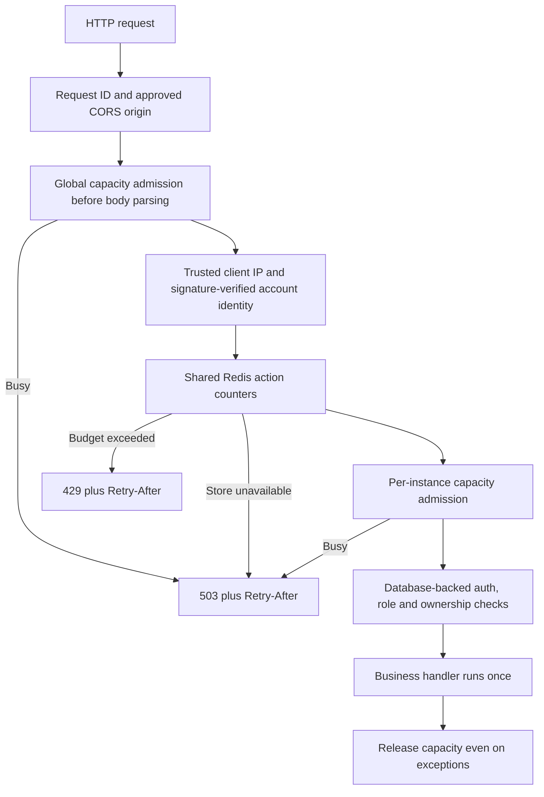

# How request protection and applications work

Updated 8 October 2026. This guide explains the implementation and how to tune
it. These defaults are starting budgets, not a measured promise of production
capacity.

## The request flow



The rate limiter answers **how often one person can request an action**. Capacity
admission answers **how much work this API instance can do at once**. They solve
different problems. Neither increases CPU, database capacity or provider quota.

Redis performs increment and expiry in a single Lua operation. All instances
using the same Redis and namespace see the same counters. Fixed windows begin
on the first request and expire after the configured duration; attempts count
even when a later capacity or validation check rejects them. A boundary can
allow a burst across two windows, so the application policy also has an hourly
budget. No business handler runs inside the Redis exception catch: a route
failure cannot cause the limiter to execute its side effects a second time.

A valid JWT signature supplies the account bucket before a database query.
Normal authentication still checks the database, account activity, invite
expiration, role and ownership. Invalid tokens use an IP bucket. Office users
have separate account budgets but still share the broad network safety ceiling.
Login/reset/email actions also have normalized target and network budgets.
OAuth lacks an email until Google verifies it, so its public quota uses the
network budget. Email and IP identities are hashed before becoming Redis keys.

All registered HTTP routes get a policy, including newly added routes through
read/write fallbacks. Health and OPTIONS bypass quotas; readiness caches its dependency checks for
three seconds and permits one check in flight. The Razorpay signed
webhook bypasses customer action quotas, but keeps network/capacity protections
and its existing signature verification. New expensive routes should be added
to the named policy selector instead of relying on the generic fallback.

## Default budgets

Each named policy reads `RATE_LIMIT_<NAME>_CALLS` and
`RATE_LIMIT_<NAME>_WINDOW_SECONDS` from the backend environment.

| Action | Default per identity |
| --- | --- |
| Login/check account/reset/verify | 10 per minute |
| OAuth / overall public auth network | 120 per minute |
| Registration | 5 per 5 minutes |
| Reset email / verification resend | 3 per 5 minutes per target |
| Job application | 5 per minute AND 30 per hour per account |
| CV/JD AI scoring and generation | 10 per 5 minutes |
| Uploads and identity uploads | 12 per 5 minutes |
| Interview/practice start | 4 per 5 minutes |
| Interview answers/questions | 60 per minute |
| Interview activation, face registration and finish | 60 per minute |
| Speech calls / speech tokens | 120 / 20 per minute |
| Invite preview/send | 5 per 5 minutes |
| Payment writes | 20 per 5 minutes |
| Exports | 10 per 5 minutes |
| Ordinary reads / writes | 240 / 60 per minute |
| Overall authenticated account | 600 per minute |
| Broad IP network ceiling | 3,000 per minute |

The network window is one minute; `RATE_LIMIT_NETWORK_CALLS` changes its ceiling.
For a large office, university network or synthetic test using a single source
IP, size this ceiling from measured traffic and verified ingress addressing.
Do not disable action quotas to get a flattering benchmark.

## Capacity and socket controls

`API_MAX_INFLIGHT=128` bounds requests in one instance. Separate maxima protect
AI (6), uploads (8), speech (12), starts (6) and invite preparation (2). Capacity
is released at request teardown. These maxima are **per instance**, unlike the
shared Redis rate counters. Scale them against available CPU, database pool and
external provider quotas; adding instances also adds capacity.

Camera events have shared socket quotas before database/model work: 180 frames
per minute per bound account, 120 control events, 60 mobile status events and
120 connection attempts per IP. Laptop and phone share the frame account quota.
The existing frame interval is configurable with
`PROCTORING_FRAME_INTERVAL_MS=700`. A per-instance analysis semaphore
(`PROCTORING_MAX_INFLIGHT=4`) skips frames when busy instead of building a
backlog. Socket messages are capped at 2 MiB and local connection bindings at
2,000. Socket acknowledgements identify throttling/unavailable services.
A missed frame is coverage loss; it must not become a cheating verdict.

## Application and scoring flow

1. Validate job ID, invite scope, job status/deadline and selected CV.
2. An existing submitted application returns its ID with 200, including a
   retry after the job closes. A first submission returns 201.
3. The unique candidate/job index arbitrates simultaneous inserts. Invite
   skeleton conversion uses a conditional update requiring no CV snapshot.
   Only the winning request increments the applicant counter and wakes scoring.
4. Save the CV/JD snapshots and pending status in Mongo before returning.
   The application is immediately visible. Submission makes no scoring call.
5. Two bounded CV workers atomically claim persisted pending/due work. Each
   claim has a unique lease token, a 300-second lease and periodic renewal.
   Restarted workers recover pending applications and expired claims.
6. Provider failure persists a due time for retries after 30, 60 and 120 seconds.
   Retries use the same workers; there is no timer/thread per candidate.
7. Only the current lease can publish results. A concurrent recruiter decision
   is preserved while the genuine CV score is saved. Exhausted scoring keeps the
   score unavailable and the application available for recruiter review.
8. Progress pushes reach candidate/recruiter rooms; polling reads the stored
   truth, continues through retries and slows after two minutes.

Claims guarantee conditional publication, not exactly-once external provider
billing: if a worker loses connectivity and its lease expires while a provider
call is in flight, another worker can retry it. Mongo applications are the
authoritative applicant source; secondary job counters and live notifications
are not a cross-collection transaction.

Notification workers/queue are bounded (4 workers plus 128 queued jobs).
Application receipt/status emails remain best effort; a full queue never loses
the application. Bulk invites separately reserve background capacity (2 batches)
**before** wallet debit or row creation and keep the slot until dispatch ends.
Batches accept at most 2,000 email strings. Existing invite credit reconciliation
still applies; this change does not add durable email delivery after a process
restart.

## Environment and production rollout

Nonsecret settings were added to the local backend `.env` and the committed
`.env.example`. Existing credentials were preserved. Configure `REDIS_URL`
with your actual service credentials, preferably TLS (`rediss://`), and use a
distinct `RATE_LIMIT_NAMESPACE` for staging and production.

Production defaults to `RATE_LIMIT_REQUIRE_REDIS=true`; startup requires a
reachable shared store. During an outage, requests receive 503 instead of
silently getting independent quotas in every worker. Health reports an
unreachable mandatory dependency. Local development without Redis uses bounded
memory counters (20,000 identity keys) that expire; they are process-local.
An explicitly configured Redis outage never silently falls back to memory.

`TRUSTED_PROXY_HOPS=0` ignores caller-supplied forwarded IP headers. Set the
correct hop count only after verifying the ingress chain and restricting direct
access to the API. Incorrect trust can let callers spoof their identity.

Mongo pool size defaults to 50, pool wait to 2 seconds and server selection to
5 seconds. Busy/unreachable auth lookups become 503 rather than invalid-token
401, so temporary overload does not log candidates out. Some older controllers
still catch their own errors; the global error handler cannot replace errors
already translated inside those controllers.

Before deploying, run the **read-only** duplicate audit against staging first:

```powershell
cd python-backend
..\.venv-tests\Scripts\python.exe scripts/admin/audit_application_duplicates.py
```

The new unique index covers canonical string job/candidate IDs. Review duplicates,
non-string and noncanonical legacy IDs before rollout; the audit never deletes
or merges records. Startup deliberately fails if identities are not canonical lowercase ObjectId
strings or the critical index cannot be created. Older Mongo deployments that cannot coexist with the old nonunique
index need a separately reviewed index migration. Do not boot the new release
against unreviewed legacy production data.

Keep the existing single-worker/sticky topology for live interview engines and
proctoring state. Shared quotas and Mongo scoring leases do not distribute those
engines. On Cloud Run, in-process CV workers need CPU allocated outside HTTP
requests (instance-based billing/minimum capacity) or a separate continuously
running worker process; request-only CPU allocation can stall background work.

## Login improvements

The left panel uses native CSS illustration/motion, with reduced-motion support.
The form stays on the right on desktop and uses a compact mobile layout.
Keyboard focus, labels, role selection and error alerts are accessible.
One pending-attempt guard covers password/Google sign-in, including popup-close
handling. Role and inputs cannot change during submission. Successful navigation
uses the server role. Recruiters get the correct onboarding link, candidates get
Invite ID guidance, and 429/503 shows a server-directed countdown. Auth requests
have a 20-second network timeout. Writes are never automatically replayed by the
client. The shared client exposes status, error code and retry delay.

## Verification and learning references

Behavioral tests exercise concurrent bursts, shared Lua counters, outages,
capacity release, duplicate application races, invite conversion, lease recovery,
provider failure, slow workers and recruiter updates. Emulated Mongo/Redis tests
do not prove real deployment capacity. Run the corrected staging Locust profile
with **distinct signed candidate tokens** in an untracked file such as
`staging.load-test-accounts.json` (ignored by Git). Measure p50/p95/p99 submit latency,
429/503/5xx rates, provider latency, oldest pending application and scoring
throughput. Verify socket coverage with actual laptop/mobile footage.

Visual verification was unavailable because no browser surfaces were enabled;
web and kiosk builds plus lint are the available frontend checks.

Primary references explaining the design:
[Redis atomic counters](https://redis.io/docs/latest/commands/incr/),
[Flask proxy trust](https://flask.palletsprojects.com/en/stable/deploying/proxy_fix/),
[MongoDB indexes](https://www.mongodb.com/docs/languages/python/pymongo-driver/current/indexes/).
