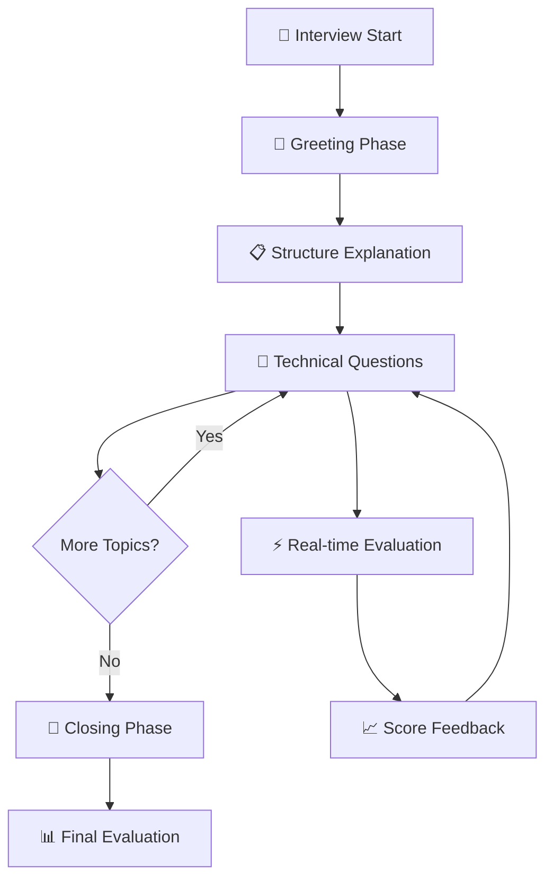

# Interview Module 🎯

> A comprehensive, intelligent interview system with natural conversation flow, multi-LLM support, real-time evaluation, and advanced session management.

[](https://www.python.org/downloads/)
[](https://opensource.org/licenses/MIT)

## 🌟 Features

- **🤖 Multi-LLM Support**: OpenAI GPT, Google Gemini, Groq Llama
- **📄 Document Intelligence**: Extract and analyze CVs, job descriptions, and references
- **💬 Natural Conversation Flow**: Phase-based interview progression with context awareness
- **⚡ Real-time Evaluation**: Advanced rubrics-based scoring with immediate feedback
- **🔄 Session Management**: Handle multiple concurrent interviews with state persistence
- **🎛️ Flexible Configuration**: Easy customization for different interview scenarios
- **📊 Comprehensive Analytics**: Detailed scoring, progress tracking, and interview summaries

## 🚀 Quick Start

### Basic Usage

```python
from interview.core.session_manager import InterviewSessionManager
from interview.config.settings import InterviewConfig, LLMConfig, LLMProvider

# Setup configuration
llm_config = LLMConfig(
    provider=LLMProvider.OPENAI,
    api_key="your-openai-api-key",
    model_name="gpt-4"
)

interview_config = InterviewConfig(
    min_questions=5,
    max_questions=15,
    max_duration_minutes=45
)

# Initialize interview system
session_manager = InterviewSessionManager(interview_config, llm_config)

# Start an interview
session_result = session_manager.create_session(
    cv_path="uploads/cv/candidate_resume.pdf",
    jd_path="uploads/jd/job_description.pdf",
    reference_paths=["uploads/reference/technical_guide.pdf"]
)

session_id = session_result["session_id"]

# Conduct interview loop
while True:
    # Submit answer and get next question
    result = session_manager.submit_answer(
        session_id=session_id,
        question="Previous question",
        answer="Candidate's answer"
    )

    if result["interview_complete"]:
        print("Interview completed!")
        print(f"Final evaluation: {result['final_evaluation']}")
        break

    print(f"Next question: {result['next_question']}")
    print(f"Current score: {result['current_evaluation']['overall_score']}")
```

### Interactive Testing

```python
# For interactive testing and development
from interactive_interview import main

# Run the interactive interview simulator
main()
```

## 🏗️ Architecture

### System Overview

```
┌─────────────────────────────────────────────────────────────┐
│                     Interview System                        │
├─────────────────────────────────────────────────────────────┤
│  ┌─────────────┐  ┌─────────────┐  ┌─────────────┐         │
│  │   Session   │  │  Question   │  │ Evaluation  │         │
│  │  Manager    │  │ Generator   │  │   System    │         │
│  └─────────────┘  └─────────────┘  └─────────────┘         │
│         │                 │                 │               │
│  ┌─────────────┐  ┌─────────────┐  ┌─────────────┐         │
│  │ Document    │  │    LLM      │  │   Config    │         │
│  │ Processor   │  │  Factory    │  │  Manager    │         │
│  └─────────────┘  └─────────────┘  └─────────────┘         │
└─────────────────────────────────────────────────────────────┘
```

### Core Components

#### 🧠 Core Module (`core/`)

- **`session_manager.py`**: Central orchestrator managing interview lifecycle
- **`prompt_based_question_generator.py`**: Intelligent question generation with conversation context
- **`question_generator.py`**: Legacy question generation (being phased out)

#### 🤖 LLM Module (`llm/`)

- **`factory.py`**: LLM provider factory with automatic provider detection
- **`openai_llm.py`**: OpenAI GPT integration
- **`gemini_llm.py`**: Google Gemini integration
- **`groq_llm.py`**: Groq Llama integration
- **`base.py`**: Abstract base class for LLM providers

#### 📄 Document Module (`document/`)

- **`loader.py`**: PDF/text document loading and validation
- **`processor.py`**: Text processing, keyword extraction, and analysis

#### ⚙️ Configuration (`config/`)

- **`settings.py`**: Centralized configuration management with dataclasses

#### 🎯 Prompts Module (`prompts/`)

- **`greeting_prompts.py`**: Interview opening and rapport building
- **`technical_question_prompts.py`**: Technical assessment prompts
- **`skill_assessment_prompts.py`**: Skill level evaluation
- **`closing_prompts.py`**: Interview conclusion and wrap-up

## 📋 Interview Flow Architecture

### Phase-Based Interview Progression



### Conversation Context Management

```python
@dataclass
class ConversationContext:
    candidate_name: str
    job_title: str
    cv_keywords: List[str]
    current_topic: str
    topics_covered: List[str]
    interview_phase: InterviewPhase
    depth_level: DepthLevel
    question_count: int
    candidate_skill_level: str
    conversation_energy: float
```

## 🔧 Configuration

### Environment Setup

```bash
# Required environment variables
export OPENAI_API_KEY="your-openai-key"
export GOOGLE_API_KEY="your-gemini-key"  # Optional
export GROQ_API_KEY="your-groq-key"      # Optional

# Optional configurations
export INTERVIEW_MAX_QUESTIONS=15
export INTERVIEW_MIN_QUESTIONS=5
export INTERVIEW_MAX_DURATION=45
```

### Configuration Classes

```python
from interview.config.settings import InterviewConfig, LLMConfig, LLMProvider

# LLM Configuration
llm_config = LLMConfig(
    provider=LLMProvider.OPENAI,      # OPENAI, GEMINI, GROQ
    api_key="your-api-key",
    model_name="gpt-4",               # Model specific to provider
    temperature=0.7,                  # Response creativity (0-1)
    max_tokens=1000                   # Maximum response length
)

# Interview Configuration
interview_config = InterviewConfig(
    min_questions=5,                  # Minimum questions to ask
    max_questions=15,                 # Maximum questions allowed
    max_duration_minutes=45,          # Interview time limit
    difficulty_adaptation=True,       # Adapt to candidate skill level
    enable_follow_ups=True           # Allow follow-up questions
)
```

## 📁 Project Structure

```
interview/
├── __init__.py                      # Package initialization
├── api.py                          # Main API interface
├── requirements.txt                # Python dependencies
├── README.md                       # This documentation
│
├── config/                         # Configuration management
│   ├── __init__.py
│   └── settings.py                 # Centralized config classes
│
├── core/                          # Core interview logic
│   ├── __init__.py
│   ├── session_manager.py         # Main session orchestrator
│   ├── prompt_based_question_generator.py  # Advanced question generation
│   └── question_generator.py      # Legacy question generation
│
├── document/                      # Document processing
│   ├── __init__.py
│   ├── loader.py                  # PDF/text loading
│   └── processor.py               # Text analysis
│
├── evaluation/                    # Answer evaluation (DEPRECATED)
│   ├── __init__.py
│   └── DEPRECATED.md             # Migration guide to new evaluation system
│
├── llm/                          # LLM provider integrations
│   ├── __init__.py
│   ├── base.py                   # Abstract LLM interface
│   ├── factory.py                # Provider factory
│   ├── openai_llm.py            # OpenAI integration
│   ├── gemini_llm.py            # Google Gemini integration
│   └── groq_llm.py              # Groq integration
│
└── prompts/                      # Interview prompts
    ├── __init__.py
    ├── greeting_prompts.py       # Opening prompts
    ├── technical_question_prompts.py  # Technical questions
    ├── skill_assessment_prompts.py    # Skill evaluation
    ├── structure_explanation_prompts.py  # Interview structure
    └── closing_prompts.py        # Closing prompts
```

## 🔄 Usage Patterns

### 1. Basic Interview Session

```python
from interview.core.session_manager import InterviewSessionManager
from interview.config.settings import InterviewConfig, LLMConfig

# Initialize
session_manager = InterviewSessionManager(interview_config, llm_config)

# Create session
session = session_manager.create_session(cv_path, jd_path, reference_paths)

# Interview loop
while not session_complete:
    result = session_manager.submit_answer(session_id, question, answer)
    if result["interview_complete"]:
        break
    next_question = result["next_question"]
```

### 2. Real-time Evaluation Integration

```python
# Submit answer and get immediate feedback
result = session_manager.submit_answer(session_id, question, answer)

# Access evaluation details
evaluation = result["current_evaluation"]
print(f"Score: {evaluation['overall_score'] * 100}%")
print(f"Feedback: {evaluation['reasoning']}")

# Check score breakdown
if "score_breakdown" in evaluation:
    for category, score in evaluation["score_breakdown"].items():
        print(f"{category}: {score * 100}%")
```

### 3. Advanced Question Generation

```python
from interview.core.prompt_based_question_generator import PromptBasedQuestionGenerator

# Initialize with conversation context
qg = PromptBasedQuestionGenerator(llm)
context = qg.initialize_conversation(resume_sections, job_description)

# Generate contextual questions
question, metadata = qg.get_next_question(
    context,
    last_answer="Previous answer",
    answer_evaluation={"overall_score": 0.8}
)
```

## 🚦 API Reference

### Session Manager

```python
class InterviewSessionManager:
    def create_session(cv_path: str, jd_path: str, reference_paths: List[str]) -> Dict
    def submit_answer(session_id: str, question: str, answer: str) -> Dict
    def get_session_status(session_id: str) -> Dict
    def end_session(session_id: str) -> Dict
```

### Question Generator

```python
class PromptBasedQuestionGenerator:
    def initialize_conversation(resume_sections: Dict, job_description: str) -> ConversationContext
    def get_next_question(context: ConversationContext, last_answer: str = None, answer_evaluation: Dict = None) -> Tuple[str, QuestionMetadata]
```

### Document Loader

```python
class DocumentLoader:
    def __init__(cv_path: str, jd_path: str, reference_paths: List[str])
    def validate_documents() -> Dict[str, bool]
    def get_cv_sections() -> Dict[str, str]
    def get_jd_text() -> str
```

## 📊 Evaluation Integration

The interview module integrates with the advanced **Rubrics Evaluation System** for precise answer scoring:

```python
# Automatic evaluation integration
evaluation_result = session_manager.submit_answer(session_id, question, answer)

# Evaluation structure
{
    "overall_score": 0.85,                    # 0-1 scale
    "relevance_score": 0.90,                  # Topic relevance
    "technical_accuracy_score": 0.80,         # Technical correctness
    "communication_score": 0.85,              # Clarity and structure
    "reasoning": "Excellent explanation...",   # Detailed feedback
    "evaluation_method": "rubrics-eval",      # Evaluation system used
    "score_breakdown": {                      # Detailed breakdown
        "content_accuracy": 0.85,
        "depth_of_understanding": 0.80,
        "examples_and_applications": 0.90
    }
}
```

## 🧪 Testing & Development

### Interactive Testing

```bash
# Run interactive interview simulator
cd python-backend
python interactive_interview.py

# Options:
# 1. Start Interactive Interview (Full Experience)
# 2. Document Analysis Demo (Quick Overview)
# 3. Exit
```

### Unit Testing

```bash
# Run specific tests
python -m pytest interview/tests/

# Test individual components
python interview/test.py
```

### Development Setup

```bash
# Install development dependencies
pip install -r requirements.txt

# Set up environment variables
cp .env.example .env
# Edit .env with your API keys

# Run in development mode
python -m interview.api
```

## 🔍 Troubleshooting

### Common Issues

1. **Import Errors**

   ```bash
   # Fix: Ensure you're in the python-backend directory
   cd python-backend
   python -c "import interview; print('Import successful')"
   ```

2. **API Key Issues**

   ```bash
   # Check environment variables
   echo $OPENAI_API_KEY

   # Test API connectivity
   python -c "from interview.llm.factory import LLMFactory; print('API connection OK')"
   ```

3. **Document Loading Errors**
   ```python
   # Validate document paths
   from interview.document.loader import DocumentLoader
   loader = DocumentLoader(cv_path, jd_path, [])
   validation = loader.validate_documents()
   print(validation)
   ```

### Debug Mode

```python
# Enable detailed logging
import logging
logging.basicConfig(level=logging.DEBUG)

# Run with debug information
session_manager = InterviewSessionManager(interview_config, llm_config)
```

## 🤝 Contributing

1. **Fork the repository**
2. **Create a feature branch**: `git checkout -b feature/amazing-feature`
3. **Commit changes**: `git commit -m 'Add amazing feature'`
4. **Push to branch**: `git push origin feature/amazing-feature`
5. **Open a Pull Request**

### Development Guidelines

- Follow PEP 8 style guidelines
- Add type hints to all functions
- Include docstrings for all public methods
- Write unit tests for new functionality
- Update README for any API changes

## 📜 License

This project is licensed under the MIT License - see the [LICENSE](LICENSE) file for details.

## 🔗 Related Modules

- **[Evaluation Model](../evaluation_model/README.md)**: Advanced rubrics-based evaluation system
- **[React Frontend](../../react-frontend/README.md)**: Web interface for interviews

---

_Built with ❤️ for intelligent interview automation_ 2. **Dependency Injection**: Components are loosely coupled 3. **Factory Pattern**: Easy swapping of LLM providers 4. **Configuration-Driven**: Behavior controlled through config objects 5. **Error Handling**: Graceful degradation and informative error messages

## Installation

```bash
pip install -r requirements.txt
```

## Configuration

### Basic Configuration

```python
from interview.config.settings import InterviewConfig, LLMConfig, LLMProvider

# Interview settings
interview_config = InterviewConfig(
    max_questions=8,
    min_questions=4,
    similarity_threshold=0.7
)

# LLM settings
llm_config = LLMConfig(
    provider=LLMProvider.GROQ,
    model_name="llama-3.3-70b-versatile",
    api_key="your-api-key",
    temperature=0.7
)
```

### Supported LLM Providers

1. **Groq**: Fast inference for Llama models
2. **OpenAI**: GPT-3.5/GPT-4 models
3. **Extensible**: Easy to add new providers

## Usage Examples

### Basic Interview Flow

```python
from interview.api import InterviewAPI
from interview.config.settings import LLMProvider

# Initialize
api = InterviewAPI(
    llm_provider=LLMProvider.GROQ,
    model_name="llama-3.3-70b-versatile",
    api_key="your-key"
)

# Start interview
session = api.start_interview("cv.pdf", "jd.pdf")
session_id = session["session_id"]

# Interview loop
while True:
    # Get next question
    question_result = api.get_question(session_id)
    if "error" in question_result:
        break

    question = question_result["question"]
    print(f"Q: {question}")

    # Get answer (from user input)
    answer = input("A: ")

    # Submit and evaluate
    result = api.submit_answer(session_id, question, answer)

    # Show evaluation
    eval_data = result["current_evaluation"]
    print(f"Score: {eval_data['overall_score']:.2f}")

    # Check if complete
    if result.get("interview_complete"):
        print("Interview finished!")
        print(result["final_evaluation"])
        break
```

### Custom Question Generation

```python
from interview.core.question_generator import QuestionGenerator
from interview.config.settings import QuestionType

# Initialize with LLM
generator = QuestionGenerator(llm)

# Generate specific question types
technical_questions = generator.generate_questions_by_type(
    resume_sections,
    QuestionType.TECHNICAL,
    count=5
)

# Generate balanced question set
balanced_questions = generator.generate_balanced_question_set(
    resume_sections,
    total_questions=8
)
```

### Advanced Real-time Evaluation

The interview system uses the advanced **Rubrics Evaluation System** for sophisticated answer scoring:

```python
# Evaluation happens automatically during interviews
result = session_manager.submit_answer(session_id, question, answer)

# Access detailed evaluation results
evaluation = result["current_evaluation"]
print(f"Overall Score: {evaluation['overall_score'] * 100}%")
print(f"Relevance: {evaluation['relevance_score'] * 100}%")
print(f"Technical Accuracy: {evaluation['technical_accuracy_score'] * 100}%")
print(f"Communication: {evaluation['communication_score'] * 100}%")
print(f"Feedback: {evaluation['reasoning']}")

# Access detailed score breakdown if available
if "score_breakdown" in evaluation:
    for category, score in evaluation["score_breakdown"].items():
        print(f"{category}: {score * 100}%")
```

## API Reference

### InterviewAPI

Main interface for the interview system.

#### Methods

- `start_interview(cv_path, jd_path, reference_docs)`: Start new session
- `get_question(session_id)`: Get next question
- `submit_answer(session_id, question, answer)`: Submit answer and get evaluation
- `get_session_status(session_id)`: Get session progress
- `end_interview(session_id)`: End session and get final evaluation

### Configuration Classes

- `InterviewConfig`: Interview behavior settings
- `LLMConfig`: LLM provider configuration
- `DocumentConfig`: Document processing settings
- `EvaluationConfig`: Evaluation weights and thresholds

## Extending the System

### Adding New LLM Providers

```python
from interview.llm.base import BaseLLM, LLMResponse

class CustomLLM(BaseLLM):
    def complete(self, prompt: str) -> LLMResponse:
        # Your implementation
        return LLMResponse(text="response")

    def is_available(self) -> bool:
        # Check availability
        return True

# Register with factory
from interview.llm.factory import LLMFactory
from interview.config.settings import LLMProvider

LLMFactory.register_provider(LLMProvider.CUSTOM, CustomLLM)
```

### Custom Evaluation Integration

```python
# The system uses the evaluation_model for advanced scoring
from evaluation_model.rubrics_eval.evaluation_system import EvaluationSystem

# Evaluation system is automatically integrated in session manager
# Custom evaluation logic can be added by extending the evaluation model
```

## Best Practices

1. **Error Handling**: Always check for "error" keys in responses
2. **Resource Management**: Use appropriate timeouts and limits
3. **Configuration**: Use config objects rather than hardcoded values
4. **Testing**: Test with various document types and content
5. **Security**: Never expose API keys in code

## Troubleshooting

### Common Issues

1. **Import Errors**: Install all required dependencies
2. **API Key Issues**: Ensure correct environment variables are set
3. **File Not Found**: Verify file paths are absolute and files exist
4. **Model Errors**: Check model names are correct for the provider

### Performance Tips

1. **Caching**: Reuse models across sessions when possible
2. **Batch Processing**: Process multiple questions at once when suitable
3. **Resource Limits**: Set appropriate timeouts and token limits
4. **Memory Management**: Clean up completed sessions

## Contributing

The modular architecture makes it easy to contribute:

1. **New LLM Providers**: Implement `BaseLLM` interface
2. **Document Formats**: Extend `DocumentProcessor`
3. **Evaluation Enhancements**: Extend the `evaluation_model.rubrics_eval` system
4. **Question Types**: Extend `PromptBasedQuestionGenerator`

## License

[Your License Here]
